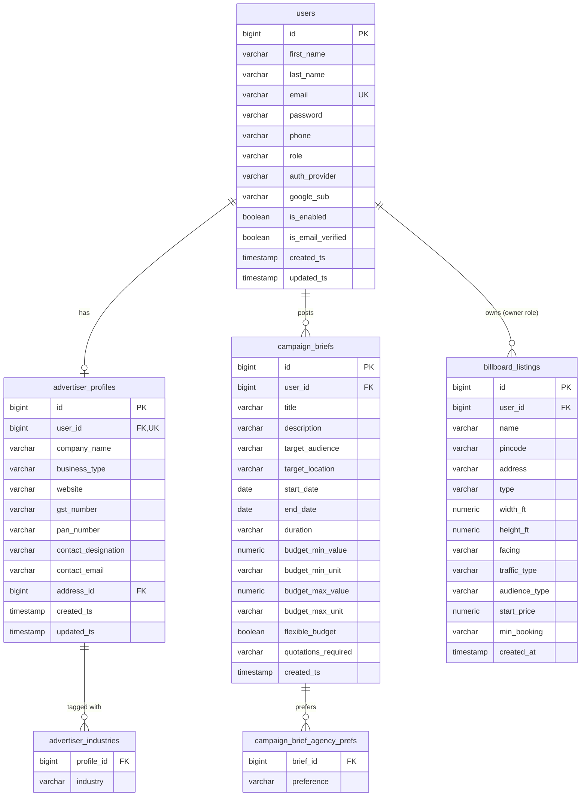
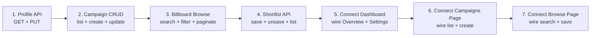

# Advertiser Module — Architecture Analysis & Planning

> **The AdBasket** — India's outdoor advertising marketplace  
> Module: **Advertiser** (Brand / Business side)  
> Date: November 2026  
> Branch: `amjangde/advertiser-module-architecture`

---

## 1. Project Overview

The AdBasket is a three-module marketplace connecting outdoor advertising stakeholders:

| Module | Role | Status |
|--------|------|--------|
| **Owner** | Billboard owners list inventory, receive quotes, manage bookings | ✅ Almost done |
| **Advertiser** | Brands/businesses search billboards, post campaigns, receive quotes | 🟡 UI built, backend partial |
| **Agency** | OOH agencies manage campaigns end-to-end for advertisers | ⬜ Not started |

### Tech Stack

| Layer | Technology |
|-------|-----------|
| Frontend | React 18 + Vite, React Router, CSS Modules (scoped `.css` per page) |
| Backend | Spring Boot 3, JPA/Hibernate, Flyway migrations |
| Database | PostgreSQL (prod), H2 in PG mode (dev/test) |
| Auth | JWT access tokens + HttpOnly cookie refresh tokens, Google FedCM/OneTap |
| Shared Infra | `RegisterProvider` / `RegisterShell` wizard framework, `AuthContext`, `ToastContext` |

---

## 2. Current State Assessment

### What's Built & Functional

| Area | Status | Details |
|------|--------|---------|
| Registration API | ✅ Working | `POST /api/auth/register/advertiser` — creates User + AdvertiserProfile + CampaignBrief, issues JWT |
| Registration UI | ✅ Working | 7-step wizard connected to backend via `mapAdvertiser()` → `registerAdvertiser()` |
| DB Schema | ✅ Migrated | `advertiser_profiles`, `advertiser_industries`, `campaign_briefs`, `campaign_brief_agency_prefs` |
| Routing | ✅ Working | `/advertisers`, `/advertisers/register`, `/advertisers/dashboard` |
| Landing Page | ⚠️ Static | Fully rendered but all data hardcoded (listings, cities, stats, featured) |
| Dashboard | ⚠️ Static | 8 sub-pages rendered with mock data, no API calls |

### Summary

**Registration is the only end-to-end functional flow.** Everything else (dashboard, campaigns, quotes, tenders, analytics, settings, browse) renders beautiful UI with hardcoded data and `showToast()` stubs.

---

## 3. Frontend Page Inventory

### 3.1 Landing Page — `AdvertiserHome`

**File:** [`AdvertiserHome.jsx`](file:///Users/amjangde/Workspace/advertisement/frontend/src/pages/AdvertiserHome/AdvertiserHome.jsx) (1659 lines)  
**Data:** [`data.jsx`](file:///Users/amjangde/Workspace/advertisement/frontend/src/pages/AdvertiserHome/data.jsx) (749 lines)  
**Route:** `/advertisers`

| Section | Purpose | Data Source |
|---------|---------|-------------|
| Hero | Search bar (type/city/budget), CTA buttons, animated stats | Hardcoded `HERO_*` constants |
| Live Feed | Platform activity cards (new listings, agency joins, bids) | Hardcoded `FEED_ITEMS` |
| Live Ticker | Scrolling marquee of recent activity | Hardcoded `TICKER_ITEMS` |
| Trust Bar | "Trusted by" brand logos | Hardcoded `TRUST_LOGOS` |
| Featured Spaces | 3 billboard cards with badges, specs, pricing | Hardcoded `FEATURED` |
| City Explorer | 8 cities with live stats (listings, agencies, CPM, formats) | Hardcoded `CITY_DATA` |
| Dual Path | "Spaces vs Agencies" comparison with mini agency cards | Hardcoded inline |
| How It Works | 4-step journey (Search → Shortlist → Compare → Book) | Hardcoded `STEPS` |
| OOH vs Digital | Comparison table (CPM, recall, targeting) across 4 channels | Hardcoded `COMPARE_DATA` |
| Campaign Inspiration | 6 real-world campaign case studies | Hardcoded `INSPIRATION` |
| Agency Spotlight | 3 featured agency cards | Hardcoded `SPOTLIGHT` |
| ROI Calculator | Interactive sliders: budget × duration × tier → impressions, CPM, boards | Client-side math |
| Why The AdBasket | 6 value proposition cards | Hardcoded `WHY` |
| Testimonials | 3 advertiser testimonials | Hardcoded `TESTIMONIALS` |
| FAQ | 6 accordion Q&A items | Hardcoded `FAQ` |

**Data needs for Phase 1:** Hero search should route to real billboard browse. City Explorer and Featured can remain static initially.

### 3.2 Registration Wizard — `AdvertiserRegister`

**File:** [`AdvertiserRegister.jsx`](file:///Users/amjangde/Workspace/advertisement/frontend/src/pages/AdvertiserRegister/AdvertiserRegister.jsx) (193 lines)  
**Steps:** [`steps.jsx`](file:///Users/amjangde/Workspace/advertisement/frontend/src/pages/AdvertiserRegister/steps.jsx) (1133 lines)  
**Route:** `/advertisers/register`

| Step | Content | Validation |
|------|---------|------------|
| 1. Login Setup | Email + password (or signed-in banner for Google users) | Email format, password ≥ 8 chars |
| 2. Business Info | Company name, type, industries, logo upload | Required: name, type, ≥1 industry |
| 3. Contact Details | Name, designation, email, phone, office address + pincode auto-fill | 10-digit phone, valid pincode |
| 4. Project Details | Title, description, audience, location, start/end date, duration | All required, end ≥ start |
| 5. Budget & Quotations | Min/max budget with unit, flexible toggle, quote count, agency prefs | Budget values, ≥1 agency pref |
| 6. Verification | GST, PAN (optional), attachments, brand files | GST format if provided |
| 7. Review & Submit | Summary of all steps, terms acceptance | Terms accepted |

**Status:** ✅ Fully functional — submits to backend, creates account + profile + first campaign brief, issues JWT, redirects to dashboard.

### 3.3 Dashboard — `AdvertiserDashboard`

**File:** [`AdvertiserDashboard.jsx`](file:///Users/amjangde/Workspace/advertisement/frontend/src/pages/AdvertiserDashboard/AdvertiserDashboard.jsx) (1293 lines)  
**Data:** [`data.jsx`](file:///Users/amjangde/Workspace/advertisement/frontend/src/pages/AdvertiserDashboard/data.jsx) (311 lines)  
**Route:** `/advertisers/dashboard`

**Layout:** Sidebar (nav + user info) → Topbar (page title + notifications + profile menu) → Page content

| Sub-Page | Key | Components | Data Status |
|----------|-----|-----------|-------------|
| Overview | `overview` | Onboarding checklist, stat cards (4), active campaigns (3), chart, recent quotes (2), media plan summary | All mock |
| Campaigns | `campaigns` | List with status filter (All/Live/Scheduled/Completed), 3 campaign rows | All mock |
| Media Plan Builder | `mediaplan` | Billboard list + remove, plan summary (cities, footfall, impressions), export PDF, duration selector | Local state only (from `MEDIA_PLAN_INIT`) |
| Browse & Shortlist | `browse-dash` | Saved billboards list, "Add to Plan" action | Mock `SAVED` data |
| Quotes & Proposals | `quotes` | Quote cards with View/Negotiate/Decline actions, status filter | Mock `QUOTES` data |
| My Tenders | `tenders` | Active tender list with bid counts, "Post New Tender" CTA | Hardcoded inline |
| Analytics & ROI | `analytics` | Stat cards (impressions, spend, CPM, digital equivalent), bar chart | All mock |
| Settings (Profile) | `settings` | Profile form (pre-filled from `useAuth().user`), notification preferences toggles | Partial (uses auth user data, rest mock) |

**What's real:** Sidebar shows user initials/name from `AuthContext`. Topbar logout works. Everything else is mock.

---

## 4. Backend Code Inventory

### 4.1 Entities

#### `AdvertiserProfile`
**File:** [`AdvertiserProfile.java`](file:///Users/amjangde/Workspace/advertisement/backend/src/main/java/com/theadbasket/backend/advertiser/AdvertiserProfile.java)

| Field | Type | Column | Notes |
|-------|------|--------|-------|
| `id` | Long | PK, identity | |
| `user` | User | `user_id` (1:1, unique) | FK → users |
| `companyName` | String(150) | NOT NULL | |
| `businessType` | String(80) | NOT NULL | |
| `website` | String(255) | nullable | |
| `gstNumber` | String(15) | nullable | |
| `panNumber` | String(10) | nullable | |
| `contactDesignation` | String(120) | NOT NULL | |
| `contactEmail` | String(180) | NOT NULL | |
| `address` | Address | `address_id` (1:1, cascade ALL) | Embedded address entity |
| `industries` | List\<String\> | ElementCollection → `advertiser_industries` | |
| `createdAt` | Instant | `created_ts`, auto | |
| `updatedAt` | Instant | `updated_ts`, auto | |

#### `CampaignBrief`
**File:** [`CampaignBrief.java`](file:///Users/amjangde/Workspace/advertisement/backend/src/main/java/com/theadbasket/backend/advertiser/CampaignBrief.java)

| Field | Type | Column | Notes |
|-------|------|--------|-------|
| `id` | Long | PK, identity | |
| `user` | User | `user_id` (M:1) | FK → users |
| `title` | String(200) | NOT NULL | |
| `description` | String(2000) | NOT NULL | |
| `targetAudience` | String(500) | NOT NULL | |
| `targetLocation` | String(300) | NOT NULL | |
| `startDate` | LocalDate | NOT NULL | |
| `endDate` | LocalDate | NOT NULL | |
| `duration` | String(50) | NOT NULL | |
| `budgetMinValue` | BigDecimal(14,2) | nullable | |
| `budgetMinUnit` | String(20) | nullable | |
| `budgetMaxValue` | BigDecimal(14,2) | nullable | |
| `budgetMaxUnit` | String(20) | nullable | |
| `flexibleBudget` | boolean | NOT NULL, default false | |
| `quotationsRequired` | String(20) | nullable | |
| `agencyPreferences` | List\<String\> | ElementCollection → `campaign_brief_agency_prefs` | |
| `createdAt` | Instant | `created_ts`, auto | |

### 4.2 Repositories

| Repository | File | Methods |
|-----------|------|---------|
| `AdvertiserProfileRepository` | [`AdvertiserProfileRepository.java`](file:///Users/amjangde/Workspace/advertisement/backend/src/main/java/com/theadbasket/backend/advertiser/AdvertiserProfileRepository.java) | `findByUserId(Long)` |
| `CampaignBriefRepository` | [`CampaignBriefRepository.java`](file:///Users/amjangde/Workspace/advertisement/backend/src/main/java/com/theadbasket/backend/advertiser/CampaignBriefRepository.java) | (standard JPA only, no custom queries) |

### 4.3 Services & Controllers

| Component | File | Responsibility |
|-----------|------|---------------|
| `AdvertiserRegistrationService` | [`AdvertiserRegistrationService.java`](file:///Users/amjangde/Workspace/advertisement/backend/src/main/java/com/theadbasket/backend/registration/AdvertiserRegistrationService.java) | `register()`: Create User → AdvertiserProfile → CampaignBrief → issue JWT |
| `RegistrationController` | [`RegistrationController.java`](file:///Users/amjangde/Workspace/advertisement/backend/src/main/java/com/theadbasket/backend/registration/RegistrationController.java) | `POST /api/auth/register/advertiser` — delegates to service, sets refresh cookie |

### 4.4 DTOs

| DTO | Fields | Validation |
|-----|--------|------------|
| `AdvertiserRegistrationRequest` | accountEmail, password, companyName, businessType, website, gstNumber, panNumber, industries, firstName, lastName, contactDesignation, contactEmail, contactPhone, addressLine1/2, landmark, city, state, pincode, project (nested), acceptedTerms | @Email, @NotBlank, @Pattern (GST, PAN, phone, pincode), @Size |
| `CampaignBriefRequest` | title, description, targetAudience, targetLocation, startDate, endDate, duration, budgetMinValue/Unit, budgetMaxValue/Unit, flexibleBudget, quotationsRequired, agencyPreferences | @NotBlank, @NotNull, @PositiveOrZero, custom date range validator |

### 4.5 Shared Infrastructure Used

| Component | Purpose |
|-----------|---------|
| `AccountRegistrar` | Shared user creation / attach logic (used by all 3 registration services) |
| `AuthService` | JWT token issuance |
| `AuthCookieService` | HttpOnly refresh token cookie management |
| `RolePolicyProperties` | Feature flag to enable/disable registration per role |
| `Address` | Reusable address entity (line1, line2, landmark, city, state, pincode) |

---

## 5. Database Schema (Advertiser-Related Tables)

### ER Diagram



> [!NOTE]
> `billboard_listings` belongs to the Owner module but is key for the Advertiser module's browse/search functionality. Advertisers need **read access** to this table.

---

## 6. Functionality Gap Analysis

| Feature | UI Exists | Backend Exists | Gap |
|---------|-----------|---------------|-----|
| Registration | ✅ Full wizard | ✅ Full API | ✅ **Done** |
| Login | ✅ Via auth modal | ✅ Full auth flow | ✅ **Done** |
| Profile View | ✅ Settings page (partial) | ❌ No GET API | Need `GET /api/advertiser/profile` |
| Profile Edit | ✅ Settings page form | ❌ No PUT API | Need `PUT /api/advertiser/profile` |
| Campaign Brief List | ✅ Campaigns page | ❌ No list API | Need `GET /api/advertiser/campaigns` |
| Campaign Brief Create | ⚠️ "New Campaign" button exists | ❌ No standalone create API | Need `POST /api/advertiser/campaigns` |
| Campaign Brief Update | ⚠️ Detail view stubbed | ❌ No update API | Need `PUT /api/advertiser/campaigns/{id}` |
| Campaign Brief Delete | ❌ No UI | ❌ No delete API | Low priority for Phase 1 |
| Billboard Browse | ✅ Hero search + Browse link | ❌ No search/filter API | Need `GET /api/billboards` (public, paginated) |
| Billboard Detail | ❌ No dedicated page | ❌ No detail API | Need `GET /api/billboards/{id}` |
| Billboard Shortlist/Save | ✅ "Saved Billboards" in dashboard | ❌ No entity or API | Need new `saved_billboards` table + CRUD |
| Media Plan Builder | ✅ Full UI with add/remove | ❌ No persistence | Needs to persist plan (new entity) |
| Quotes & Proposals | ✅ Full UI | ❌ No entity or API | Need new `quotes` table + APIs (Phase 2) |
| Tenders | ✅ Full UI | ❌ No entity or API | Need new `tenders` table + APIs (Phase 2) |
| Analytics & ROI | ✅ Full UI | ❌ No data pipeline | Deferred — needs real campaign data first |
| Notifications | ✅ Dropdown in topbar | ❌ No entity or API | Phase 2 — needs WebSocket/SSE |
| Onboarding Checklist | ✅ In Overview | ❌ No progress tracking | Nice-to-have — can be client-side initially |

---

## 7. Phase 1 — Recommended Scope

> [!IMPORTANT]
> **Goal:** Make the advertiser dashboard functional with **real data** for the core user journey:  
> Register → View/Edit Profile → Manage Campaign Briefs → Browse Billboards → Save/Shortlist Billboards

### 7.1 Feature Set

| # | Feature | Priority | Effort |
|---|---------|----------|--------|
| 1 | **Advertiser Profile API** (GET + PUT) | P0 | Small |
| 2 | **Campaign Brief CRUD** (list, create, update, delete) | P0 | Medium |
| 3 | **Billboard Browse API** (search, filter, paginate) | P0 | Medium |
| 4 | **Billboard Detail API** | P0 | Small |
| 5 | **Billboard Shortlist** (save/unsave, list saved) | P1 | Medium |
| 6 | **Dashboard Overview** (connect real profile + campaign data) | P1 | Small |
| 7 | **Settings Page** (connect to profile API) | P1 | Small |

### 7.2 What's Deferred to Phase 2

- Quotes & Proposals (requires Owner-side participation)
- Tenders & Bidding (requires Owner-side participation)
- Media Plan Persistence (can function as local state in Phase 1)
- Analytics & ROI (needs real campaign data)
- Notifications (needs event system)
- Agency Discovery (requires Agency module)

---

## 8. Phase 1 — API Design

### 8.1 Advertiser Profile

```
GET  /api/advertiser/profile
     → 200: AdvertiserProfileResponse (profile + user basics)
     Auth: Bearer token (ADVERTISER role)

PUT  /api/advertiser/profile
     ← AdvertiserProfileUpdateRequest (companyName, businessType, website, gstNumber, panNumber, contactDesignation, contactEmail, address, industries)
     → 200: AdvertiserProfileResponse
     Auth: Bearer token (ADVERTISER role)
```

### 8.2 Campaign Briefs

```
GET    /api/advertiser/campaigns
       → 200: Page<CampaignBriefResponse>
       Query: ?page=0&size=10&sort=createdAt,desc
       Auth: Bearer token (ADVERTISER role)

GET    /api/advertiser/campaigns/{id}
       → 200: CampaignBriefResponse
       Auth: Bearer token (ADVERTISER role, owns campaign)

POST   /api/advertiser/campaigns
       ← CampaignBriefRequest
       → 201: CampaignBriefResponse
       Auth: Bearer token (ADVERTISER role)

PUT    /api/advertiser/campaigns/{id}
       ← CampaignBriefRequest
       → 200: CampaignBriefResponse
       Auth: Bearer token (ADVERTISER role, owns campaign)

DELETE /api/advertiser/campaigns/{id}
       → 204
       Auth: Bearer token (ADVERTISER role, owns campaign)
```

### 8.3 Billboard Browse (Public / Authenticated)

```
GET  /api/billboards
     → 200: Page<BillboardListingSummary>
     Query: ?city=Mumbai&type=LED&minPrice=50000&maxPrice=500000&page=0&size=20&sort=startPrice,asc
     Auth: Optional (authenticated users get "saved" flag on each result)

GET  /api/billboards/{id}
     → 200: BillboardListingDetail (full info + owner summary)
     Auth: Optional
```

### 8.4 Billboard Shortlist (Saved Billboards)

```
POST   /api/advertiser/saved-billboards/{listingId}
       → 201
       Auth: Bearer token (ADVERTISER role)

DELETE /api/advertiser/saved-billboards/{listingId}
       → 204
       Auth: Bearer token (ADVERTISER role)

GET    /api/advertiser/saved-billboards
       → 200: Page<BillboardListingSummary>
       Auth: Bearer token (ADVERTISER role)
```

---

## 9. New Entities & Tables Needed (Phase 1)

### 9.1 `saved_billboards`

```sql
CREATE TABLE saved_billboards (
    id         BIGINT GENERATED BY DEFAULT AS IDENTITY PRIMARY KEY,
    user_id    BIGINT NOT NULL,
    listing_id BIGINT NOT NULL,
    created_at TIMESTAMP NOT NULL DEFAULT CURRENT_TIMESTAMP,
    CONSTRAINT uq_saved_billboard UNIQUE (user_id, listing_id),
    CONSTRAINT fk_saved_billboard_user FOREIGN KEY (user_id) REFERENCES users (id) ON DELETE CASCADE,
    CONSTRAINT fk_saved_billboard_listing FOREIGN KEY (listing_id) REFERENCES billboard_listings (id) ON DELETE CASCADE
);
CREATE INDEX idx_saved_billboards_user ON saved_billboards (user_id);
```

### 9.2 Campaign Status Enhancement (Optional for Phase 1)

The current `campaign_briefs` table has no `status` column. Adding one would enable the status-based filtering the UI shows:

```sql
ALTER TABLE campaign_briefs ADD COLUMN status VARCHAR(20) NOT NULL DEFAULT 'DRAFT';
-- Values: DRAFT, SUBMITTED, IN_REVIEW, ACTIVE, COMPLETED, CANCELLED
```

---

## 10. Architecture Decisions

### 10.1 Reuse Patterns from Owner Module

| Pattern | Owner Implementation | Advertiser Approach |
|---------|---------------------|-------------------|
| Registration Wizard | `RegisterProvider` + `RegisterShell` | ✅ Already using it |
| Dashboard Layout | Sidebar + Topbar + Page content | Same pattern — extract shared `DashboardShell` component |
| Profile API | `GET/PUT /api/owner/profile` (if exists) | Follow same pattern for advertiser |
| Listing CRUD | Owner CRUD endpoints for billboards | Advertiser gets **read-only** access to same `billboard_listings` |

### 10.2 API Namespace Convention

```
/api/auth/register/advertiser     → Registration (exists)
/api/advertiser/profile           → Profile management (new)
/api/advertiser/campaigns         → Campaign brief CRUD (new)
/api/advertiser/saved-billboards  → Shortlist management (new)
/api/billboards                   → Public browse (new, shared across roles)
```

### 10.3 Authorization Model

- Advertiser APIs check `role == ADVERTISER` on the JWT principal
- Campaign and shortlist APIs additionally verify resource ownership (`user_id` match)
- Billboard browse API is public (no auth required), but returns `isSaved` flag when authenticated

### 10.4 Frontend Data Flow

```
Phase 1 target state:

AdvertiserDashboard
├── Overview      → GET /api/advertiser/profile + GET /api/advertiser/campaigns?size=3
├── Campaigns     → GET /api/advertiser/campaigns (paginated)
├── Browse & Save → GET /api/billboards + POST/DELETE /api/advertiser/saved-billboards
├── Media Plan    → Local state (persist to localStorage, server persistence in Phase 2)
├── Settings      → GET + PUT /api/advertiser/profile
└── Quotes, Tenders, Analytics → Remain static (Phase 2)
```

---

## 11. File Structure (Proposed New Backend Files)

```
backend/src/main/java/com/theadbasket/backend/
├── advertiser/
│   ├── AdvertiserProfile.java                 (exists)
│   ├── AdvertiserProfileRepository.java       (exists)
│   ├── CampaignBrief.java                     (exists)
│   ├── CampaignBriefRepository.java           (exists)
│   ├── SavedBillboard.java                    ← NEW entity
│   ├── SavedBillboardRepository.java          ← NEW repository
│   ├── AdvertiserProfileController.java       ← NEW controller
│   ├── AdvertiserProfileService.java          ← NEW service
│   ├── CampaignBriefController.java           ← NEW controller
│   ├── CampaignBriefService.java              ← NEW service
│   ├── SavedBillboardController.java          ← NEW controller
│   ├── SavedBillboardService.java             ← NEW service
│   └── dto/
│       ├── AdvertiserProfileResponse.java     ← NEW
│       ├── AdvertiserProfileUpdateRequest.java ← NEW
│       ├── CampaignBriefResponse.java         ← NEW
│       └── BillboardListingSummary.java       ← NEW (or in billboard package)
├── billboard/
│   ├── BillboardBrowseController.java         ← NEW (public browse API)
│   └── BillboardBrowseService.java            ← NEW
```

---

## 12. Implementation Order



> [!TIP]
> Each step is independently deployable and testable. The frontend pages already exist — each step replaces mock data with API calls.

---

## 13. Key Risks & Considerations

| Risk | Mitigation |
|------|-----------|
| Billboard search performance at scale | Add indexes on `pincode`, `type`, `start_price`; consider full-text search for name/address |
| Campaign Brief doesn't have `status` field | Add via migration before building campaigns page — small change, big UX impact |
| Owner module coupling | Billboard browse API should be a separate controller, not inside the owner package |
| Media Plan persistence complexity | Keep it client-side (localStorage) in Phase 1; persist to server when quote/tender workflow needs it |
| Notification stubs in UI | Suppress notification badge dot until Phase 2; show "Coming soon" on empty states |
