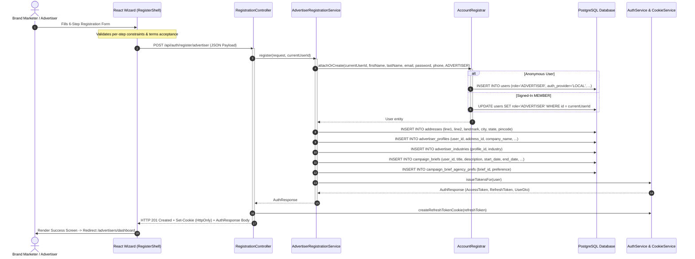

# Advertiser Registration Flow — Comprehensive Architecture & Field Specification

> **Project:** The AdBasket  
> **Module:** Advertiser (Brand / Business Onboarding)  
> **Branch:** `amjangde/advertiser-module-architecture`  
> **Status:** Production-Ready Architectural & Field Specification  
> **Grounding:** Aligned with Flyway Migrations `V1__init.sql`, `V2__registration_profiles.sql`, `V3__normalize_schema.sql`, `V5__create_notifications.sql`, Spring Boot JPA Entities, and React Frontend Components.

---

## 1. System Architecture & End-to-End Registration Flow

The Advertiser Registration flow provides a secure, transactional onboarding pipeline that transforms an anonymous visitor or a basic authenticated `MEMBER` into a verified marketplace `ADVERTISER`.

### 1.1 Dual-State Entry Architecture

The backend (`RegistrationController` and `AccountRegistrar`) and frontend (`RegisterProvider` and `Step1`) handle two distinct operational states:

1. **Anonymous Registration (New Customer Pipeline):**
   - Caller is unauthenticated (`principal == null`).
   - Step 1 requires `f_loginEmail` and `f_password`.
   - Backend creates a new `User` record with `role = Role.ADVERTISER` and `auth_provider = AuthProvider.LOCAL`.
   - Password is validated for complexity (min 8 chars, uppercase, number, symbol) and hashed with BCrypt.
2. **Authenticated Role Promotion (`MEMBER` $\rightarrow$ `ADVERTISER` Pipeline):**
   - Caller is already authenticated via Google OneTap/FedCM or Quick Email Sign-up (`principal != null`, `role == Role.MEMBER`).
   - Step 1 detects active session, displays `SignedInBanner`, pre-fills email/name, and makes password optional.
   - Backend promotes the existing account to `Role.ADVERTISER` without creating a duplicate `User` record.



---

## 2. Complete Database Schema & Entity Relationships

The registration process writes atomically across **6 database tables** defined across `V1__init.sql`, `V2__registration_profiles.sql`, and normalized in `V3__normalize_schema.sql`.

```mermaid
erDiagram
    users ||--o| advertiser_profiles : "has profile (1:1)"
    users ||--o{ campaign_briefs : "posts initial brief (1:N)"
    users ||--o{ refresh_tokens : "owns"
    users ||--o{ notifications : "receives"
    
    advertiser_profiles ||--|| addresses : "located at (1:1)"
    advertiser_profiles ||--o{ advertiser_industries : "operates in (1:N)"
    
    campaign_briefs ||--o{ campaign_brief_agency_prefs : "prefers (1:N)"

    users {
        bigint id PK
        varchar(80) first_name "NOT NULL"
        varchar(80) last_name "NULL"
        varchar(180) email "NOT NULL, UNIQUE"
        varchar(100) password "NULL (BCrypt hash)"
        varchar(20) phone "NULL"
        varchar(20) role "NOT NULL (ADVERTISER)"
        varchar(20) auth_provider "NOT NULL (LOCAL / GOOGLE)"
        varchar(64) google_sub "NULL, INDEXED"
        boolean is_enabled "NOT NULL, DEFAULT TRUE"
        boolean is_email_verified "NOT NULL, DEFAULT FALSE"
        timestamp created_ts "NOT NULL, DEFAULT CURRENT_TIMESTAMP"
        timestamp updated_ts "NOT NULL, DEFAULT CURRENT_TIMESTAMP"
    }

    advertiser_profiles {
        bigint id PK
        bigint user_id FK "NOT NULL, UNIQUE"
        bigint address_id FK "NOT NULL, INDEXED"
        varchar(150) company_name "NOT NULL"
        varchar(80) business_type "NOT NULL"
        varchar(255) website "NULL"
        varchar(15) gst_number "NULL, UNIQUE"
        varchar(10) pan_number "NULL"
        varchar(120) contact_designation "NOT NULL"
        varchar(180) contact_email "NOT NULL"
        timestamp created_ts "NOT NULL, DEFAULT CURRENT_TIMESTAMP"
        timestamp updated_ts "NOT NULL, DEFAULT CURRENT_TIMESTAMP"
    }

    addresses {
        bigint id PK
        varchar(300) line1 "NOT NULL"
        varchar(300) line2 "NULL"
        varchar(200) landmark "NULL"
        varchar(100) city "NOT NULL"
        varchar(100) state "NOT NULL"
        varchar(6) pincode "NOT NULL, INDEXED"
        timestamp created_ts "NOT NULL, DEFAULT CURRENT_TIMESTAMP"
        timestamp updated_ts "NOT NULL, DEFAULT CURRENT_TIMESTAMP"
    }

    advertiser_industries {
        bigint profile_id FK "NOT NULL, INDEXED"
        varchar(80) industry "NOT NULL"
    }

    campaign_briefs {
        bigint id PK
        bigint user_id FK "NOT NULL, INDEXED"
        varchar(200) title "NOT NULL"
        varchar(2000) description "NOT NULL"
        varchar(500) target_audience "NOT NULL"
        varchar(300) target_location "NOT NULL"
        date start_date "NOT NULL"
        date end_date "NOT NULL"
        varchar(50) duration "NOT NULL"
        numeric(14,2) budget_min_value "NULL"
        varchar(20) budget_min_unit "NULL"
        numeric(14,2) budget_max_value "NULL"
        varchar(20) budget_max_unit "NULL"
        boolean flexible_budget "NOT NULL, DEFAULT FALSE"
        varchar(20) quotations_required "NULL"
        timestamp created_ts "NOT NULL, DEFAULT CURRENT_TIMESTAMP"
    }

    campaign_brief_agency_prefs {
        bigint brief_id FK "NOT NULL, INDEXED"
        varchar(80) preference "NOT NULL"
    }
```

---

## 3. Comprehensive Step-by-Step Field Specifications

The registration train consists of **6 cohesive steps**:

---

### Step 1: Login Setup (`Step1`)
- **Frontend File:** `frontend/src/pages/AdvertiserRegister/steps.jsx`
- **Purpose:** Establishes account credentials for anonymous visitors or verifies active identity for signed-in `MEMBER` users.

| Field Name | Form Key | UI Control | Frontend Constraints | DTO Field & Validation | Entity Field & DB Column | DB Type & Nullability | Notes |
| :--- | :--- | :--- | :--- | :--- | :--- | :--- | :--- |
| **Login Email** | `f_loginEmail` | Text Input (`type="email"`) | Required if anon. Valid email format. | `accountEmail`<br>`@Email`, `@Size(max=180)` | `User.email`<br>`users.email` | `VARCHAR(180)`<br>**NOT NULL, UNIQUE** | Case-insensitive uniqueness enforced by DB. |
| **Password** | `f_password` | `PasswordField` | Required if anon. Min 8 chars. | `password`<br>`@Size(max=72)` | `User.password`<br>`users.password` | `VARCHAR(100)`<br>NULL (for Google-only) | Enforces uppercase, lowercase, number, symbol. Stored as BCrypt hash. |
| **Confirm Password** | `f_confirmPassword` | `ConfirmPasswordField` | Must match `f_password`. | *Client-side only* | *None* | N/A | Validated by client prior to step advancement. |
| **Signed-in Identity** | *N/A* | `SignedInBanner` | Read-only | `currentUserId` passed via Auth Principal | `User.id` | `BIGINT` | If authenticated, bypasses email/password entry. |

---

### Step 2: Business Information (`Step2`)
- **Frontend File:** `frontend/src/pages/AdvertiserRegister/steps.jsx`
- **Purpose:** Identifies the commercial legal entity and business sector.

| Field Name | Form Key | UI Control | Frontend Constraints | DTO Field & Validation | Entity Field & DB Column | DB Type & Nullability | Notes |
| :--- | :--- | :--- | :--- | :--- | :--- | :--- | :--- |
| **Company Name** | `f_companyName` | Text Input | Required. Max 150 chars. | `companyName`<br>`@NotBlank`, `@SanitizeText`, `@Size(max=150)` | `AdvertiserProfile.companyName`<br>`advertiser_profiles.company_name` | `VARCHAR(150)`<br>**NOT NULL** | Official trading or corporate name. |
| **Business Type** | `f_businessType` | Select Dropdown | Required. Selected from list. | `businessType`<br>`@NotBlank`, `@SanitizeText`, `@Size(max=80)` | `AdvertiserProfile.businessType`<br>`advertiser_profiles.business_type` | `VARCHAR(80)`<br>**NOT NULL** | Allowed: *Startup, SME, Corporate, Manufacturer, Retailer, Service Provider, Educational Institution, NGO, Government Organization, Other*. |
| **Website URL** | `f_website` | Text Input (`type="url"`) | Optional. Max 255 chars. | `website`<br>`@SanitizeText`, `@Size(max=255)` | `AdvertiserProfile.website`<br>`advertiser_profiles.website` | `VARCHAR(255)`<br>NULLABLE | Empty string converted to `null`. |
| **Industry Categories** | `selections.industries` | `MultiSelectDropdown` | Required. Min 1 category selected. | `industries`<br>`@NotEmpty List<@NotBlank String>` | `AdvertiserProfile.industries`<br>`advertiser_industries.industry` | `VARCHAR(80)`<br>**NOT NULL** | Stored in child table `advertiser_industries` with FK cascade. Allowed: *Electronics, Healthcare, Real Estate, FMCG, Education, Fashion, Agriculture, Technology, Other*. |
| **Company Logo** | *f_logo (state)* | `LogoUpload` | Optional. Max 5MB (PNG/JPG/SVG). | *Not mapped in current DTO* | *Missing column* | None | **Gap:** UI renders logo uploader, but column is missing in DB schema. |

---

### Step 3: Contact Details (`Step3`)
- **Frontend File:** `frontend/src/pages/AdvertiserRegister/steps.jsx`
- **Purpose:** Captures the primary account representative and registered office location.

| Field Name | Form Key | UI Control | Frontend Constraints | DTO Field & Validation | Entity Field & DB Column | DB Type & Nullability | Notes |
| :--- | :--- | :--- | :--- | :--- | :--- | :--- | :--- |
| **Contact First Name** | `f_firstName` | Text Input | Required. Max 80 chars. | `firstName`<br>`@NotBlank`, `@SanitizeText`, `@Size(max=80)` | `User.firstName`<br>`users.first_name` | `VARCHAR(80)`<br>**NOT NULL** | Representative's first name. |
| **Contact Last Name** | `f_lastName` | Text Input | Optional. Max 80 chars. | `lastName`<br>`@SanitizeText`, `@Size(max=80)` | `User.lastName`<br>`users.last_name` | `VARCHAR(80)`<br>NULLABLE | **Fix:** Split from single name field into first/last name. |
| **Designation** | `f_desig` | Text Input | Required. Max 120 chars. | `contactDesignation`<br>`@NotBlank`, `@SanitizeText`, `@Size(max=120)` | `AdvertiserProfile.contactDesignation`<br>`advertiser_profiles.contact_designation` | `VARCHAR(120)`<br>**NOT NULL** | e.g. *Marketing Director, Founder*. |
| **Contact Email** | `f_email` | Text Input (`type="email"`) | Required. Valid email format. | `contactEmail`<br>`@NotBlank`, `@Email`, `@Size(max=180)` | `AdvertiserProfile.contactEmail`<br>`advertiser_profiles.contact_email` | `VARCHAR(180)`<br>**NOT NULL** | Operational email for alerts & quotes. Has copy shortcut. |
| **Mobile Number** | `f_phone` | Tel Input (`+91` prefix) | Required. Exactly 10 digits. | `contactPhone`<br>`@NotBlank`, `@Pattern(PHONE)` | `User.phone`<br>`users.phone` | `VARCHAR(20)`<br>NULLABLE (in DB) | Cleaned to digits only. Pattern: `^[0-9+\-\s]{10,15}$`. |
| **Address Line 1** | `f_addressLine1` | Text Input | Required. Max 300 chars. | `addressLine1`<br>`@NotBlank`, `@SanitizeText`, `@Size(max=300)` | `Address.line1`<br>`addresses.line1` | `VARCHAR(300)`<br>**NOT NULL** | Unit, Building, Street. |
| **Address Line 2** | `f_addressLine2` | Text Input | Optional. Max 300 chars. | `addressLine2`<br>`@SanitizeText`, `@Size(max=300)` | `Address.line2`<br>`addresses.line2` | `VARCHAR(300)`<br>NULLABLE | Area, Sub-locality. |
| **Landmark** | `f_landmark` | Text Input | Optional. Max 200 chars. | `landmark`<br>`@SanitizeText`, `@Size(max=200)` | `Address.landmark`<br>`addresses.landmark` | `VARCHAR(200)`<br>NULLABLE | Nearby reference landmark. |
| **City** | `f_city` | Text Input | Required. Max 100 chars. | `city`<br>`@NotBlank`, `@SanitizeText`, `@Size(max=100)` | `Address.city`<br>`addresses.city` | `VARCHAR(100)`<br>**NOT NULL** | Auto-populated by PIN lookup or manual. |
| **State** | `f_state` | Text Input | Required. Max 100 chars. | `state`<br>`@NotBlank`, `@SanitizeText`, `@Size(max=100)` | `Address.state`<br>`addresses.state` | `VARCHAR(100)`<br>**NOT NULL** | Auto-populated by PIN lookup or manual. |
| **PIN Code** | `f_pincode` | Text Input (6 digits) | Required. Regex `^[1-9][0-9]{5}$`. | `pincode`<br>`@NotBlank`, `@Pattern(PINCODE)` | `Address.pincode`<br>`addresses.pincode` | `VARCHAR(6)`<br>**NOT NULL, INDEXED** | Cannot start with 0. Triggers postal autofill. |

---

### Step 4: Campaign & Budget Details (`Step4` — Consolidated)
- **Frontend File:** `frontend/src/pages/AdvertiserRegister/steps.jsx`
- **Purpose:** Captures the advertiser's initial mandatory campaign requirement and spending parameters in one unified form.

| Field Name | Form Key | UI Control | Frontend Constraints | DTO Field & Validation | Entity Field & DB Column | DB Type & Nullability | Notes |
| :--- | :--- | :--- | :--- | :--- | :--- | :--- | :--- |
| **Project Title** | `f_projectTitle` | Text Input | Required. Max 200 chars. | `project.title`<br>`@NotBlank`, `@SanitizeText`, `@Size(max=200)` | `CampaignBrief.title`<br>`campaign_briefs.title` | `VARCHAR(200)`<br>**NOT NULL** | Name of advertising initiative. |
| **Description** | `f_projectDesc` | Textarea (`rows={5}`) | Required. Max 2000 chars. | `project.description`<br>`@NotBlank`, `@SanitizeText`, `@Size(max=200)` | `CampaignBrief.description`<br>`campaign_briefs.description` | `VARCHAR(2000)`<br>**NOT NULL** | Full campaign scope, media formats desired. |
| **Target Audience** | `f_targetAudience` | Text Input | Required. Max 500 chars. | `project.targetAudience`<br>`@NotBlank`, `@SanitizeText`, `@Size(max=500)` | `CampaignBrief.targetAudience`<br>`campaign_briefs.target_audience` | `VARCHAR(500)`<br>**NOT NULL** | Target demographics (e.g. *Youth 18-30*). |
| **Target Location** | `f_targetLocation` | Text Input | Required. Max 300 chars. | `project.targetLocation`<br>`@NotBlank`, `@SanitizeText`, `@Size(max=300)` | `CampaignBrief.targetLocation`<br>`campaign_briefs.target_location` | `VARCHAR(300)`<br>**NOT NULL** | Target cities/markets (e.g. *Mumbai, Pune*). |
| **Start Date** | `f_startDate` | Date Input (`type="date"`) | Required. Valid ISO Date. | `project.startDate`<br>`@NotNull LocalDate` | `CampaignBrief.startDate`<br>`campaign_briefs.start_date` | `DATE`<br>**NOT NULL** | Desired campaign rollout date. |
| **End Date** | `f_endDate` | Date Input (`type="date"`) | Required. End Date $\ge$ Start Date. | `project.endDate`<br>`@NotNull LocalDate`, `isValidDateRange()` | `CampaignBrief.endDate`<br>`campaign_briefs.end_date` | `DATE`<br>**NOT NULL** | Cross-field validation prevents inverted dates. |
| **Duration** | `f_duration` | Select Dropdown | Required. Selected from list. | `project.duration`<br>`@NotBlank`, `@Size(max=50)` | `CampaignBrief.duration`<br>`campaign_briefs.duration` | `VARCHAR(50)`<br>**NOT NULL** | Options: *Less than 1 week, 1–2 weeks, 1 month, 1–3 months, 3–6 months, 6–12 months, Ongoing*. |
| **Min Budget Value** | `f_budgetMinValue` | Number Input (`min="0"`) | Required. Numeric scalar $\ge 0$. | `project.budgetMinValue`<br>`@NotNull`, `@PositiveOrZero BigDecimal` | `CampaignBrief.budgetMinValue`<br>`campaign_briefs.budget_min_value` | `NUMERIC(14,2)`<br>NULLABLE (in DB) | Numerical unit multiplier (e.g. `50`). |
| **Min Budget Unit** | `f_budgetMinUnit` | Select Dropdown | Optional. Default: `thousand`. | `project.budgetMinUnit`<br>`@Size(max=20)` | `CampaignBrief.budgetMinUnit`<br>`campaign_briefs.budget_min_unit` | `VARCHAR(20)`<br>NULLABLE | Options: *thousand, lakh, crore*. |
| **Max Budget Value** | `f_budgetMaxValue` | Number Input (`min="0"`) | Required. Numeric scalar $\ge 0$. | `project.budgetMaxValue`<br>`@NotNull`, `@PositiveOrZero BigDecimal` | `CampaignBrief.budgetMaxValue`<br>`campaign_briefs.budget_max_value` | `NUMERIC(14,2)`<br>NULLABLE (in DB) | Numerical unit multiplier (e.g. `2`). |
| **Max Budget Unit** | `f_budgetMaxUnit` | Select Dropdown | Optional. Default: `lakh`. | `project.budgetMaxUnit`<br>`@Size(max=20)` | `CampaignBrief.budgetMaxUnit`<br>`campaign_briefs.budget_max_unit` | `VARCHAR(20)`<br>NULLABLE | Options: *thousand, lakh, crore*. |
| **Flexible Budget?** | `f_flexBudget` | `YesNoToggle` | Optional. Default: `no`. | `project.flexibleBudget`<br>`boolean` | `CampaignBrief.flexibleBudget`<br>`campaign_briefs.flexible_budget` | `BOOLEAN`<br>**NOT NULL, DEFAULT FALSE** | Whether advertiser accepts bids outside budget. |
| **Quotations Count** | `f_quoteCount` | `RadioCards` | Required. Selected card. | `project.quotationsRequired`<br>`@NotBlank`, `@Size(max=20)` | `CampaignBrief.quotationsRequired`<br>`campaign_briefs.quotations_required` | `VARCHAR(20)`<br>NULLABLE (in DB) | Desired bidder volume: *3, 5, 10, 10+*. |
| **Agency Preferences** | `selections.agencyPref` | `TogglePills` | Required. Min 1 selected. | `project.agencyPreferences`<br>`@NotEmpty List<@NotBlank String>` | `CampaignBrief.agencyPreferences`<br>`campaign_brief_agency_prefs.preference` | `VARCHAR(80)`<br>**NOT NULL** | Child table with FK cascade. Allowed: *verified, local, national, international, open*. |

---

### Step 5: Verification & Attachments (`Step5`)
- **Frontend File:** `frontend/src/pages/AdvertiserRegister/steps.jsx`
- **Purpose:** Collects optional statutory tax credentials (GSTIN/PAN).

| Field Name | Form Key | UI Control | Frontend Constraints | DTO Field & Validation | Entity Field & DB Column | DB Type & Nullability | Notes |
| :--- | :--- | :--- | :--- | :--- | :--- | :--- | :--- |
| **GST Number** | `f_gst` | Text Input (mono, uppercase) | Optional. If provided, exactly 15 alphanumeric chars. | `gstNumber`<br>`@Pattern(GST_OPTIONAL)` | `AdvertiserProfile.gstNumber`<br>`advertiser_profiles.gst_number` | `VARCHAR(15)`<br>NULLABLE, **UNIQUE** | Regex: `^[0-9A-Za-z]{15}$`. Empty converted to `null`. Unique constraint enforced in DB (`uq_advertiser_profiles_gst`). |
| **PAN Number** | `f_pan` | Text Input (mono, uppercase) | Optional. If provided, exactly 10 alphanumeric chars. | `panNumber`<br>`@Pattern(PAN_OPTIONAL)` | `AdvertiserProfile.panNumber`<br>`advertiser_profiles.pan_number` | `VARCHAR(10)`<br>NULLABLE | Regex: `^[0-9A-Za-z]{10}$`. Empty converted to `null`. |
| **Creative Assets Notice** | *N/A* | Informational Callout | Read-only | *N/A* | *N/A* | N/A | Clarifies that creative artwork (PSD, AI, Video) is attached directly to specific quotes from the dashboard. |

---

### Step 6: Review & Submit (`Step6`)
- **Frontend File:** `frontend/src/pages/AdvertiserRegister/steps.jsx`
- **Purpose:** Full review of all entered details with step-jump edit capabilities, legal terms consent, and atomic submission.

| Field Name | Form Key | UI Control | Frontend Constraints | DTO Field & Validation | Entity Field & DB Column | DB Type & Nullability | Notes |
| :--- | :--- | :--- | :--- | :--- | :--- | :--- | :--- |
| **Review Cards** | *N/A* | `ReviewBlock` & `ReviewRow` | Read-only | *N/A* | *N/A* | N/A | Displays consolidated summaries for Steps 1–5 with edit links. |
| **Terms Acceptance** | `f_termsAccept` | Checkbox (`TermsRow`) | **Mandatory** (`true`). | `acceptedTerms`<br>`@AssertTrue` | *Validation constraint only* | N/A | Explicit consent to Terms & Conditions and Privacy Policy. |
| **Submit Button** | *N/A* | `button.btn-submit` | Disabled while submitting | Triggers `POST /api/auth/register/advertiser` | Multiple tables | N/A | Shows loading spinner during network transit. |

---

## 4. Deep Architectural Comparison & Identified Deficiencies

A rigorous audit of the Advertiser backend code (`AdvertiserRegistrationService`, `AdvertiserProfile`, `CampaignBrief`) against the database and the mature `OwnerRegistrationService` reveals the following critical areas:

### 4.1 Missing Onboarding Welcome Notification
- **Observation:** `OwnerRegistrationService` utilizes `notificationService.createNotification(...)` to send a welcome notification upon completion, which populates the user's dashboard notification bell.
- **Deficiency:** `AdvertiserRegistrationService` does **not** call `NotificationService`. When an advertiser completes onboarding and arrives at `/advertisers/dashboard`, the notification dropdown is empty or renders mock data.
- **Architectural Fix:** Inject `NotificationService` into `AdvertiserRegistrationService` and dispatch an onboarding notification:
  ```java
  notificationService.createNotification(
          user,
          "Welcome to The AdBasket!",
          "Your advertiser account is registered and your campaign brief \"" + brief.getTitle() + "\" has been submitted for verification.",
          NotificationCategory.ONBOARDING,
          NotificationTone.TEAL,
          "/advertisers/dashboard"
  );
  ```

### 4.2 Duplicate GST Unhandled 409 Conflict
- **Observation:** In `V3__normalize_schema.sql`, a unique constraint was placed on `advertiser_profiles`:
  ```sql
  ALTER TABLE advertiser_profiles ADD CONSTRAINT uq_advertiser_profiles_gst UNIQUE (gst_number);
  ```
- **Deficiency:** If an advertiser inputs a GST number already registered by another user, `advertiserProfileRepository.save(profile)` will fail with a raw `DataIntegrityViolationException` (HTTP 500).
- **Architectural Fix:** Add `existsByGstNumber(String gstNumber)` to `AdvertiserProfileRepository` and perform a pre-flight check in `AdvertiserRegistrationService`:
  ```java
  if (request.gstNumber() != null && !request.gstNumber().isBlank()) {
      String cleanGst = request.gstNumber().trim().toUpperCase();
      if (advertiserProfileRepository.existsByGstNumber(cleanGst)) {
          throw new ConflictException(ErrorCode.GST_ALREADY_EXISTS, cleanGst);
      }
  }
  ```

### 4.3 Authenticated Role Promotion Profile Sync
- **Observation:** In `AccountRegistrar.attachOrCreate(currentUserId, ...)`, when `currentUserId != null` (signed-in Google user becoming an Advertiser), the method only updates `role` and optional password.
- **Deficiency:** If a user signed in via Google (where `phone` was blank, and name was split automatically), any contact phone or corrected name entered in Step 3 is **never written** to `users.phone` or `users.first_name`!
- **Architectural Fix:** Replicate `OwnerRegistrationService.onboardMember` pattern where incoming contact phone and names safely backfill the user record:
  ```java
  if (user.getPhone() == null || user.getPhone().isBlank()) {
      user.setPhone(request.contactPhone().trim());
  }
  ```

### 4.4 Missing Lifecycle Status and `updated_ts` on Campaign Briefs
- **Observation:**
  - `campaign_briefs` has no `status` column in DB.
  - `campaign_briefs` has `created_ts` but **no `updated_ts` column**!
- **Deficiency:** When an advertiser or admin updates a campaign brief later, there is no audit timestamp. Additionally, the dashboard cannot distinguish between `PENDING_REVIEW`, `ACTIVE`, `IN_REVIEW`, or `COMPLETED`.
- **Architectural Fix:** Add `status VARCHAR(20) NOT NULL DEFAULT 'PENDING_REVIEW'` and `updated_ts TIMESTAMP NOT NULL DEFAULT CURRENT_TIMESTAMP` via a clean migration.

### 4.5 Budget Denormalization for Search Performance
- **Observation:** Budgets are stored as separate scalars (`50`) and units (`thousand`).
- **Deficiency:** Performing SQL range queries (`WHERE budget_amount BETWEEN 50000 AND 200000`) across campaigns cannot be executed with standard B-tree indexes.
- **Architectural Fix:** Store normalized integer/numeric INR amounts (`budget_min_amount NUMERIC(14,2)`, `budget_max_amount NUMERIC(14,2)`) computed during ingestion.

---

## 5. Implementation Action Plan

1. **Frontend (`steps.jsx` & `AdvertiserRegister.jsx`):**
   - Update `STEPS` array from 7 items to 6 items.
   - Combine `Step4` and `Step5` into unified `Step4` component with sections: Requirement Overview, Audience & Location, Timeline, Budget & Quotations, Agency Preferences.
   - Re-index Step 6 $\rightarrow$ Step 5 (Verification), Step 7 $\rightarrow$ Step 6 (Review & Submit).
   - Ensure Contact Person First Name and Last Name are split cleanly.
2. **Backend (`AdvertiserRegistrationService.java`):**
   - Inject `NotificationService` and issue welcome notification.
   - Check `existsByGstNumber` before entity persistence to return clear HTTP 409 on duplicate GST.
   - Safe-sync `phone` to `users` for authenticated onboarding.
3. **Database Migration (`V11__advertiser_campaign_lifecycle.sql`):**
   - Add `status` and `updated_ts` to `campaign_briefs`.
   - Add `budget_min_amount` and `budget_max_amount` to `campaign_briefs`.
   - Add `logo_url` and `company_phone` to `advertiser_profiles`.
