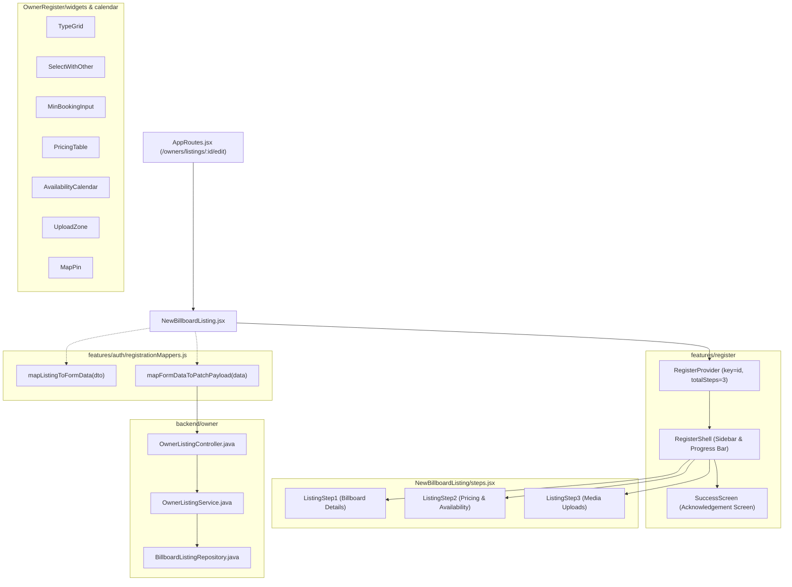

# Technical Document: Unify Billboard Listing Forms and Full-Form Edit Flow

- **PR Link / Ticket:** [PR #37](https://github.com/Advertisement-Market/advertisement/pull/37)
- **Author:** @vedafactor
- **Date:** 2026-10-22
- **Module / Route:** `frontend/src/pages/NewBillboardListing`, `frontend/src/pages/OwnerDashboard`, `frontend/src/pages/OwnerRegister`, `backend/src/main/java/com/theadbasket/backend/owner`

---

## 1. Overview & User Journey

- **User Persona:** Authenticated Billboard Owner (`OWNER` role) and Newly Registering Billboard Owner.
- **Problem Statement:**
  Previously, billboard inventory definitions suffered from fragmentation across three entry points:
  1. The initial owner registration flow (`/owners/register`, Step 4) used a legacy minimum booking dropdown instead of the compound value and unit selector.
  2. The standalone inventory creation wizard (`/owners/listings/new`) used strict digit-stripping for companion fields that rejected legitimate alphanumeric names (such as "Terminal 2" or "Gate 4") and had inconsistent pincode regex compared to backend validation.
  3. The owner dashboard (`/owners/dashboard`) used a partial, 450-line modal form (`ListingFormModal`) with only a subset of fields, bypassing structure types, ground height, audience tags, and media uploads.
- **Unified User Journey:**
  1. **Listing Creation:** From the topbar or the "My Listings" tab in `OwnerDashboard`, clicking "Add New Listing" opens `/owners/listings/new` with the canonical 3-step wizard.
  2. **Listing Edit Flow:** From `OwnerDashboard` (`/owners/dashboard?tab=listings`), clicking "Edit" on any listing card navigates directly to `/owners/listings/:id/edit`, passing the listing object via navigation state for instant, flicker-free form prefilling while synchronizing with the backend.
  3. **Multi-Step Form Completion:** The owner edits any of the 22 inventory attributes across Step 1 (Details), Step 2 (Pricing & Availability), and Step 3 (Media Uploads).
  4. **Submission & Acknowledgement:** On submitting the edit form, the client sends a clean `PATCH /api/owner/listings/{id}` payload with trimmed values and empty-string clearing for optional fields. The owner is presented with an acknowledgement success screen detailing the status timeline and a primary "Back to Dashboard" button returning to `/owners/dashboard?tab=listings`.

---

## 2. Component Hierarchy & Architecture



### Component Updates

1. **`NewBillboardListing.jsx`**:
   - Dual-mode lifecycle (`isEdit = Boolean(id)`).
   - Instant prefilling from `useLocation().state?.listing` combined with `AbortController`-guarded `ownerListingApi.getListing(id)`.
   - DTO unwrap resilience (`res?.data ?? res`) to prevent passing undefined responses to mappers.
   - Keyed mounting (`key={id ?? 'new'}`) to ensure complete form state resets across route switches.
   - Edit acknowledgement screen using `EDIT_SUCCESS_TIMELINE` and a direct "Back to Dashboard" link.
2. **`review.jsx` (`SuccessScreen`)**:
   - Added defensive array checks (`Array.isArray(timeline) && timeline.length > 0`) preventing unhandled runtime exceptions when timelines are optional or undefined.
3. **`OwnerDashboard.jsx`**:
   - Completely removed `ListingFormModal` (~450 lines of duplicate UI).
   - Replaced modal triggering with `navigate(ROUTES.editBillboardListing(listing.id), { state: { listing } })`.
   - Integrated `useSearchParams` to support `?tab=listings` with `VALID_TABS` whitelist fallback to `'overview'`.
4. **`widgets.jsx`**:
   - Preserved digits in companion input `SelectWithOther` to permit alphanumeric descriptions.
   - Exported shared `MinBookingInput` and `BOOKING_DURATION_UNITS`.
5. **`OwnerRegister/steps.jsx` & `OwnerRegister.jsx`**:
   - Replaced legacy booking selects in Step 4 with `MinBookingInput`.
   - Updated Step 7 review to display duration value and unit.

---

## 3. State Management & Data Flow

### Bidirectional Form Mapping

Form fields in the 3-step wizard use prefixed identifiers (`f_*`) to avoid state collisions. The mapping logic in `registrationMappers.js` provides lossless conversion:

```text
Backend BillboardListingDto <---> mapListingToFormData <---> Wizard Form Fields (f_*)
Wizard Form Fields (f_*)    <---> mapFormDataToPatchPayload <---> Backend BillboardListingUpdateRequest
```

- **Inversion Mappers:**
  - Facing direction: Normalized compass points (`NORTH` $\leftrightarrow$ "North").
  - Traffic type: Standard options (`CITY_URBAN` $\leftrightarrow$ "City / Urban") with fallback to `"other"`.
  - Audience type: Standard options (`COMMUTERS` $\leftrightarrow$ "Commuters") with fallback to `"other"`.
- **String Trimming & Optional Clearing:**
  - Required fields (`name`, `addressLine1`, `city`, `state`, `pincode`) are trimmed before transmission.
  - Optional fields (`addressLine2`, `landmark`, `discountNote`, `footfall`) send empty string `""` when cleared by the user, signaling the backend to clear the stored database column.

---

## 4. API Integration & Network Handling

### Endpoints

| Method | Endpoint | Description | Payload / Response |
| :--- | :--- | :--- | :--- |
| `GET` | `/api/owner/listings` | Fetch owner's inventory listings | Returns `List<BillboardListingDto>` |
| `GET` | `/api/owner/listings/{id}` | Fetch single listing by ID | Returns `BillboardListingDto` |
| `POST` | `/api/owner/listings` | Create new billboard listing | `BillboardListingCreateRequest` $\rightarrow$ `BillboardListingDto` |
| `PATCH` | `/api/owner/listings/{id}` | Full-form update of listing | `BillboardListingUpdateRequest` $\rightarrow$ `BillboardListingDto` |

### Network Handling Matrix

- **Loading State:** Skeletons and loading indicators are displayed while fetching remote inventory when navigation state is not available.
- **Empty State:** When no listings exist, `OwnerDashboard` presents a clear call-to-action button to create the first listing.
- **Error State:** Network failures and unexpected errors display descriptive toast notifications via `apiErrorMessage`.
- **Abort / Cancellation Handling:** In React 18 / StrictMode double-mount environments, canceled requests (`CanceledError` / `AbortController.abort()`) are caught cleanly without redirecting the user or firing false error toasts.
- **Development Mock Fallback:** When running in local development mode without an active backend session, `NewBillboardListing` falls back to mock listings to permit end-to-end testing of the full edit workflow.

---

## 5. UI Evidence & Responsive Review

| Breakpoint | Desktop (> 1024px) | Tablet (768px - 1023px) | Mobile (< 768px) |
| :--- | :--- | :--- | :--- |
| **Edit Billboard Wizard** | Full multi-step layout with fixed sidebar progress and 2-column form rows. | Responsive layout with stacked input fields and condensed sidebar indicators. | Single-column form layout, sticky step progress bar, and touch-friendly buttons. |
| **Acknowledgement Screen** | Centered success card with complete timeline and prominent dashboard button. | Adaptive card container with full-width action buttons. | Full viewport card with stacked timeline items and bottom navigation CTA. |

---

## 6. Accessibility & Defensive Architecture

- **Keyboard Navigation:** Full Tab, Shift+Tab, and Enter/Space keyboard accessibility for all inputs, select widgets, type selection cards, and action buttons.
- **Accessible Form Elements:** Every input includes an associated `<label>` or `aria-label` with explicit validation indicators.
- **Pincode Regex Alignment:** Synchronized client-side regex (`/^[1-9]\d{5}$/`) with backend Jakarta Bean Validation patterns, trimming input before evaluation.
- **Backend Defense-in-Depth:**
  - `OwnerListingService.java` enforces touch validation: blanking a touched required field throws `BadRequestException` (`VALIDATION_FAILED`).
  - Persisted string fields are normalized using `TextUtil.blankToNull` to eliminate invisible Unicode whitespace padding.

---

## 7. Verification & Testing Evidence

### Automated Frontend Tests (`npm test`)

```text
 RUN  v3.2.7 frontend

 ✓ src/features/auth/registrationMappers.test.js (13 tests)
 ✓ src/features/auth/pincodeAutofill.test.js (8 tests)
 ✓ src/features/notification/notificationApi.test.js (3 tests)
 ✓ src/lib/validators.test.js (7 tests)
 ✓ src/features/owner/ownerListingApi.test.js (6 tests)
 ✓ src/lib/apiClient.test.js (8 tests)
 ✓ src/pages/OwnerRegister/widgets.test.jsx (4 tests)
 ✓ src/pages/OwnerDashboard/OwnerDashboard.test.jsx (12 tests)
 ✓ src/pages/NewBillboardListing/NewBillboardListing.test.jsx (18 tests)

 Test Files  9 passed (9)
      Tests  79 passed (79)
```

### Automated Backend Tests (`mvn test`)

```text
[INFO] Running com.theadbasket.backend.owner.OwnerListingControllerTest
[INFO] Tests run: 9, Failures: 0, Errors: 0, Skipped: 0
[INFO] -------------------------------------------------------
[INFO] Tests run: 207, Failures: 0, Errors: 0, Skipped: 1
[INFO] BUILD SUCCESS
```

### Manual Verification Steps

1. Start development servers:
   - Backend: `mvn spring-boot:run`
   - Frontend: `npm run dev`
2. Navigate to `http://localhost:5173/owners/dashboard?tab=listings`.
3. Locate any listing card (e.g. "BKC LED Screen") and click **Edit**.
4. Verify that `/owners/listings/1/edit` opens instantly with all 22 fields prefilled.
5. Edit values across Step 1 and Step 2, advance to Step 3, and click **Submit Billboard Listing**.
6. Verify that the acknowledgement screen appears displaying "Billboard Updated!" and the updated timeline.
7. Click **Back to Dashboard** and verify navigation returns to `/owners/dashboard?tab=listings`.
