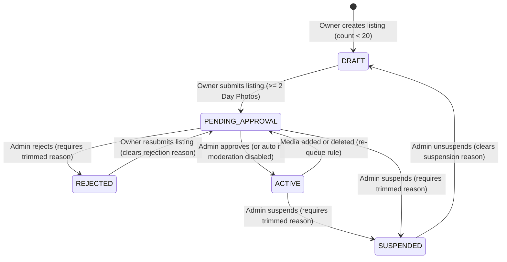
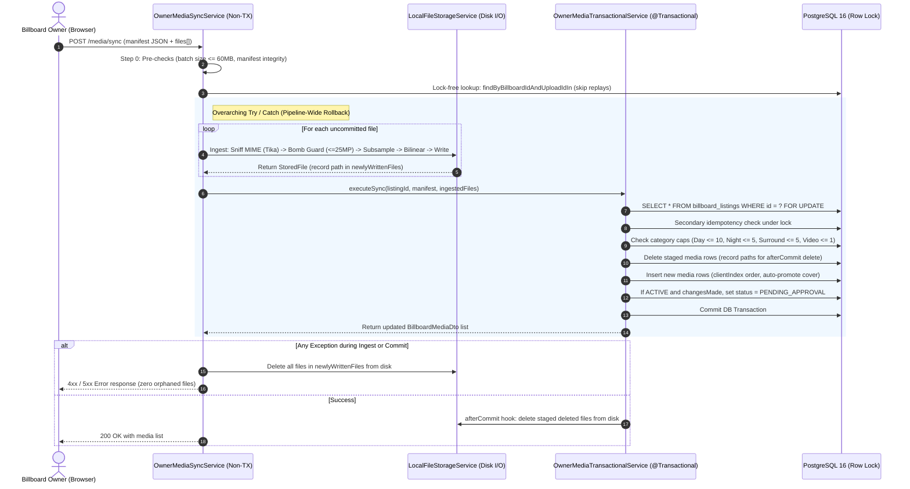

# Technical Document: PR-38 Owner Billboard Media Pipeline & Inventory Lifecycle

- **PR Link / Ticket:** [PR #38](https://github.com/Advertisement-Market/advertisement/pull/38)
- **Author:** @vedafactor
- **Date:** 2026-10-23
- **Module / Package:** `backend/src/main/java/com/theadbasket/backend/owner`, `backend/src/main/java/com/theadbasket/backend/common/storage`, `frontend/src/pages/NewBillboardListing`, `frontend/src/pages/OwnerDashboard`, `frontend/src/pages/OwnerRegister`

---

## 1. Overview & Business Intent

This single, unified pull request delivers an end-to-end media management and moderation lifecycle for billboard owners in **The AdBasket**. It replaces all mock media placeholders with secure, local filesystem persistence, atomic database synchronization, and an administrative moderation workflow.

### User Personas & Flows
1. **Billboard Owner:**
   - Uploads high-resolution daylight, night, and surrounding photos, and optional drone/traffic videos.
   - Saves progress in `DRAFT` status and explicitly submits listings for review once minimum requirements are met ($\ge 2$ day photos, required metadata).
   - If a listing is `REJECTED`, the owner views the rejection reason, fixes details or photos, and resubmits the listing (moving from `REJECTED` to `PENDING_APPROVAL`, clearing `rejection_reason`).
   - If an `ACTIVE` listing has media added or deleted, it automatically re-queues to `PENDING_APPROVAL` for moderation re-verification (unless the sync was an idempotent replay or no-op).
   - If a listing is `SUSPENDED`, the owner cannot modify it, but can view the listing and the `suspension_reason` on their dashboard.
2. **Admin:**
   - Reviews pending listings in `PENDING_APPROVAL`.
   - Approves listings (`ACTIVE`), rejects with mandatory trimmed reason (`REJECTED`), suspends active listings with mandatory trimmed reason (`SUSPENDED`), or unsuspends listings (reverting them to `DRAFT`).
3. **Advertiser / Marketplace Visitor:**
   - Only sees approved `ACTIVE` billboards in public search and marketplace browse.

---

## 2. Architecture & Data Flow

### 2.1 State Machine Lifecycle



### 2.2 Atomic Media Sync Pipeline



---

## 3. Implementation Traps & Design Decisions

### Trap 1: Resource Handler Cache Headers vs Interceptor
- **Problem:** Spring's `ResourceHttpRequestHandler` sets its own `Cache-Control` header on static file deliveries, which can overwrite or conflict with custom interceptor headers.
- **Solution:** Configure `Cache-Control` directly through `ResourceHandlerRegistration.setCacheControl(CacheControl.maxAge(1, TimeUnit.DAYS).cachePublic())` in `WebMvcConfig`.
- **Interceptor Role:** The `MediaSecurityHeadersInterceptor` is restricted strictly to setting security headers:
  - `X-Content-Type-Options: nosniff`
  - `Content-Security-Policy: default-src 'none'; sandbox`
  - `Content-Disposition: inline; filename="asset.{ext}"`
- **Testing:** Integration tests assert against the **final HTTP response headers** (`MockMvcResultMatchers.header()`), never the intermediate interceptor.

### Trap 2: Downscale Quality & Anti-Aliasing
- **Problem:** Performing a single naive bilinear resize directly on a massive photo (e.g. 6000x4000) causes visible aliasing artifacts and high heap consumption during decode.
- **Solution:** Two-phase downscaling in `LocalFileStorageService`:
  1. **Subsampling on Decode:** Compute power-of-two subsampling via `ImageReadParam.setSourceSubsampling(subsample, subsample, 0, 0)` such that `maxDim / (subsample * 2) >= 2560`. This guarantees the decoded intermediate image stays at or above 2560px (within 2x of target) before scaling.
  2. **Bilinear Scaling:** Perform the final downscale to 2560px using `RenderingHints.VALUE_INTERPOLATION_BILINEAR`, `VALUE_RENDER_QUALITY`, and `VALUE_ANTIALIAS_ON`.

### Trap 3: Batch Size Pre-Check & Multipart Cleanup
- **Problem:** Decoding large batches before size validation wastes CPU, and aborted multipart requests could leave orphaned temporary files in Tomcat's work directory.
- **Solution:** Step 0 immediately sums `file.getSize()` for all files in the batch against the 60MB limit before any I/O or decoding. Spring/Tomcat automatically purges temporary multipart files in the `finally` block of `DispatcherServlet.doDispatch()`.

### Trap 4: Listing Cap Concurrency
- **Problem:** Checking `countByUserId(userId) < 20` at create time is inherently racy under concurrent requests without a user-level lock or database trigger.
- **Decision:** The 20-listing limit is a business soft cap; occasional race conditions permitting 21 listings under rare concurrent double-clicks are acceptable.
- **Status Accounting:** All listing statuses count toward the cap, including `SUSPENDED`, `REJECTED`, `DRAFT`, `PENDING_APPROVAL`, and `ACTIVE`.

### Trap 5: Edit-Mode Chunking & Partial Atomic Sync
- **Problem:** If an owner replaces 15 photos in edit mode, uploads must be chunked (e.g., $\le 10$ files per request). Staged deletes are sent with the first chunk. If chunk 1 succeeds but chunk 2 fails on network timeout, chunk 1's deletions are already committed.
- **Design:** The sync endpoint is atomic **within a single request**. The frontend UI steers owners to replace or stage at most 10 photos at a time, avoiding multi-chunk partial failure ambiguity.

### Trap 6: Conscious Interim Security & Data Exposures
1. **Public Static Media URL:** Suspended media files remain statically fetchable by direct URL until a dedicated status-checking media controller is introduced in a future PR.
   - *Emergency Runbook:* For immediate copyright or legal takedowns, administrators must move or delete the filesystem directory `./uploads/billboards/{id}/`.
2. **Draft Media Unauthenticated Fetch:** Draft photos are publicly fetchable if the UUID filename is known. Filenames are cryptographically random UUIDv4 (`{uuid}.jpg`), making them unguessable.
3. **Video Metadata:** Image EXIF metadata is stripped and orientation is normalized, but MP4/MOV videos retain container metadata (including camera and GPS tags) due to pass-through streaming.

---

## 4. Checklists, Invariants & Database Schema

### 4.1 Lifecycle Invariants
- [x] **Reject-Fix-Resubmit Loop:**
  - `POST /api/owner/listings/{id}/submit` allows submission from `DRAFT` or `REJECTED`.
  - On submission from `REJECTED`, `rejection_reason` is automatically cleared (`null`).
  - Transition moves listing to `PENDING_APPROVAL` (or `ACTIVE` if moderation is disabled).
- [x] **Pipeline-Wide File Cleanup Catch:**
  - The `try / catch` in `OwnerMediaSyncService` wraps both the file ingestion loop AND the inner transactional call.
  - Newly written paths are added to `newlyWrittenFiles` immediately following each disk write.
  - Any failure (bomb check, MIME mismatch, semaphore timeout 503, database constraint, optimistic lock) deletes all newly written files immediately.
- [x] **Shared Re-Queue Rule:**
  - Single upload (`POST /media`) delegates directly to `syncMedia`, sharing the identical re-queue logic.
  - A sync that consists entirely of idempotent replays or makes zero row additions/deletions (`changesMade == false`) **must not** re-queue an `ACTIVE` listing to `PENDING_APPROVAL`.
- [x] **Suspension Reason & Visibility:**
  - `POST /api/admin/listings/{id}/suspend` requires a trimmed, non-blank `reason` stored in `suspension_reason`.
  - `POST /api/admin/listings/{id}/unsuspend` transitions status to `DRAFT` and clears `suspension_reason`.
  - Owner `GET /api/owner/listings/{id}` continues to return 200 OK for suspended listings so owners can review their details and suspension rationale.

### 4.2 Security Guards
- [x] **Admin Authorization:** All `/api/admin/**` endpoints reject non-admin users with `403 Forbidden`.
- [x] **PATCH Body Sanitization:** `PATCH /api/owner/listings/{id}` ignores `status`, `rejectionReason`, and `suspensionReason` in the request body. Status transitions can only occur via explicit endpoints.
- [x] **Cross-Listing Delete Isolation:** Staged delete IDs in the sync manifest must belong to the billboard specified in the URL path (`b.id = :listingId`); foreign media IDs are rejected or ignored.

### 4.3 Database Schema & Flyway Migration (`V9__create_billboard_media.sql`)

```sql
-- Status and moderation columns on billboard_listings
ALTER TABLE billboard_listings
    ADD COLUMN status VARCHAR(32) NOT NULL DEFAULT 'ACTIVE',
    ADD COLUMN rejection_reason VARCHAR(1000) NULL,
    ADD COLUMN suspension_reason VARCHAR(1000) NULL;

-- Backfill legacy records to ACTIVE
UPDATE billboard_listings SET status = 'ACTIVE' WHERE status IS NULL;

-- Create billboard_media table
CREATE TABLE billboard_media (
    id BIGSERIAL PRIMARY KEY,
    billboard_id BIGINT NOT NULL REFERENCES billboard_listings(id) ON DELETE CASCADE,
    category VARCHAR(32) NOT NULL,
    storage_key VARCHAR(512) NOT NULL,
    upload_id VARCHAR(64) NOT NULL,
    original_name VARCHAR(255),
    content_type VARCHAR(100) NOT NULL,
    file_size_bytes BIGINT NOT NULL,
    is_cover BOOLEAN NULL,
    display_order INT NOT NULL DEFAULT 0,
    created_ts TIMESTAMPTZ NOT NULL DEFAULT NOW()
);

-- ANSI SQL NULL-tolerant partial uniqueness: only 1 cover photo (is_cover = true) per billboard
CREATE UNIQUE INDEX uq_billboard_media_cover ON billboard_media (billboard_id, is_cover);
CREATE INDEX idx_billboard_media_billboard_category ON billboard_media (billboard_id, category);
CREATE INDEX idx_billboard_media_upload_id ON billboard_media (billboard_id, upload_id);
```

---

## 5. Frontend Architecture & Component Updates

1. **`UploadZone` Component (`widgets.jsx`):**
   - Supports both controlled mode (`files`, `onChange`) and uncontrolled mode fallback.
   - Client-side validation: immediately rejects unsupported formats (`.heic`, `.webp`, `.svg`, `.gif`) and files exceeding size thresholds (10MB for photos, 100MB for video).
   - Thumbnail previews: displays newly added files with a remove button (✕), properly revoking `URL.createObjectURL` references to prevent memory leaks. Renders existing media from DB with `COVER` badges.
2. **`ListingStep3` (`steps.jsx`):**
   - Wires form state for `f_dayPhotos`, `f_nightPhotos`, `f_surroundingPhotos`, and `f_video`.
   - Tracks staged removals via `f_stagedDeleteIds`.
3. **`NewBillboardListing.jsx` Submit Flow:**
   - **Creation:** `createListing` (DRAFT) $\rightarrow$ `syncMedia` (upload files) $\rightarrow$ `submitListing` (PENDING_APPROVAL) $\rightarrow$ `SuccessScreen`.
   - **Edit:** `updateListing` (metadata PATCH) $\rightarrow$ `syncMedia` (staged deletions & new files) $\rightarrow$ `SuccessScreen`.
4. **`OwnerDashboard.jsx`:**
   - Displays real cover photo from `l.coverPhotoUrl` on billboard cards.
   - Distinct status badges: `Draft`, `Pending Review`, `Active`, `Rejected`, and `Suspended`.
   - Banner displaying `rejectionReason` or `suspensionReason` when applicable.

---

## 6. API Specification

| Method | Path | Auth / Role | Description |
| :--- | :--- | :--- | :--- |
| `POST` | `/api/owner/listings/{id}/media/sync` | `OWNER` | Synchronizes media files, staged deletions, and ordering |
| `POST` | `/api/owner/listings/{id}/media` | `OWNER` | Uploads a single media file (delegates to sync service) |
| `PUT` | `/api/owner/listings/{id}/media/{mediaId}/cover` | `OWNER` | Sets the designated photo as the listing cover |
| `PUT` | `/api/owner/listings/{id}/media/order` | `OWNER` | Reorders media display order |
| `POST` | `/api/owner/listings/{id}/submit` | `OWNER` | Submits a `DRAFT` or `REJECTED` listing for admin approval |
| `GET` | `/api/owner/listings/{id}` | `OWNER` | Retrieves listing details (including DRAFT, REJECTED, SUSPENDED) |
| `POST` | `/api/admin/listings/{id}/approve` | `ADMIN` | Approves listing, transitioning to `ACTIVE` |
| `POST` | `/api/admin/listings/{id}/reject` | `ADMIN` | Rejects listing with mandatory reason, transitioning to `REJECTED` |
| `POST` | `/api/admin/listings/{id}/suspend` | `ADMIN` | Suspends listing with mandatory reason, transitioning to `SUSPENDED` |
| `POST` | `/api/admin/listings/{id}/unsuspend` | `ADMIN` | Unsuspends listing, transitioning to `DRAFT` |
| `GET` | `/api/listings/active` | `PermitAll` | Marketplace browse query (strictly filtered to `ACTIVE` listings) |
| `GET` | `/api/media/**` | `PermitAll` | Static media file delivery with security headers |

---

## 7. Comprehensive Verification Test Matrix

The following test suite covers all critical paths and edge cases:

1. **Idempotent Replay Disk Isolation:** Submitting the exact same sync request twice writes zero extra files to disk on the second request.
2. **Concurrent Identical Sync Requests:** Two simultaneous identical sync requests both resolve cleanly without orphaned files or database constraint collisions.
3. **Manifest Validation:**
   - Manifest with missing `uploadId` fails with 400.
   - Manifest with duplicate `uploadId` fails with 400.
   - Manifest with invalid `clientIndex` fails with 400.
4. **MIME / Category Mismatch:** Uploading an image file (e.g. PNG) with category labeled as `VIDEO` is rejected with 400.
5. **Reject -> Fix -> Resubmit Loop:**
   - Owner submits listing $\rightarrow$ status `PENDING_APPROVAL`.
   - Admin rejects with reason $\rightarrow$ status `REJECTED`, reason visible.
   - Owner edits details/photos and calls `/submit` $\rightarrow$ status `PENDING_APPROVAL`, `rejection_reason` cleared.
   - Admin approves $\rightarrow$ status `ACTIVE`.
6. **No-Op Sync on Active Listing:** Executing a sync with no file additions and no deletions on an `ACTIVE` listing preserves `ACTIVE` status without re-queueing.
7. **Downscale Quality & Subsampling:** 6000x4000 high-res JPEG is accepted, subsampled to $\ge 2560\text{px}$, downscaled without aliasing, and stripped of GPS metadata.
8. **Decompression Bomb Protection:** 10,000x10,000px image rejected before full decode with 400 (`IMAGE_DIMENSIONS_EXCEEDED`).
9. **Legacy Zero-Photo Edit Path:** Updating non-media fields on existing legacy rows succeeds without requiring media re-upload.
10. **Security & Role Guards:**
    - Non-admin user receives 403 on `/api/admin/**`.
    - `PATCH /api/owner/listings/{id}` ignores injected `status` or `rejectionReason`.
    - Staged delete IDs from another listing are rejected/ignored.
11. **Static Media Security Headers:** Verifying final HTTP response headers on `/api/media/**` contain `nosniff`, `sandbox` CSP, `inline` Content-Disposition, and `Cache-Control: public, max-age=86400`.

---

## 8. Commit Strategy & Review Progression

To ensure high reviewability across this substantial feature, commits are structured strictly in implementation dependency order:

1. `feat(db): add V9 flyway migration for billboard_media and listing status with testcontainers tests`
2. `feat(storage): implement secure local file storage with Tika MIME sniffing, EXIF rotation, and subsampling`
3. `feat(owner): add atomic media sync and transactional services with row locking and disk rollback`
4. `feat(lifecycle): implement submit listing, admin moderation endpoints, and marketplace status filtering`
5. `feat(frontend): upgrade UploadZone, wire listing wizard step 3, and add dashboard status badges`
6. `docs: add PR-38 technical specification and update architecture guidelines`
