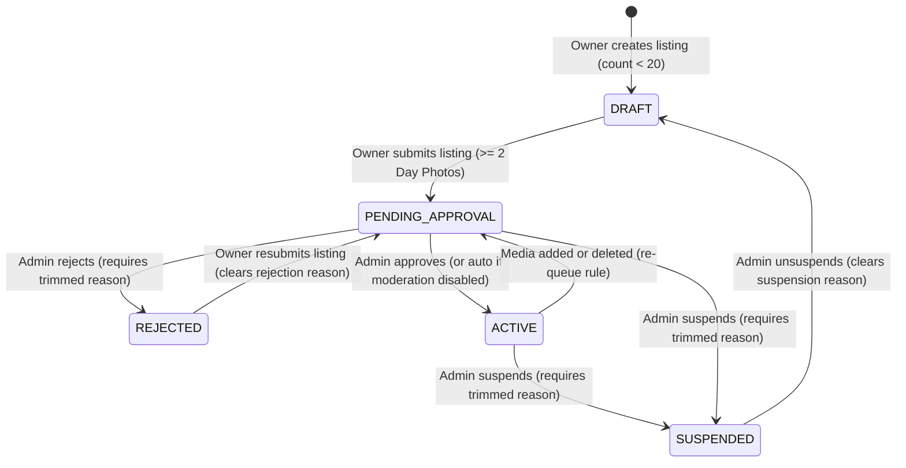
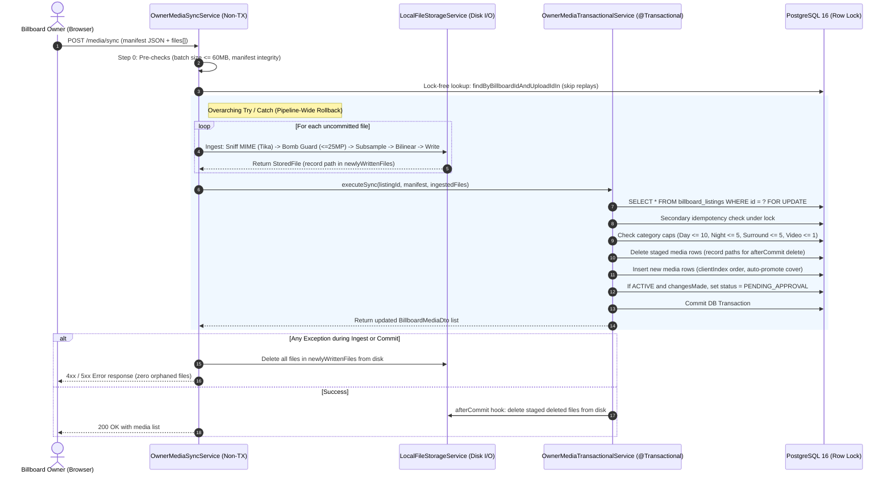

# Technical Document: PR-39 Owner Billboard Media Pipeline & Inventory Lifecycle

- **PR Link / Ticket:** [PR #39](https://github.com/Advertisement-Market/advertisement/pull/39)
- **Author:** @vedafactor
- **Date:** 2026-10-23
- **Module / Package:** `backend/src/main/java/com/theadbasket/backend/owner`, `backend/src/main/java/com/theadbasket/backend/common/storage`, `frontend/src/pages/NewBillboardListing`, `frontend/src/pages/OwnerDashboard`, `frontend/src/pages/OwnerRegister`

---

## 1. Overview & Business Intent

This single, unified pull request delivers an end-to-end media management and moderation lifecycle for billboard owners in **The AdBasket**. It replaces all mock media placeholders with secure, local filesystem persistence, atomic database synchronization, and an administrative moderation workflow.

### User Personas & Flows
1. **Billboard Owner:**
   - Uploads high-resolution daylight, night, and surrounding photos, and optional drone/traffic videos.
   - Saves progress in `DRAFT` status and explicitly submits listings for review once minimum requirements are met ($\ge 2$ day photos, required metadata).
   - If a listing is `REJECTED`, the owner views the rejection reason, fixes details or photos, and resubmits the listing (moving from `REJECTED` to `PENDING_APPROVAL`, clearing `rejection_reason`).
   - If an `ACTIVE` listing has media added or deleted, it automatically re-queues to `PENDING_APPROVAL` for moderation re-verification (unless the sync was an idempotent replay or no-op).
   - If a listing is `SUSPENDED`, the owner cannot modify it, but can view the listing and the `suspension_reason` on their dashboard.
2. **Admin:**
   - Reviews pending listings in `PENDING_APPROVAL`.
   - Approves listings (`ACTIVE`), rejects with mandatory trimmed reason (`REJECTED`), suspends active listings with mandatory trimmed reason (`SUSPENDED`), or unsuspends listings (reverting them to `DRAFT`).
3. **Advertiser / Marketplace Visitor:**
   - Only sees approved `ACTIVE` billboards in public search and marketplace browse.

---

## 2. Architecture & Data Flow

### 2.1 State Machine Lifecycle



### 2.2 Atomic Media Sync Pipeline



---

## 3. Implementation Traps & Design Decisions

### Trap 1: Resource Handler Cache Headers vs Interceptor
- **Problem:** Spring's `ResourceHttpRequestHandler` sets its own `Cache-Control` header on static file deliveries, which can overwrite or conflict with custom interceptor headers.
- **Solution:** Configure `Cache-Control` directly through `ResourceHandlerRegistration.setCacheControl(CacheControl.maxAge(1, TimeUnit.DAYS).cachePublic())` in `WebMvcConfig`.
- **Interceptor Role:** The `MediaSecurityHeadersInterceptor` is restricted strictly to setting security headers:
  - `X-Content-Type-Options: nosniff`
  - `Content-Security-Policy: default-src 'none'; sandbox`
  - `Content-Disposition: inline; filename="asset.{ext}"`
- **Testing:** Integration tests assert against the **final HTTP response headers** (`MockMvcResultMatchers.header()`), never the intermediate interceptor.

### Trap 2: Downscale Quality & Anti-Aliasing
- **Problem:** Performing a single naive bilinear resize directly on a massive photo (e.g. 6000x4000) causes visible aliasing artifacts and high heap consumption during decode.
- **Solution:** Two-phase downscaling in `LocalFileStorageService`:
  1. **Subsampling on Decode:** Compute power-of-two subsampling via `ImageReadParam.setSourceSubsampling(subsample, subsample, 0, 0)` such that `maxDim / (subsample * 2) >= 2560`. This guarantees the decoded intermediate image stays at or above 2560px (within 2x of target) before scaling.
  2. **Bilinear Scaling:** Perform the final downscale to 2560px using `RenderingHints.VALUE_INTERPOLATION_BILINEAR`, `VALUE_RENDER_QUALITY`, and `VALUE_ANTIALIAS_ON`.

### Trap 3: Batch Size Pre-Check & Multipart Cleanup
- **Problem:** Decoding large batches before size validation wastes CPU, and aborted multipart requests could leave orphaned temporary files in Tomcat's work directory.
- **Solution:** Step 0 immediately sums `file.getSize()` for all files in the batch against the 60MB limit before any I/O or decoding. Spring/Tomcat automatically purges temporary multipart files in the `finally` block of `DispatcherServlet.doDispatch()`.

### Trap 4: Listing Cap Concurrency
- **Problem:** Checking `countByUserId(userId) < 20` at create time is inherently racy under concurrent requests without a user-level lock or database trigger.
- **Decision:** The 20-listing limit is a business soft cap; occasional race conditions permitting 21 listings under rare concurrent double-clicks are acceptable.
- **Status Accounting:** All listing statuses count toward the cap, including `SUSPENDED`, `REJECTED`, `DRAFT`, `PENDING_APPROVAL`, and `ACTIVE`.

### Trap 5: Edit-Mode Chunking & Partial Atomic Sync
- **Problem:** If an owner replaces 15 photos in edit mode, uploads must be chunked (e.g., $\le 10$ files per request). Staged deletes are sent with the first chunk. If chunk 1 succeeds but chunk 2 fails on network timeout, chunk 1's deletions are already committed.
- **Design:** The sync endpoint is atomic **within a single request**. The frontend UI steers owners to replace or stage at most 10 photos at a time, avoiding multi-chunk partial failure ambiguity.

### Trap 6: Conscious Interim Security & Data Exposures
1. **Public Static Media URL:** Suspended media files remain statically fetchable by direct URL until a dedicated status-checking media controller is introduced in a future PR.
   - *Emergency Runbook:* For immediate copyright or legal takedowns, administrators must move or delete the filesystem directory `./uploads/billboards/{id}/`.
2. **Draft Media Unauthenticated Fetch:** Draft photos are publicly fetchable if the UUID filename is known. Filenames are cryptographically random UUIDv4 (`{uuid}.jpg`), making them unguessable.
3. **Video Metadata:** Image EXIF metadata is stripped and orientation is normalized, but MP4/MOV videos retain container metadata (including camera and GPS tags) due to pass-through streaming.

---

## 4. Checklists, Invariants & Database Schema

### 4.1 Lifecycle Invariants
- [x] **Reject-Fix-Resubmit Loop:**
  - `POST /api/owner/listings/{id}/submit` allows submission from `DRAFT` or `REJECTED`.
  - On submission from `REJECTED`, `rejection_reason` is automatically cleared (`null`).
  - Transition moves listing to `PENDING_APPROVAL` (or `ACTIVE` if moderation is disabled).
- [x] **Pipeline-Wide File Cleanup Catch:**
  - The `try / catch` in `OwnerMediaSyncService` wraps both the file ingestion loop AND the inner transactional call.
  - Newly written paths are added to `newlyWrittenFiles` immediately following each disk write.
  - Any failure (bomb check, MIME mismatch, semaphore timeout 503, database constraint, optimistic lock) deletes all newly written files immediately.
- [x] **Shared Re-Queue Rule:**
  - Single upload (`POST /media`) delegates directly to `syncMedia`, sharing the identical re-queue logic.
  - A sync that consists entirely of idempotent replays or makes zero row additions/deletions (`changesMade == false`) **must not** re-queue an `ACTIVE` listing to `PENDING_APPROVAL`.
- [x] **Suspension Reason & Visibility:**
  - `POST /api/admin/listings/{id}/suspend` requires a trimmed, non-blank `reason` stored in `suspension_reason`.
  - `POST /api/admin/listings/{id}/unsuspend` transitions status to `DRAFT` and clears `suspension_reason`.
  - Owner `GET /api/owner/listings/{id}` continues to return 200 OK for suspended listings so owners can review their details and suspension rationale.

### 4.2 Security Guards
- [x] **Admin Authorization:** All `/api/admin/**` endpoints reject non-admin users with `403 Forbidden`.
- [x] **PATCH Body Sanitization:** `PATCH /api/owner/listings/{id}` ignores `status`, `rejectionReason`, and `suspensionReason` in the request body. Status transitions can only occur via explicit endpoints.
- [x] **Cross-Listing Delete Isolation:** Staged delete IDs in the sync manifest must belong to the billboard specified in the URL path (`b.id = :listingId`); foreign media IDs are rejected or ignored.

### 4.3 Database Schema & Flyway Migration (`V9__create_billboard_media.sql`)

```sql
-- Status and moderation columns on billboard_listings
ALTER TABLE billboard_listings
    ADD COLUMN status VARCHAR(32) NOT NULL DEFAULT 'ACTIVE',
    ADD COLUMN rejection_reason VARCHAR(1000) NULL,
    ADD COLUMN suspension_reason VARCHAR(1000) NULL;

-- Backfill legacy records to ACTIVE
UPDATE billboard_listings SET status = 'ACTIVE' WHERE status IS NULL;

-- Create billboard_media table
CREATE TABLE billboard_media (
    id BIGSERIAL PRIMARY KEY,
    billboard_id BIGINT NOT NULL REFERENCES billboard_listings(id) ON DELETE CASCADE,
    category VARCHAR(32) NOT NULL,
    storage_key VARCHAR(512) NOT NULL,
    upload_id VARCHAR(64) NOT NULL,
    original_name VARCHAR(255),
    content_type VARCHAR(100) NOT NULL,
    file_size_bytes BIGINT NOT NULL,
    is_cover BOOLEAN NULL,
    display_order INT NOT NULL DEFAULT 0,
    created_ts TIMESTAMPTZ NOT NULL DEFAULT NOW()
);

-- ANSI SQL NULL-tolerant partial uniqueness: only 1 cover photo (is_cover = true) per billboard
CREATE UNIQUE INDEX uq_billboard_media_cover ON billboard_media (billboard_id, is_cover);
CREATE INDEX idx_billboard_media_billboard_category ON billboard_media (billboard_id, category);
CREATE INDEX idx_billboard_media_upload_id ON billboard_media (billboard_id, upload_id);
```

---

## 5. Frontend Architecture & Component Updates

1. **`UploadZone` Component (`widgets.jsx`):**
   - Supports both controlled mode (`files`, `onChange`) and uncontrolled mode fallback.
   - Client-side validation: immediately rejects unsupported formats (`.heic`, `.webp`, `.svg`, `.gif`) and files exceeding size thresholds (10MB for photos, 100MB for video).
   - Thumbnail previews: displays newly added files with a remove button (✕), properly revoking `URL.createObjectURL` references to prevent memory leaks. Renders existing media from DB with `COVER` badges.
2. **`ListingStep3` (`steps.jsx`):**
   - Wires form state for `f_dayPhotos`, `f_nightPhotos`, `f_surroundingPhotos`, and `f_video`.
   - Tracks staged removals via `f_stagedDeleteIds`.
3. **`NewBillboardListing.jsx` Submit Flow:**
   - **Creation:** `createListing` (DRAFT) $\rightarrow$ `syncMedia` (upload files) $\rightarrow$ `submitListing` (PENDING_APPROVAL) $\rightarrow$ `SuccessScreen`.
   - **Edit:** `updateListing` (metadata PATCH) $\rightarrow$ `syncMedia` (staged deletions & new files) $\rightarrow$ conditional submit:
     - If `prevStatus === 'REJECTED'`: auto-invokes `submitListing` $\rightarrow$ transitions to `PENDING_APPROVAL`, clears `rejection_reason`.
     - If `prevStatus === 'DRAFT'`: owner has an explicit choice to either save progress in DRAFT ("Save Draft Changes") or submit for review ("Save & Submit for Review").
     - If `prevStatus === 'ACTIVE'`: warning banner alerts owner that changing media (photos added/deleted) automatically unpublishes the listing to `PENDING_APPROVAL` for admin re-verification upon save.
     - If `submitListing` fails after a successful update/sync: specific error toast with retry action keeps the user on Step 3 with changes preserved.
4. **`OwnerDashboard.jsx`:**
   - Displays real cover photo from `l.coverPhotoUrl` on billboard cards.
   - Distinct status badges: `Draft`, `Pending Review`, `Active`, `Rejected`, and `Suspended`.
   - Banner displaying `rejectionReason` or `suspensionReason` when applicable.
   - Primary action buttons:
     - "Submit for Review" on `DRAFT` listings (invokes `submitListing` with success toast and reload).
     - "Fix Listing" on `REJECTED` listings.
     - "Edit Listing" / "View Listing" based on lifecycle state.

---

## 6. API Specification

| Method | Path | Auth / Role | Description |
| :--- | :--- | :--- | :--- |
| `POST` | `/api/owner/listings/{id}/media/sync` | `OWNER` | Synchronizes media files, staged deletions, and ordering |
| `POST` | `/api/owner/listings/{id}/media` | `OWNER` | Uploads a single media file (delegates to sync service) |
| `DELETE` | `/api/owner/listings/{id}/media/{mediaId}` | `OWNER` | Deletes a single media file and updates listing status if active |
| `PUT` | `/api/owner/listings/{id}/media/{mediaId}/cover` | `OWNER` | Sets the designated photo as the listing cover |
| `PUT` | `/api/owner/listings/{id}/media/reorder` | `OWNER` | Reorders media display order |
| `POST` | `/api/owner/listings/{id}/submit` | `OWNER` | Submits a `DRAFT` or `REJECTED` listing for admin approval |
| `GET` | `/api/owner/listings/{id}` | `OWNER` | Retrieves listing details (including DRAFT, REJECTED, SUSPENDED) |
| `POST` | `/api/admin/listings/{id}/approve` | `ADMIN` | Approves listing, transitioning to `ACTIVE` |
| `POST` | `/api/admin/listings/{id}/reject` | `ADMIN` | Rejects listing with mandatory reason, transitioning to `REJECTED` |
| `POST` | `/api/admin/listings/{id}/suspend` | `ADMIN` | Suspends listing with mandatory reason, transitioning to `SUSPENDED` |
| `POST` | `/api/admin/listings/{id}/unsuspend` | `ADMIN` | Unsuspends listing, transitioning to `DRAFT` |
| `GET` | `/api/listings/active` | `PermitAll` | Marketplace browse query (strictly filtered to `ACTIVE` listings) |
| `GET` | `/api/media/**` | `PermitAll` | Static media file delivery with security headers |

---

## 7. Comprehensive Verification Test Matrix

The following test suite covers all critical paths and edge cases:

1. **Idempotent Replay Disk Isolation:** Submitting the exact same sync request twice writes zero extra files to disk on the second request.
2. **Concurrent Identical Sync Requests:** Two simultaneous identical sync requests both resolve cleanly without orphaned files or database constraint collisions.
3. **Manifest Validation:**
   - Manifest with missing `uploadId` fails with 400.
   - Manifest with duplicate `uploadId` fails with 400.
   - Manifest with invalid `clientIndex` fails with 400.
4. **MIME / Category Mismatch:** Uploading an image file (e.g. PNG) with category labeled as `VIDEO` is rejected with 400.
5. **Reject -> Fix -> Resubmit Loop:**
   - Owner submits listing $\rightarrow$ status `PENDING_APPROVAL`.
   - Admin rejects with reason $\rightarrow$ status `REJECTED`, reason visible.
   - Owner edits details/photos and calls `/submit` $\rightarrow$ status `PENDING_APPROVAL`, `rejection_reason` cleared.
   - Admin approves $\rightarrow$ status `ACTIVE`.
6. **No-Op Sync on Active Listing:** Executing a sync with no file additions and no deletions on an `ACTIVE` listing preserves `ACTIVE` status without re-queueing.
7. **Downscale Quality & Subsampling:** 6000x4000 high-res JPEG is accepted, subsampled to $\ge 2560\text{px}$, downscaled without aliasing, and stripped of GPS metadata.
8. **Decompression Bomb Protection:** 10,000x10,000px image rejected before full decode with 400 (`IMAGE_DIMENSIONS_EXCEEDED`).
9. **Legacy Zero-Photo Edit Path:** Updating non-media fields on existing legacy rows succeeds without requiring media re-upload.
10. **Security & Role Guards:**
    - Non-admin user receives 403 on `/api/admin/**`.
    - `PATCH /api/owner/listings/{id}` ignores injected `status` or `rejectionReason`.
    - Staged delete IDs from another listing are rejected/ignored.
11. **Static Media Security Headers:** Verifying final HTTP response headers on `/api/media/**` contain `nosniff`, `sandbox` CSP, `inline` Content-Disposition, and `Cache-Control: public, max-age=86400`.
12. **PostgreSQL Connection-Level Lock Timeout & MVC Translation (`PostgresLockTimeoutIT`):**
    - *Status:* **Not yet verified locally (gated on Docker execution in CI).**
    - Configured against real PostgreSQL 16 container with Hikari `connectionInitSql = "SET lock_timeout = '5s'"` and dedicated Flyway datasource (`spring.flyway.url/user/password`) with `init-sqls: ["SET lock_timeout = 0"]`.
    - Proves Transaction A holding row lock blocks Transaction B calling `DELETE /api/owner/listings/{id}` until PostgreSQL aborts waiting query with `55P03`, translating to `CannotAcquireLockException` and HTTP 409 `CONCURRENT_MODIFICATION`.
    - Verification gate: Requires a green CI run reporting `PostgresLockTimeoutIT` executed (not skipped), plus mutation check (removing `connection-init-sql` to confirm test failure).
13. **Profile Configuration & Placeholder Resolution (`ProfileYamlConfigTest`):**
    - Verifies that both `application-prod.yml` and `application-staging.yml` load valid YAML and successfully resolve datasource and dedicated Flyway properties without unresolvable placeholder errors, even when `DB_PASSWORD` is empty or unset.
14. **Active Listing Re-moderation Scenarios (`OwnerMediaSyncIntegrationTest`):**
    - `mediaChangeOnActiveListingTransitionsStatusToPendingApproval`: Adding a photo to an `ACTIVE` listing transitions status to `PENDING_APPROVAL`.
    - `metadataOnlyEditOnActiveListingKeepsStatusActive`: Updating non-media metadata preserves `ACTIVE` status.
    - `reorderAndCoverOnActiveListingKeepsStatusActive`: Reordering photos and designating a cover on an `ACTIVE` listing preserves `ACTIVE` status.
15. **Multi-Threaded Serialization & Lock Mutation Proof (`OwnerMediaSyncIntegrationTest`):**
    - Two threads with `CountDownLatch` executing concurrent syncs serialize cleanly without duplicate display orders.
    - Mutation check: removing the row lock yields immediate collision (`Found duplicate(s): [1] in: [1, 1]`), proving the lock is active and non-trivial.

---

## 8. Operational Remediation & Concurrency Specifications

### 8.1 Diagnostic & Data Repair for Display Order Duplicates
Prior to PR-39's global display order calculation, display orders were queried per category (`DAY_PHOTO`), which could produce duplicate `display_order` sequences across different categories for the same billboard.

1. **Diagnostic Query (Run against Staging / Production):**
   ```sql
   SELECT billboard_id, display_order, COUNT(*) AS duplicate_count
   FROM billboard_media
   GROUP BY billboard_id, display_order
   HAVING COUNT(*) > 1;
   ```

2. **One-Time Data Repair Script (PostgreSQL-Specific):**
   If duplicate rows exist, run the following transaction-wrapped script during a deployment maintenance window or low-traffic quiet period. It strictly targets billboards with collisions and normalizes their media sequences to dense, 1-based order by `(display_order, created_ts, id)`:
   ```sql
   BEGIN;

   WITH affected_billboards AS (
       SELECT billboard_id
       FROM billboard_media
       GROUP BY billboard_id, display_order
       HAVING COUNT(*) > 1
   ),
   renumbered AS (
       SELECT id,
              ROW_NUMBER() OVER (
                  PARTITION BY billboard_id 
                  ORDER BY display_order ASC, created_ts ASC, id ASC
              ) AS dense_order
       FROM billboard_media
       WHERE billboard_id IN (SELECT billboard_id FROM affected_billboards)
   )
   UPDATE billboard_media bm
   SET display_order = r.dense_order
   FROM renumbered r
   WHERE bm.id = r.id
     AND bm.display_order != r.dense_order;

   COMMIT;
   ```
   > [!NOTE]
   > This query is documented as an operational one-off for PostgreSQL staging/production and is omitted from H2 Flyway migrations due to engine-specific `UPDATE ... FROM` syntax. Listings with collisions are compacted to dense sequential values `(1, 2, 3...)`.
   > 
   > **Follow-Up Ticket 1:** Once the repair script is verified on production, open a follow-up ticket to enforce an immediate/deferrable database constraint on `(billboard_id, display_order)`.
   > 
   > **Follow-Up Ticket 2 (Server-Side Atomic Resubmit):** Currently, editing a `REJECTED` listing performs `updateListing` $\rightarrow$ `syncMedia` $\rightarrow$ `submitListing` on the client. In a follow-up, `updateListing` can support an atomic `submit=true` parameter to transition directly to `PENDING_APPROVAL` server-side, removing any dependence on client-side status state and eliminating the two-call gap.

### 8.2 Concurrency Architecture & Lock Isolation
- **Pessimistic Row Lock & Hint Portability:** `BillboardListingRepository.findByIdForUpdate` and `findByIdAndUserIdForUpdate` execute `SELECT ... FOR UPDATE` with a 5000ms bounded timeout query hint (`@QueryHint(name = "jakarta.persistence.lock.timeout", value = "5000")`). Because Hibernate's PostgreSQL dialect ignores positive numeric lock hints in SQL (Postgres syntax only supports `NOWAIT` and `SKIP LOCKED`), the repository documents that actual lock timeout is enforced at the connection level.
- **Connection-Level Lock Timeout Across PostgreSQL Profiles:** Connection-level timeout is configured via HikariCP's `connection-init-sql: "SET lock_timeout = '5s'"` across all PostgreSQL profiles (`application-prod.yml` and `application-staging.yml`). Local development under H2 remains unaffected.
- **Dedicated Flyway Datasource & Pool Isolation:** To ensure database migrations and table DDL are never aborted by the 5-second lock timeout, Flyway is provisioned with its own isolated datasource referencing `${spring.datasource.url/username/password}` (guaranteeing coordinate synchronization without variable drift) and executing `spring.flyway.init-sqls: ["SET lock_timeout = 0"]`. This guarantees Flyway's session-scoped reset never touches or leaks into the application's Hikari connection pool, which uniformly enforces 5s lock timeouts.
- **End-to-End Testcontainers Verification (`PostgresLockTimeoutIT`):** Configured with `@ActiveProfiles("staging")` against real PostgreSQL 16 container, with `@DynamicPropertySource` injecting only the container's `spring.datasource.url/username/password` coordinates so that Hikari's `connection-init-sql` and Flyway's dedicated datasource settings are tested directly from `application-staging.yml`. Picked up by Maven Surefire (`<include>**/*IT.java</include>` in `pom.xml`) and CI (`mvn clean verify`).
  1. Asserts application pool connection reports `SHOW lock_timeout` as `5s`.
  2. Transaction A holds row lock via `findByIdForUpdate` and signals `lockAcquiredLatch` once the query returns (with a 30s holder latch timeout to prevent timing flakiness on loaded CI runners).
  3. Transaction B calls `DELETE /api/owner/listings/{id}` (`OwnerListingService.deleteListing`).
  4. At ~5000ms, PostgreSQL aborts the waiting query with SQLState `55P03` (`ERRCODE_LOCK_NOT_AVAILABLE`). Spring's `SQLErrorCodeSQLExceptionTranslator` maps it to `CannotAcquireLockException` and `GlobalExceptionHandler` returns HTTP 409 Conflict (`CONCURRENT_MODIFICATION`).
  5. Transaction A releases the lock, and a retry of `DELETE /api/owner/listings/{id}` immediately succeeds with 204 No Content, confirming the listing is deleted.
  > [!NOTE]
  > **CI vs Local Test Execution & Mutation Verification:** In local environments without a running Docker daemon, Testcontainers tests (`UserRepositoryIT`, `V9MigrationPostgresTest`, `PostgresLockTimeoutIT`) skip cleanly via `disabledWithoutDocker = true`. The PostgreSQL lock timeout and error translation chain must be verified in CI on a Docker-enabled runner. The mutation check (removing `connection-init-sql: "SET lock_timeout = '5s'"` from `application-staging.yml` on a throwaway branch) must confirm test failure (`SHOW lock_timeout` fails or the query hangs without timing out into 409).
  > 
  > **Residual Operational Risk:** The 5-second lock timeout is global to the Hikari connection pool in staging and production. Any statement that waits on a locked row for $> 5$ seconds will be cancelled with SQLState `55P03` and map to HTTP 409. Large operational maintenance scripts (such as the display order repair script) must be executed directly via `psql` in a dedicated session rather than through the application datasource.
- **Protected Writers:** All media mutation endpoints (`executeSync`, `reorderMedia`, `setCover`, `deleteSingleMedia`) as well as `OwnerListingService.deleteListing` acquire this row lock before altering media records, computing `display_order`, or cascading deletions.
- **Validation Guard in `reorderMedia`:** Validates that submitted `mediaIds` contains exactly the complete set of existing media IDs for the listing, preventing partial reorders from creating stale sequences.
- **Zero Disk I/O inside Lock Boundary:** Ingestion, Tika MIME detection, decompression bomb guards, and disk file writes are performed upfront in `OwnerMediaSyncService` *outside* the `@Transactional` boundary. The locked phase in `OwnerMediaTransactionalService` executes only fast database metadata operations (sub-millisecond).
- **Active Listing Re-moderation & `changesMade` Definition:**
  - `changesMade` is defined as `!toDelete.isEmpty() || !toInsert.isEmpty();`.
  - Adding or deleting media on an `ACTIVE` listing modifies the underlying creative material and unpublishes the listing to `PENDING_APPROVAL` for admin re-verification.
  - Reordering existing approved media (`reorderMedia`) and selecting an approved day photo cover (`setCover`) do *not* alter media content and maintain `ACTIVE` status without re-review.
  - Metadata-only PATCH updates (`updateListing`) preserve `ACTIVE` status.
  - Warning banner on step 3 only displays for `ACTIVE` listings when pending media changes exist (`hasPendingMediaChanges`), avoiding alarming owners who only edit metadata.
  - Verified in `OwnerMediaSyncIntegrationTest` via `mediaChangeOnActiveListingTransitionsStatusToPendingApproval`, `metadataOnlyEditOnActiveListingKeepsStatusActive`, and `reorderAndCoverOnActiveListingKeepsStatusActive`.
- **Draft Submission Control & Double-Click Guard:**
  - `OwnerDashboard.jsx` displays a direct "Submit for Review" button on all cards in `DRAFT` status with a submitting lock state (`submittingReviewId`) preventing double-clicks.
  - On submit failure, error message surfaces in a visible toast without changing status; on success, toast confirms submission and listings refresh automatically.
  - `NewBillboardListing` step 3 features a unified submission control for `DRAFT` listings: checking "Submit for Review once saved" dynamically switches the action to "Save & Submit for Review →" (validated against $\ge 2$ day photos and disabled if incomplete), while leaving it unchecked enables "Save Draft Changes →" for partial progress.
  - If submission fails after a successful update/sync, changes remain saved in `DRAFT` and an actionable retry error is surfaced.
- **Mutation & Multi-Thread Verification:**
  - Concurrency latch mutation check: removing the row lock resulted in immediate collision: `Found duplicate(s): [1] in: [1, 1]`. Row lock ensures complete serialization.
  - Category query mutation check: reverting to category-based query failed with `JSON path "$[2].displayOrder" expected:<3> but was:<2>`.

---

## 9. Deployment Checklist & Operational Tasks

| Step | Action | Environment | Assigned Owner | Status |
| :--- | :--- | :--- | :--- | :--- |
| 1 | Run Diagnostic Query for duplicate `display_order` | Staging / Prod | @vedafactor | Pre-Deploy |
| 2 | Execute One-Time Repair Script if duplicates are detected | Staging / Prod | @vedafactor | Maintenance Window |
| 3 | Run Diagnostic Query to confirm zero remaining duplicates | Staging / Prod | @vedafactor | Post-Repair |
| 4 | Deploy backend artifact (V9 migration + global displayOrder calculation) | Staging / Prod | @vedafactor | Deploy |
| 5 | Verify Nginx `client_max_body_size 65M;` configuration | Ingress / Proxy | Infra / DevOps | Completed |
| 6 | Open follow-up ticket for `uq_billboard_media_display_order` | Backlog | @vedafactor | Post-Merge |

---

## 10. Implementation & Review Strategy


To ensure high reviewability across this substantial feature, commits are structured strictly in implementation dependency order:

1. `feat(db): add V9 flyway migration for billboard_media and listing status with testcontainers tests`
2. `feat(storage): implement secure local file storage with Tika MIME sniffing, EXIF rotation, and subsampling`
3. `feat(owner): add atomic media sync and transactional services with row locking and disk rollback`
4. `feat(lifecycle): implement submit listing, admin moderation endpoints, and marketplace status filtering`
5. `feat(frontend): upgrade UploadZone, wire listing wizard step 3, and add dashboard status badges`
6. `docs: add PR-39 technical specification and update architecture guidelines`
