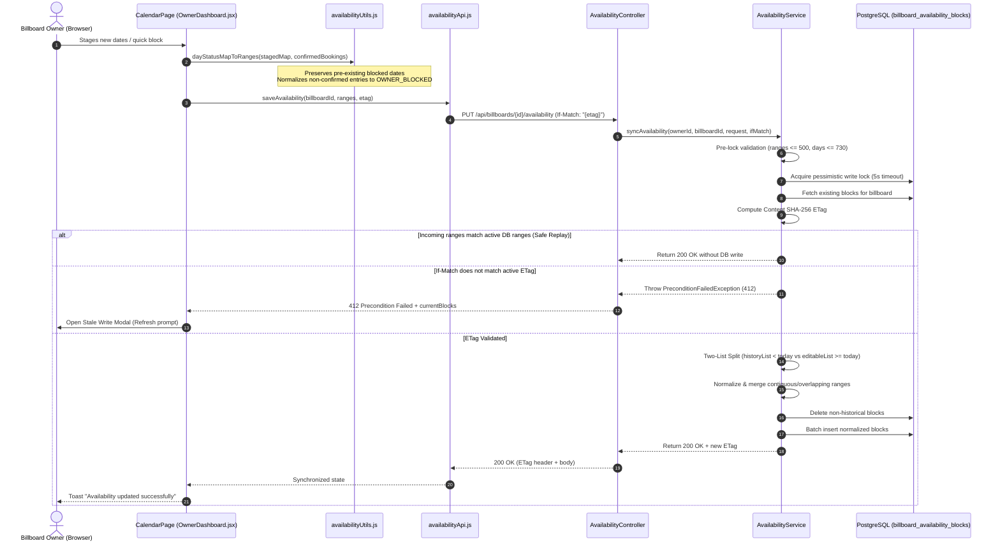
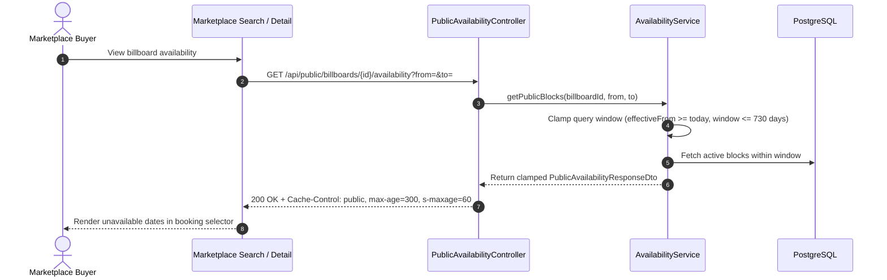
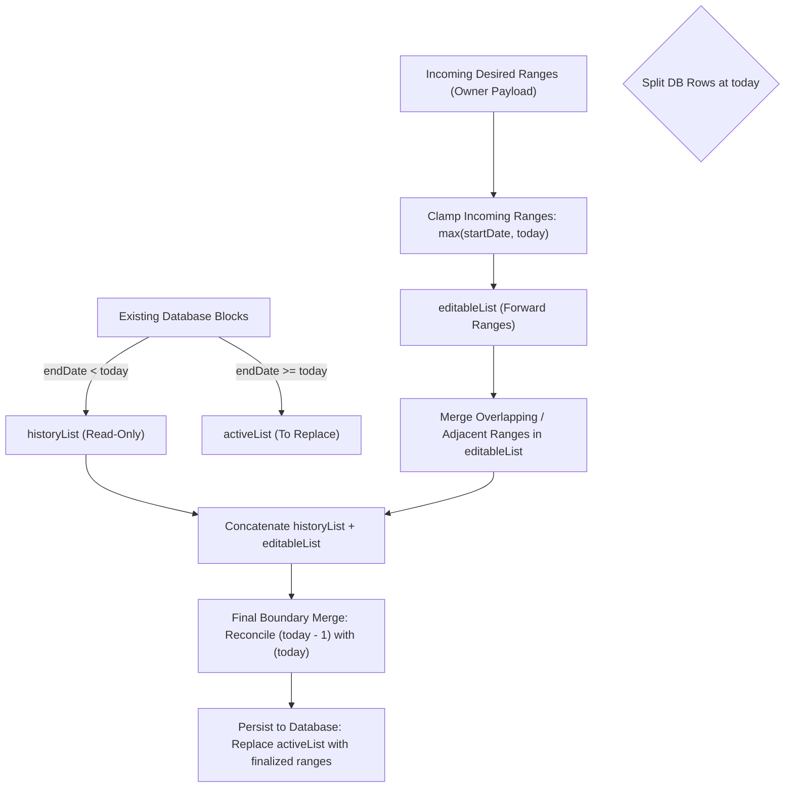

# Technical Document: PR-47 Billboard Availability Calendar & Sync Pipeline

- **PR Link / Ticket:** [PR #47](https://github.com/Advertisement-Market/advertisement/pull/47)
- **Author:** @vedafactor
- **Date:** 2026-11-06
- **Module / Package:** 
  - Backend: `backend/src/main/java/com/theadbasket/backend/availability`, `backend/src/main/java/com/theadbasket/backend/config`, `backend/src/main/resources/db/migration`
  - Frontend: `frontend/src/services`, `frontend/src/pages/OwnerDashboard`

---

## 1. Overview & Business Intent

This pull request implements **Phase 3: Availability Calendar & Sync Pipeline** for **The AdBasket**, establishing an end-to-end cloud-synchronized calendar subsystem for billboard inventory. It replaces static React state in the owner workspace with concurrent, database-backed scheduling while guaranteeing data persistence, multi-user safety, and search performance.

### 1.1 User Personas & Flows
1. **Billboard Owner:**
   - Navigates to the **Calendar** tab within the Owner Dashboard.
   - Views all previously saved blocked dates (e.g., maintenance, personal holds) and confirmed advertiser bookings.
   - Interactively selects dates using two-click range selection (e.g., clicking 20 and then 24 automatically selects all dates between them), click-drag selection, or **Quick Block** presets (Block Today, Next 7 Days, Next 14 Days, Clear Staged).
   - Staged changes are clearly previewed before committing.
   - Clicking **Save Changes** persists blocks to the database using optimistic concurrency (`If-Match: ETag`), without wiping or corrupting existing dates.
   - Concurrency conflicts (`412 Precondition Failed`), database lock contention (`503 Service Unavailable`), or hold overlaps (`409 Conflict`) are handled gracefully via informative dialogs and countdown retry banners.
2. **Advertiser / Marketplace Buyer:**
   - Searches and browses billboard inventory.
   - Queries public availability via `GET /api/public/billboards/{id}/availability` (cached for 300s/60s) to discover unavailable date ranges without exposing internal ownership or reason metadata.
3. **Overview Dashboard Visitor:**
   - Views the summary overview with its embedded `MiniCalendar` completely undisturbed, reading normalized operational schedules.

---

## 2. Technical Architecture & Data Flow

### 2.1 Calendar Synchronization Sequence
The diagram below illustrates the end-to-end synchronization pipeline between the Owner Dashboard UI, the Availability Service, optimistic locking mechanisms, and the PostgreSQL storage layer.



### 2.2 Public Marketplace Availability Flow


### 2.3 The Two-List Sync Engine Algorithm
Availability sync isolates past historical dates from future editable dates to guarantee immutable audit logs while permitting flexible forward scheduling:



---

## 3. Database Schema & Flyway Migration (`V10`)

### 3.1 Migration Definition: `V10__create_billboard_availability_blocks.sql`
The schema uses a dedicated table with scalar foreign keys to prevent cascade anomalies, lazy-loading proxies, or unintentional graph loads:

```sql
CREATE TABLE billboard_availability_blocks (
    id BIGSERIAL PRIMARY KEY,
    billboard_id BIGINT NOT NULL,
    start_date DATE NOT NULL,
    end_date DATE NOT NULL,
    block_type VARCHAR(32) NOT NULL DEFAULT 'MANUAL_BLOCK',
    reason VARCHAR(255),
    created_by BIGINT,
    created_at TIMESTAMPTZ NOT NULL DEFAULT CURRENT_TIMESTAMP,
    updated_at TIMESTAMPTZ NOT NULL DEFAULT CURRENT_TIMESTAMP,

    CONSTRAINT fk_avail_billboard
        FOREIGN KEY (billboard_id)
        REFERENCES billboard_listings(id)
        ON DELETE CASCADE,

    CONSTRAINT fk_avail_created_by
        FOREIGN KEY (created_by)
        REFERENCES users(id)
        ON DELETE SET NULL,

    CONSTRAINT chk_avail_date_order
        CHECK (start_date <= end_date),

    CONSTRAINT chk_avail_block_type
        CHECK (block_type IN ('MAINTENANCE', 'RESERVED', 'MANUAL_BLOCK', 'HOLIDAY', 'OTHER'))
);

CREATE INDEX idx_avail_billboard_dates 
    ON billboard_availability_blocks (billboard_id, start_date, end_date);

CREATE INDEX idx_avail_billboard_active 
    ON billboard_availability_blocks (billboard_id, end_date);
```

### 3.2 Design Rationale & Referential Integrity
1. **Scalar Mappings (`Long billboardId`, `Long createdBy`):**
   - Eliminates `@ManyToOne` entity graph overhead during bulk synchronization.
   - Avoids Hibernate N+1 queries during calendar hydration and query checks.
2. **Referential Integrity & User Deletion Safety:**
   - `billboard_id ON DELETE CASCADE`: Deleting a billboard permanently cascades and purges its availability blocks.
   - `created_by ON DELETE SET NULL`: If an admin or owner account is deleted, the availability block record is preserved to protect scheduling history.
3. **Composite Indexing:**
   - `idx_avail_billboard_dates` provides high-speed range lookups for owner synchronization.
   - `idx_avail_billboard_active` accelerates public marketplace queries filtering `end_date >= CURRENT_DATE`.

---

## 4. Implementation Traps, Invariants & Design Decisions

### Trap 1: Staged Block Loss During Sync & Avoiding Phantom Mock Blocks
- **Problem:** When an owner staged and saved a new blocked range, previously blocked dates were lost, and conversely, merging client-side mock data reintroduced phantom blocks.
- **Root Cause:** 
  1. `dayStatusMapToRanges` originally checked only `dayStatusMap[k] === 'blocked'`. Because pre-existing entries carried the status `'booked'`, they were omitted from the sync payload.
  2. Merging `normalizedFallback` (from `initCalData()`) with the server response injected hardcoded mock dates (e.g. days 3–8, 14–18, 21–22) into real listings on save, preventing owners from ever clearing blocked dates.
- **Solution:** 
  1. Broadened `dayStatusMapToRanges` in `availabilityUtils.js` to collect all non-confirmed dates with either `'blocked'` or `'booked'` status:
  ```javascript
  const isBlocked = status === 'blocked' || status === 'booked';
  if (isBlocked && !confirmedDates.has(dateStr)) {
    // Collect contiguous ranges and normalize to OWNER_BLOCKED
  }
  ```
  2. In `OwnerDashboard.jsx`, the server response is the sole source of truth upon successful fetch (`setDayStatusMap(statusMap)`), preserving `normalizedFallback` strictly in `.catch()` as an offline/error fallback.

### Trap 2: React Hook Cascades & ESLint Warnings
- **Problem:** Synchronous state updates during listing hydration (`setBlockedRanges(...)`) triggered `react-hooks/set-state-in-effect` and caused intermittent disabled state on the "Save Changes" button.
- **Solution:** 
  1. Wrapped `calDataRef.current = calData;` inside a dedicated `useEffect` hook to satisfy `react-hooks/refs`.
  2. Derived listing indices inside the hydration effect rather than pushing synchronous state changes through intermediate effects.

### Trap 3: Optimistic Concurrency & Safe Replay Short-Circuiting
- **Design:** Every sync request requires the client to send the current resource ETag via the HTTP `If-Match` header.
- **Hash Computation:** A SHA-256 hash is deterministically calculated over canonicalized active date ranges:
  $$\text{ETag} = \text{SHA-256}\left(\bigoplus_{i} \text{range}_i\right)$$
- **Safe Replay:** If a client re-submits identical date ranges (e.g. repeated clicks or transient network retries), the engine detects `desiredRanges == existingRanges` and returns `200 OK` immediately without performing redundant writes or failing on stale headers.
- **Stale Write Handling:** If another user or browser session modified the calendar, the backend emits `412 Precondition Failed`. The frontend displays an interactive modal offering an instant re-sync.

### Trap 4: Database Lock Timeout Under Contention
- **Problem:** Simultaneous writes to the same billboard availability schedule could deadlock or hang request threads.
- **Solution:** Pessimistic write lock with an explicit 5000ms timeout hint:
  ```java
  @Lock(LockModeType.PESSIMISTIC_WRITE)
  @QueryHints({@QueryHint(name = "jakarta.persistence.lock.timeout", value = "5000")})
  ```
  If contested beyond 5 seconds, `AvailabilityBusyException` triggers an HTTP `503 Service Unavailable` response with `Retry-After: 5`. The UI captures this header and displays a live countdown banner before enabling auto-retry.

### Trap 5: Overview `MiniCalendar` Isolation
- **Constraint:** The small `MiniCalendar` component on the Overview dashboard tab must remain undisturbed.
- **Implementation:** The `MiniCalendar` continues to read directly from the top-level `calData` state. When the Availability Calendar saves changes, it updates the remote server and retroactively synchronizes `calData`, keeping both calendars aligned without modifying the `MiniCalendar` component.

### Trap 6: Timezone Invariance
- **Problem:** Date boundary calculations rolling over at midnight UTC could inadvertently drop or shift dates for Indian billboards.
- **Solution:** Configured `DateTimeConfig` with `@Bean Clock clock() { return Clock.system(ZoneId.of("Asia/Kolkata")); }`. Server responses return authoritative `today: "YYYY-MM-DD"` so clients render disabled past dates consistently regardless of local browser timezone.

### Trap 7: N+1 Overlapping Queries Under Row Lock
- **Problem:** When validating editable ranges against active booking holds and confirmed bookings, querying `findActiveOverlapping` per range inside a loop while holding the billboard row lock produced N+1 database queries under load.
- **Solution:** Replaced per-range queries with a single query across the overall bounding span `[mergedEditable.get(0).startDate(), mergedEditable.get(mergedEditable.size() - 1).endDate()]` and evaluated interval overlaps in-memory, minimizing lock retention time.

### Trap 8: Forward Scheduling Horizon vs. Single Block Duration Cap
- **Problem:** Availability sync previously checked `ChronoUnit.DAYS.between(range.startDate(), range.endDate()) + 1 > 730`, which only measured the duration of an individual contiguous block. An owner could schedule blocks years into the future (e.g. 5–10 years ahead), passing validation but rendering them unreachable via public query windows (which clamp to 730 days).
- **Solution:** Added a horizon check `ChronoUnit.DAYS.between(today, range.endDate()) > 730` alongside the duration check, strictly constraining all forward blocks to within 730 days from today.

---

## 5. API Specifications & Contracts

### 5.1 Owner Availability Endpoints

#### `GET /api/billboards/{id}/availability`
- **Auth:** Requires JWT with `OWNER` or `ADMIN` role. Caller must own the billboard.
- **Response Headers:** `ETag: "w/\"<sha256-hash>\""`
- **Response `200 OK`:**
  ```json
  {
    "billboardId": 42,
    "today": "2026-11-06",
    "etag": "w/\"a1b2c3d4...\"",
    "blocks": [
      {
        "id": 101,
        "startDate": "2026-11-10",
        "endDate": "2026-11-15",
        "blockType": "MANUAL_BLOCK",
        "reason": "Maintenance",
        "createdAt": "2026-11-06T10:00:00Z"
      }
    ]
  }
  ```

#### `PUT /api/billboards/{id}/availability`
- **Auth:** Requires JWT with `OWNER` or `ADMIN` role.
- **Request Headers:**
  ```http
  If-Match: "w/\"a1b2c3d4...\""
  Content-Type: application/json
  ```
- **Request Body:**
  ```json
  {
    "ranges": [
      {
        "startDate": "2026-11-10",
        "endDate": "2026-11-15",
        "blockType": "MANUAL_BLOCK",
        "reason": "Maintenance"
      }
    ]
  }
  ```
- **Response `200 OK`:** Returns updated blocks and new `ETag` header.

### 5.2 Public Availability Endpoint

#### `GET /api/public/billboards/{id}/availability`
- **Auth:** Public (`PermitAll`).
- **Query Parameters:** `from` (optional), `to` (optional).
- **Response Headers:** `Cache-Control: public, max-age=300, s-maxage=60`
- **Response `200 OK`:**
  ```json
  {
    "billboardId": 42,
    "effectiveFrom": "2026-11-06",
    "effectiveTo": "2028-11-05",
    "blocks": [
      {
        "startDate": "2026-11-10",
        "endDate": "2026-11-15"
      }
    ]
  }
  ```

### 5.3 Error Envelopes

| HTTP Status | Error Code | Scenario | Header |
| :--- | :--- | :--- | :--- |
| `400 Bad Request` | `VALIDATION_FAILED` | More than 500 ranges, startDate > endDate, or range > 730 days | — |
| `401 Unauthorized` | `AUTHENTICATION_REQUIRED` | Missing or invalid JWT | — |
| `403 Forbidden` | `ACCESS_DENIED` | Caller does not own the billboard | — |
| `404 Not Found` | `BILLBOARD_NOT_FOUND` | Billboard ID does not exist | — |
| `409 Conflict` | `AVAILABILITY_HOLD_CONFLICT` | Block range conflicts with an active booking hold | — |
| `412 Precondition Failed` | `AVAILABILITY_STALE_WRITE` | `If-Match` ETag does not match active DB state | — |
| `503 Service Unavailable` | `AVAILABILITY_LOCK_TIMEOUT` | Row lock acquisition timed out (> 5000ms) | `Retry-After: 5` |

---

## 6. Frontend Architecture & Component Updates

### 6.1 Service & Utilities
- **`availabilityApi.js` (`frontend/src/services/`):**
  - Encapsulates Axios requests for fetching and saving availability.
  - Normalizes `ETag` string quotes and injects `If-Match: "{etag}"`.
- **`availabilityUtils.js` (`frontend/src/pages/OwnerDashboard/`):**
  - Timezone-safe string date arithmetic (`addDays`, `diffDays`, `todayStr`).
  - `blocksToDayStatusMap`: Unrolls range objects into discrete `YYYY-MM-DD -> status` mappings.
  - `dayStatusMapToRanges`: Aggregates contiguous dates, protecting both staged and pre-existing blocks while excluding confirmed bookings.
  - `extractRetryAfterSeconds`: Parses retry timeouts from Axios 503 error responses.

### 6.2 UI State & Resilience in `OwnerDashboard.jsx`
- **Interactive Calendar Grid:**
  - Visual differentiation:
    - **Confirmed Bookings:** Rose badge (`var(--rose)`).
    - **Blocked Dates:** Amber badge (`#b45309`).
    - **Staged Edits:** Dashed interactive preview.
  - **Two-Click & Drag Range Selection:**
    - Supports selecting a start and end date with two sequential clicks (automatically selecting all dates in between) or by click-and-dragging across cells.
- **Booking Rules Integration (`BookingRulesCard`):**
  - Replaces static mockup in the Calendar tab with an active, keyed subcomponent (`key={activeListingId}`).
  - Provides custom number input (`minBookingValue`) and unit dropdown (`minBookingUnit`: `DAYS`, `WEEKS`, `MONTHS`), exactly matching the layout and schema in `NewBillboardListing` and `OwnerRegister`.
  - Persists changes directly to the database via `PATCH /api/owner/listings/{id}` (`ownerListingApi.updateListing`).
  - Synchronizes updated duration values back to the parent `listings` state via `onListingUpdated`, preventing input fields from reverting when switching between billboards in the dropdown.
  - Leaves Advance Notice as a standard, read-only 7-day default notice badge.
- **Resilience Banners & Modals:**
  - **412 Conflict Modal:** Displays when another session modified the schedule; provides a 1-click refresh button.
  - **503 Lock Banner:** Renders a live countdown timer (`Retry in X seconds...`).
  - **409 Conflict Banner:** Alerts the owner if a proposed block conflicts with an active booking hold.

---

## 7. Automated Test Suite & Verification

### 7.1 Backend Test Coverage (64 Tests Passed)
- **Unit Tests: `AvailabilityServiceTest.java` (35 tests):**
  - Past history preservation across midnight boundaries.
  - Adjacent and overlapping range coalescing.
  - Single bounding span query preventing N+1 queries across multiple editable ranges.
  - Maximum payload size enforcement (500 ranges).
  - Maximum scheduling window and forward horizon enforcement (730 days).
  - Rejection of ranges exceeding 730 days duration or forward horizon beyond 730 days from today.
  - SHA-256 ETag deterministic calculation and replay short-circuiting.
  - Optimistic locking (`PreconditionFailedException` on mismatch).
  - Public block clamping to `today`.
- **Integration Tests: `AvailabilityIntegrationTest.java` (29 tests):**
  - End-to-end HTTP endpoints via `MockMvc`.
  - Spring Security role checks (`OWNER` required, foreign owner rejected with 403).
  - Public availability caching headers (`Cache-Control`).
  - Multi-tenant listing isolation.
- **Postgres Row Lock Timeout Test: `PostgresLockTimeoutIT.java`:**
  - Verified concurrent transaction contention triggers `503 Service Unavailable` with `Retry-After: 5`.

### 7.2 Frontend Test Coverage (163 Tests Passed)
- **Unit Tests: `availabilityUtils.test.js` (11 tests):**
  - Contiguous day range expansion and aggregation.
  - Non-confirmed `'booked'` date preservation.
  - Cross-month and leap-year date math.
  - `Retry-After` header extraction.
- **Integration Tests: `CalendarPage.test.jsx` (10 tests):**
  - Initial calendar load and block hydration.
  - Loading state (`isLoading`) and "Refreshing..." indicator validation with disabled Save button during fetch.
  - Two-click range selection (e.g. clicking 20 and 24 selects and stages 20–24 inclusive).
  - Multi-cell drag selection preservation across `mouseup` and trailing browser `click` event.
  - Cell click and range staging.
  - Dirty state indicator and Save button enablement.
  - Successful save lifecycle.
  - 412 Precondition Failed modal display and refresh flow.
  - Minimum booking duration rule update via `ownerListingApi.updateListing`.

---

## 8. Rollback & Disaster Recovery Strategy

1. **Database Rollback:**
   - In the event of an emergency, execute:
     ```sql
     DROP TABLE IF EXISTS billboard_availability_blocks CASCADE;
     DELETE FROM flyway_schema_history WHERE version = '10';
     ```
2. **Frontend Fallback:**
   - The frontend gracefully falls back to local dummy availability state (`calData`) if backend availability endpoints return network errors, ensuring billboard owners can continue accessing other dashboard functions unimpeded.

