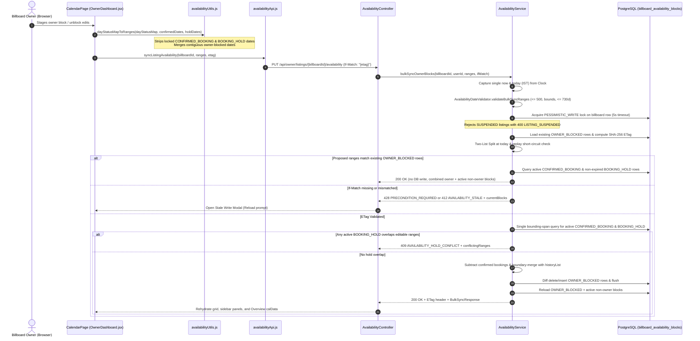
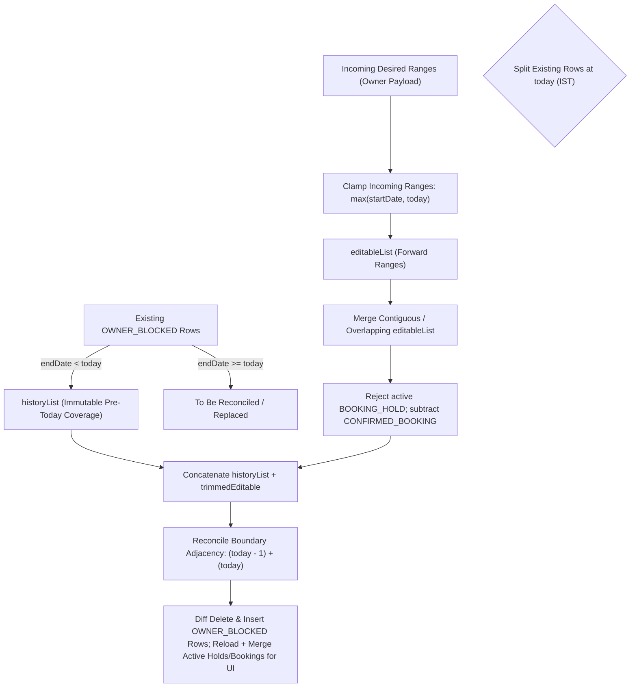

# Technical Document: PR-47 Billboard Availability Calendar & Sync Pipeline

- **PR Link / Ticket:** [PR #47](https://github.com/Advertisement-Market/advertisement/pull/47)
- **Author:** @vedafactor
- **Date:** 2026-11-09
- **Module / Package:**
  - Backend: `backend/src/main/java/com/theadbasket/backend/availability`, `backend/src/main/java/com/theadbasket/backend/config`, `backend/src/main/java/com/theadbasket/backend/owner`, `backend/src/main/java/com/theadbasket/backend/registration`, `backend/src/main/java/com/theadbasket/backend/common/web`, `backend/src/main/resources/db/migration`
  - Frontend: `frontend/src/features/availability`, `frontend/src/features/auth`, `frontend/src/pages/OwnerDashboard`, `frontend/src/pages/OwnerRegister`, `frontend/src/pages/NewBillboardListing`, `frontend/nginx.conf`

---

## 1. Overview & Business Intent

This pull request implements **Billboard Availability Calendar, Initial Block Persistence, & Sync Pipeline** for **The AdBasket**, establishing an end-to-end cloud-synchronized scheduling subsystem for billboard inventory across owner onboarding, listing creation/editing, the Owner Dashboard, and public marketplace queries. It replaces static mock state with PostgreSQL-backed scheduling, optimistic concurrency control, row-level serialization, and automated cleanup of expired booking holds.

### 1.1 User Personas & Flows

1. **Billboard Owner (Onboarding & Listing Creation / Edit):**
   - During initial registration (`OwnerRegister` Step 4) or adding/editing a billboard (`NewBillboardListing` Step 2), uses the unified `AvailabilityCalendar` component to mark initial unavailable dates.
   - `registrationMappers.js` merges contiguous blocked dates into `blockedRanges`, which `OwnerRegistrationService` and `OwnerListingService` persist via `AvailabilityService.createInitialOwnerBlocks` in the same transaction as listing creation.
   - In edit mode, `EditAvailabilityHydrator` preloads existing server blocks (locking confirmed bookings and active checkout holds), captures the ETag and server `today`, and syncs modified blocked dates via `PUT /api/owner/listings/{billboardId}/availability` on save.
2. **Billboard Owner (Dashboard & Availability Calendar Tab):**
   - Views `OWNER_BLOCKED` blocks alongside active/upcoming `CONFIRMED_BOOKING` and non-expired `BOOKING_HOLD` intervals (`expiryTs > now`), plus clickable sidebar jump chips for owner-blocked ranges.
   - Confirmed bookings and active checkout holds are strictly locked in the UI and excluded from outgoing sync payloads.
   - Interactively selects dates via two-click range selection, click-and-drag selection, or the Quick Block by Date Range card.
   - Clicking **Save Changes** persists blocks via `PUT /api/owner/listings/{billboardId}/availability` with optimistic concurrency (`If-Match: "<sha256>"`).
   - Concurrency conflicts (`412 Precondition Failed`), database lock contention (`503 Service Unavailable`), and active hold overlaps (`409 Conflict`) trigger recovery modals, countdown retry banners, and inline conflict warnings.
3. **Advertiser / Marketplace Buyer:**
   - Queries public availability via `GET /api/listings/{billboardId}/availability?from=&to=` (cached with `Cache-Control: public, max-age=15, stale-while-revalidate=30` and rate-limited at nginx ingress) without exposing internal block types, historical dates prior to `today`, or non-active listings.
4. **Overview Dashboard Visitor:**
   - Views the embedded `MiniCalendar` on the Overview tab hydrated asynchronously from the primary listing's real availability (`GET /api/owner/listings/{id}/availability`) rather than hardcoded fixture dates.

---

## 2. Technical Architecture & Data Flow

### 2.1 Owner Calendar Synchronization Sequence



### 2.2 Public Marketplace Availability Flow

```mermaid
sequenceDiagram
    autonumber
    actor Buyer as Marketplace Buyer
    participant UI as Marketplace View
    participant Nginx as nginx (/api/listings/*/availability)
    participant Controller as PublicAvailabilityController
    participant Service as AvailabilityService
    participant DB as PostgreSQL

    Buyer->>UI: View billboard availability
    UI->>Nginx: GET /api/listings/{billboardId}/availability?from=&to=
    Nginx->>Controller: Proxy after limit_req (60r/m, burst=30 nodelay)
    Controller->>Service: getPublicBlocks(billboardId, from, to)
    Service->>Service: AvailabilityDateValidator.validatePublicWindow(from, to)
    Service->>DB: Check existsByIdAndStatus(billboardId, ACTIVE)
    alt Listing missing or not ACTIVE
        Service-->>Controller: Throw ListingNotActiveException
        Controller-->>UI: 404 LISTING_NOT_ACTIVE (Cache-Control: public, max-age=60)
    else Listing is ACTIVE
        Service->>Service: Capture single now & today (IST); short-circuit [] if to < today
        Service->>Service: Clamp [effectiveFrom, effectiveTo] to [today, today+365] (max 730d)
        Service->>DB: findPublicActiveBlocks (all active block types within window)
        Service->>Service: Merge overlapping/adjacent blocks & clip to window
        Service-->>Controller: Return PublicAvailabilityDto list
        Controller-->>UI: 200 OK (Cache-Control: public, max-age=15, stale-while-revalidate=30)
    end
```

### 2.3 The Two-List Sync Engine Algorithm

Availability sync isolates historical blocks before `today` from editable forward dates (`>= today`) to preserve audit history while allowing flexible forward edits:



### 2.4 Onboarding, Edit Hydration & Hold Cleanup Pipelines

- **Initial Block Persistence:** During `POST /api/auth/register/owner` and `POST /api/owner/listings`, `OwnerRegistrationService` and `OwnerListingService` invoke `AvailabilityService.createInitialOwnerBlocks(listingId, userId, req.blockedRanges())` inside the same database transaction so initial owner blocks from the wizard are immediately queryable on first dashboard load.
- **Edit Wizard Hydration:** `NewBillboardListing.jsx` embeds `EditAvailabilityHydrator` to fetch existing availability and ETag once in edit mode, populates `f_blockedDates`, `f_lockedBookedDates`, `f_lockedHoldDates`, and `f_availabilityServerToday`, and persists edits on submit when `f_availabilityDirty` is set.
- **Expired Hold Hygiene:** `AvailabilityHoldCleanupJob` (enabled via `SchedulingConfig` and `app.scheduling.enabled=true`, disabled in `application-test.yml`) runs every `app.availability.hold-cleanup-interval-ms` (default `300000` ms) to execute `deleteExpiredHolds(BOOKING_HOLD, now)` where `expiryTs <= now`.

---

## 3. Database Schema & Flyway Migration (`V10`)

### 3.1 Consolidated Migration Definition: `V10__create_billboard_availability_blocks.sql`

```sql
CREATE TABLE billboard_availability_blocks (
    id              BIGINT GENERATED BY DEFAULT AS IDENTITY PRIMARY KEY,
    billboard_id    BIGINT                   NOT NULL,
    start_date      DATE                     NOT NULL,
    end_date        DATE                     NOT NULL,
    block_type      VARCHAR(30)              NOT NULL DEFAULT 'OWNER_BLOCKED',
    booking_ref_id  BIGINT,
    expiry_ts       TIMESTAMP WITH TIME ZONE,
    created_by      BIGINT,
    created_ts      TIMESTAMP WITH TIME ZONE NOT NULL DEFAULT CURRENT_TIMESTAMP,
    updated_ts      TIMESTAMP WITH TIME ZONE NOT NULL DEFAULT CURRENT_TIMESTAMP,
    CONSTRAINT chk_avail_date_order  CHECK (end_date >= start_date),
    CONSTRAINT chk_avail_block_type  CHECK (CASE block_type WHEN 'OWNER_BLOCKED' THEN 1 WHEN 'CONFIRMED_BOOKING' THEN 1 WHEN 'BOOKING_HOLD' THEN 1 ELSE 0 END = 1),
    CONSTRAINT chk_avail_hold_expiry CHECK (block_type <> 'BOOKING_HOLD' OR expiry_ts IS NOT NULL),
    CONSTRAINT fk_avail_billboard    FOREIGN KEY (billboard_id) REFERENCES billboard_listings(id) ON DELETE CASCADE,
    CONSTRAINT fk_avail_created_by   FOREIGN KEY (created_by) REFERENCES users(id) ON DELETE SET NULL
);

CREATE INDEX idx_avail_billboard_dates    ON billboard_availability_blocks (billboard_id, start_date, end_date);
CREATE INDEX idx_avail_billboard_type     ON billboard_availability_blocks (billboard_id, block_type);
CREATE INDEX idx_avail_billboard_end_date ON billboard_availability_blocks (billboard_id, end_date);
CREATE INDEX idx_avail_expiry             ON billboard_availability_blocks (expiry_ts);
```

### 3.2 Design Rationale & Referential Integrity

1. **Scalar Mappings (`Long billboardId`, `Long createdBy`, `Long bookingRefId`):**
   - Eliminates `@ManyToOne` proxy overhead and N+1 queries during bulk synchronization.
2. **Database Check Constraints & Hold Integrity:**
   - `chk_avail_date_order`: Guarantees `end_date >= start_date`.
   - `chk_avail_block_type`: Restricts blocks to `OWNER_BLOCKED`, `CONFIRMED_BOOKING`, or `BOOKING_HOLD`.
   - `chk_avail_hold_expiry`: Enforces non-null `expiry_ts` for every `BOOKING_HOLD` row at the schema level.
3. **Referential Integrity & User Deletion Safety:**
   - `billboard_id ON DELETE CASCADE`: Deleting a billboard cascades to purge all availability blocks.
   - `created_by ON DELETE SET NULL`: Deleting a user account preserves scheduling/booking block history.
4. **Composite Indexing:**
   - `idx_avail_billboard_dates`, `idx_avail_billboard_type`, `idx_avail_billboard_end_date`, and `idx_avail_expiry` accelerate owner syncs, public window lookups, and scheduled hold cleanup (`DELETE ... WHERE block_type = 'BOOKING_HOLD' AND expiry_ts <= :now`).
5. **Concurrency & Storage Integrity (Row Lock vs. GiST Exclusion):**
   - Concurrency is serialized on the parent listing row (`findByIdAndUserIdForUpdate` with `PESSIMISTIC_WRITE` and 5000ms lock timeout).
   - A blanket PostgreSQL `EXCLUDE USING gist` constraint was intentionally omitted from `V10` because H2's PostgreSQL mode test dialect lacks `btree_gist` support and temporary unpurged expired `BOOKING_HOLD` rows would otherwise block writes prior to `AvailabilityHoldCleanupJob` execution. Deployments with `btree_gist` pre-installed may optionally add a partial exclusion constraint scoped to `WHERE (block_type IN ('OWNER_BLOCKED', 'CONFIRMED_BOOKING'))` as documented directly inside `V10`.

---

## 4. Implementation Traps, Invariants & Design Decisions

### Trap 1: Phantom Mock Blocks & Protected Dates During Sync
- **Problem:** Merging hardcoded `initCalData()` fixtures caused flash-of-red phantom bookings on load and reintroduced fake dates when saving, while confirmed bookings or checkout holds needed strict protection from owner sync mutations.
- **Solution:**
  1. `OwnerDashboard` initializes `calData` to `{}` for authenticated users (`user ? {} : import.meta.env.DEV ? initCalData() : {}`), eliminating spurious red flashes while waiting for `getListingAvailability`.
  2. `blocksToDayStatusMap` enforces status precedence (`booked > hold > blocked`), caps corrupt spans (`MAX_BLOCK_EXPAND_DAYS = 3650`), and tracks `confirmedDates` and `holdDates`.
  3. `dayStatusMapToRanges` in `availabilityUtils.js` strips both `confirmedDates` and `holdDates` before serializing owner ranges for `PUT`.

### Trap 2: Listing Switching Races & Stale Retry Timers
- **Problem:** Switching listings while an availability fetch or a `503` auto-retry countdown timer was active could leak stale timers or leave interactive buttons enabled mid-fetch.
- **Solution:** `CalendarPage` derives `isLoading` from `Boolean(activeListingId) && loadedListingId !== activeListingId`, resets transient state synchronously on listing switch, and clears `retryTimerRef.current` on switch, response, manual retry, and unmount.

### Trap 3: Optimistic Concurrency & Safe Replay Short-Circuiting
- **Design:** A deterministic SHA-256 hash (`ETag: "<sha256-hex>"`) is computed solely from canonicalized `OWNER_BLOCKED` ranges so transient advertiser holds or confirmed bookings do not invalidate an owner's ETag unnecessarily.
- **Safe Replay:** If proposed owner ranges exactly match existing `OWNER_BLOCKED` ranges, the service returns `200 OK` (with current combined blocks and warnings) without unnecessary writes or spurious `412` failures on idempotent retries.
- **Stale Write Handling:** Mismatched or missing `If-Match` headers emit `412 AVAILABILITY_STALE` (with current blocks so the modal can reload state cleanly) or `428 PRECONDITION_REQUIRED`.

### Trap 4: Database Lock Timeout Under Contention
- **Problem:** Simultaneous writes to the same billboard schedule could deadlock or stall servlet threads.
- **Solution:** `findByIdAndUserIdForUpdate` acquires a `PESSIMISTIC_WRITE` lock with `jakarta.persistence.lock.timeout = 5000`. Lock acquisition failures throw `AvailabilityBusyException` (`503 SERVICE_UNAVAILABLE`, `Retry-After: 5`), handled by the UI countdown banner (and clamped in `extractRetryAfterSeconds` up to `MAX_RETRY_AFTER_SECONDS = 60`).

### Trap 5: Overview `MiniCalendar` Live Hydration
- **Constraint:** The Overview `MiniCalendar` component reads `calData[0]` without separate network wiring inside the widget.
- **Implementation:** `OwnerDashboard` hydrates `calData[0]` via `availabilityApi.getListingAvailability(primaryListingId)` on the Overview tab (`hydratedOverviewListingRef`) and updates `calData[listingIndex]` on every `CalendarPage` fetch/save, keeping Overview and Calendar views consistent with real backend state.

### Trap 6: Request-Scoped Clock & Timezone Invariance
- **Problem:** Capturing `LocalDate.now()` repeatedly across pre-lock and post-lock phases can skew around midnight boundaries or differ from client browser timezones.
- **Solution:** `DateTimeConfig` injects `Clock.system(ZoneId.of("Asia/Kolkata"))`. Both `getOwnerBlocks`, `getPublicBlocks`, `createInitialOwnerBlocks`, and `bulkSyncOwnerBlocks` capture `Instant now = clock.instant()` and `LocalDate today = now.atZone(IST_ZONE).toLocalDate()` once per request and return authoritative `today` in owner responses.

### Trap 7: N+1 Overlapping Queries Under Row Lock
- **Problem:** Querying overlapping bookings/holds in a loop per range while holding a row lock increased lock hold duration.
- **Solution:** `bulkSyncOwnerBlocks` executes a single bounding-span query `findActiveOverlapping(billboardId, minStart, maxEnd, now)` and evaluates overlaps in memory.

### Trap 8: Forward Scheduling Horizon vs. Single Block Duration Cap
- **Problem:** Checking only range length (`end - start + 1 <= 730`) allowed owners to create blocks years into the future outside public query reachability.
- **Solution:** `AvailabilityDateValidator` and `AvailabilityCalendar` enforce both block length (`<= 730` days) and forward horizon from `today` (`<= 730` days).

### Trap 9: Fail-Fast `If-Match` Validation Before Blocker Queries
- **Problem:** Validating `If-Match` after hold checks caused stale tabs to see `409 Conflict` instead of `412 Precondition Failed`.
- **Solution:** Pipeline checks safe replay first, then `If-Match`, then active `BOOKING_HOLD` / `CONFIRMED_BOOKING` blockers.

### Trap 10: Public Visibility Ordering & Suspended Listing Guard
- **Problem:** Checking `to < today` before listing visibility allowed draft, suspended, or nonexistent billboards to return cacheable `200 []` for past windows (creating an existence oracle and stale cache entries).
- **Solution:** `getPublicBlocks` calls `isPubliclyVisible(billboardId)` *before* `to < today`, so missing, `DRAFT`, `PENDING_APPROVAL`, `REJECTED`, and `SUSPENDED` billboards uniformly return `404 LISTING_NOT_ACTIVE`. Additionally, `bulkSyncOwnerBlocks` rejects edits to `SUSPENDED` listings with `400 LISTING_SUSPENDED`.

### Trap 11: Security & HTTP Surface Hardening
- **Security Config:** Public access for `/api/lov/**`, `/api/media/**`, and `/api/listings/*/availability` is scoped strictly via `.requestMatchers(HttpMethod.GET, PUBLIC_GET_PATHS).permitAll()`, leaving non-`GET` methods authenticated.
- **Exception Handling & Log Sanitization:** `GlobalExceptionHandler` handles `HandlerMethodValidationException`, `HttpMessageNotReadableException`, `MethodArgumentTypeMismatchException`, `MissingServletRequestParameterException`, `HttpRequestMethodNotSupportedException` (`Allow` header + `405 METHOD_NOT_ALLOWED`), `HttpMediaTypeNotSupportedException` (`415 UNSUPPORTED_CONTENT_TYPE`), `HttpMediaTypeNotAcceptableException` (`406 NOT_ACCEPTABLE`), `MaxUploadSizeExceededException` (`413 FILE_TOO_LARGE`), and `NoResourceFoundException` (`404 RESOURCE_NOT_FOUND`), sanitizing CRLF/tabs in log parameters (`sanitizeForLog`) so invalid HTTP requests never fall through to `500 INTERNAL_ERROR`.
- **Edge Rate Limiting:** `frontend/nginx.conf` defines `limit_req_zone $binary_remote_addr zone=availability_public:10m rate=60r/m;` and applies `limit_req zone=availability_public burst=30 nodelay; limit_req_status 429;` on `^/api/listings/[^/]+/availability$`.

### Trap 12: Centralized Bounds Validation (`AvailabilityDateValidator`)
- **Solution:** Extracted `AvailabilityDateValidator` with shared constants (`MAX_RANGE_DAYS = 730`, `DEFAULT_PUBLIC_WINDOW_DAYS = 365`, `MAX_BULK_RANGES = 500`, `MIN_SUPPORTED_DATE = 1970-01-01`, `MAX_SUPPORTED_DATE = 9999-12-31`), reused across `BulkSyncRequest`, `BillboardListingCreateRequest`, `BillboardListingRequest`, `AvailabilityService`, and tests, returning `AVAILABILITY_DATE_OUT_OF_BOUNDS` consistently for dates outside `[1970-01-01, 9999-12-31]`.

---

## 5. API Specifications & Contracts

### 5.1 Owner Availability Endpoints

#### `GET /api/owner/listings/{billboardId}/availability`
- **Auth:** Requires authenticated `OWNER` account owning `{billboardId}`.
- **Response Headers:** `ETag: "<sha256-hex>"`
- **Response `200 OK`:**
  ```json
  {
    "blocks": [
      {
        "id": 101,
        "startDate": "2026-11-10",
        "endDate": "2026-11-15",
        "blockType": "OWNER_BLOCKED",
        "expiryTs": null
      },
      {
        "id": 102,
        "startDate": "2026-11-20",
        "endDate": "2026-11-22",
        "blockType": "CONFIRMED_BOOKING",
        "expiryTs": null
      },
      {
        "id": 103,
        "startDate": "2026-11-25",
        "endDate": "2026-11-25",
        "blockType": "BOOKING_HOLD",
        "expiryTs": "2026-11-09T15:10:00Z"
      }
    ],
    "etag": "a1b2c3d4...",
    "today": "2026-11-09"
  }
  ```

#### `PUT /api/owner/listings/{billboardId}/availability`
- **Auth:** Requires authenticated `OWNER` account owning `{billboardId}`.
- **Request Headers:** `If-Match: "<sha256-hex>"`, `Content-Type: application/json`
- **Request Body (`BulkSyncRequest`):**
  ```json
  {
    "ranges": [
      {
        "startDate": "2026-11-10",
        "endDate": "2026-11-15"
      }
    ]
  }
  ```
- **Response `200 OK` (`BulkSyncResponse`):** Includes updated `blocks` (combined `OWNER_BLOCKED` + active bookings/holds), `warnings`, `etag` (plus `ETag` response header), and authoritative `today`.

#### Initial Blocked Ranges on Onboarding & Listing Creation
- Both `POST /api/auth/register/owner` (`billboard.blockedRanges`) and `POST /api/owner/listings` (`blockedRanges`) accept optional `List<AvailabilityRangeRequest>` validated with `@Size(max = 500)` and persisted as initial `OWNER_BLOCKED` rows on creation.

### 5.2 Public Availability Endpoint

#### `GET /api/listings/{billboardId}/availability`
- **Auth:** Public (`HttpMethod.GET` via `PUBLIC_GET_PATHS`).
- **Query Parameters:** `from` (optional ISO `YYYY-MM-DD`), `to` (optional ISO `YYYY-MM-DD`).
- **Response Headers:**
  - `200 OK`: `Cache-Control: public, max-age=15, stale-while-revalidate=30`
  - `404 Not Found` (`LISTING_NOT_ACTIVE`): `Cache-Control: public, max-age=60`
- **Response `200 OK` (`List<PublicAvailabilityDto>`):**
  ```json
  [
    {
      "startDate": "2026-11-10",
      "endDate": "2026-11-15"
    }
  ]
  ```

### 5.3 Error Envelopes

| HTTP Status | Error Code | Scenario | Header |
| :--- | :--- | :--- | :--- |
| `400 Bad Request` | `VALIDATION_FAILED` / `AVAILABILITY_DATE_OUT_OF_BOUNDS` / `AVAILABILITY_DATE_ORDER_INVALID` / `AVAILABILITY_RANGE_TOO_LONG` / `AVAILABILITY_PAYLOAD_TOO_LARGE` / `AVAILABILITY_WINDOW_INVALID` / `AVAILABILITY_WINDOW_TOO_LARGE` / `LISTING_SUSPENDED` | Invalid payload, out-of-bounds date (`< 1970-01-01` or `> 9999-12-31`), `start > end`, span or horizon `> 730` days, `> 500` ranges, or listing `SUSPENDED` | — |
| `401 Unauthorized` | `AUTHENTICATION_REQUIRED` | Missing or invalid JWT on protected routes | — |
| `404 Not Found` | `BILLBOARD_NOT_FOUND` / `LISTING_NOT_ACTIVE` / `RESOURCE_NOT_FOUND` | Billboard not found / unowned, public listing not `ACTIVE`, or unknown endpoint | `Cache-Control: public, max-age=60` on `LISTING_NOT_ACTIVE` |
| `405 Method Not Allowed` | `METHOD_NOT_ALLOWED` | Unsupported HTTP verb on matched controller | `Allow` |
| `406 Not Acceptable` | `NOT_ACCEPTABLE` | Unacceptable `Accept` media type | — |
| `409 Conflict` | `AVAILABILITY_HOLD_CONFLICT` | Proposed block overlaps active `BOOKING_HOLD` (`conflictingRanges` returned) | — |
| `412 Precondition Failed` | `AVAILABILITY_STALE` | `If-Match` does not match current ETag (`currentBlocks`, `etag`, `today` returned) | `ETag` |
| `413 Content Too Large` | `FILE_TOO_LARGE` | Multipart upload exceeds server limit | — |
| `415 Unsupported Media Type` | `UNSUPPORTED_CONTENT_TYPE` | Non-JSON or unsupported request content type | — |
| `428 Precondition Required` | `PRECONDITION_REQUIRED` | Missing `If-Match` header on `PUT` | — |
| `429 Too Many Requests` | `nginx limit_req` | Public availability polling burst exceeds nginx limit | — |
| `503 Service Unavailable` | `AVAILABILITY_BUSY` | Listing row lock acquisition timed out (`> 5000ms`) | `Retry-After: 5` |

---

## 6. Frontend Architecture & Component Updates

### 6.1 Feature Modules & Mappers
- **`frontend/src/features/availability/availabilityApi.js`:**
  - Encapsulates Axios calls for owner GET/PUT (`/api/owner/listings/{id}/availability`) and public GET (`/api/listings/{id}/availability`), normalizing strong/weak ETag quoting for `If-Match`.
- **`frontend/src/features/availability/availabilityUtils.js`:**
  - Pure `YYYY-MM-DD` date arithmetic (`isValidDateKey`, `formatDateKey`, `parseDateParts`, `addDays`, `isBefore`, `daysBetweenInclusive`).
  - `blocksToDayStatusMap`: Expands blocks cleanly with precedence `booked > hold > blocked` and span safety limit (`3650` days).
  - `dayStatusMapToRanges`: Merges contiguous blocked days into `[{ startDate, endDate }]` while stripping `confirmedDates` and `holdDates`.
  - `extractRetryAfterSeconds`: Parses strictly numeric `Retry-After` headers and clamps to `MAX_RETRY_AFTER_SECONDS = 60`.
- **`frontend/src/features/auth/registrationMappers.js`:**
  - `extractBlockedRanges` serializes `f_blockedDates` from `RegisterContext` into contiguous `blockedRanges` for both `mapOwner` (registration) and `mapBillboardListing` (create listing).

### 6.2 Onboarding, Listing Wizard & Dashboard Components
- **`OwnerRegister/calendar.jsx` (`AvailabilityCalendar`):**
  - Integrates with `RegisterContext` (`f_blockedDates`, `f_availabilityDirty`, `f_availabilityServerToday`, `f_lockedBookedDates`, `f_lockedHoldDates`).
  - Enforces 730-day span and forward horizon caps, blocks edits on past dates/bookings/holds, supports two-click range selection, single-click toggle off, and "Clear blocked dates".
  - `OwnerRegister/steps.jsx` Step 7 review summarizes selected blocked days.
- **`NewBillboardListing/NewBillboardListing.jsx` & `steps.jsx`:**
  - Uses `AvailabilityCalendar` in Step 2 for initial blocked date capture during listing creation.
  - Embeds `EditAvailabilityHydrator` in edit mode to load current server blocks/locks/ETag and invokes `availabilityApi.syncListingAvailability` on submit when modified.
- **`OwnerDashboard/OwnerDashboard.jsx` & `OwnerDashboard.css`:**
  - Hydrates Overview `MiniCalendar` (`calData[0]`) from primary listing availability and keeps authenticated initial state free of mock `initCalData` dates.
  - Renders `OWNER_BLOCKED` (amber), `CONFIRMED_BOOKING` (locked rose), `BOOKING_HOLD` (locked orange dashed + "Active Checkout Holds" sidebar), and "Owner-Blocked Dates" sidebar navigation chips.
  - Integrates `BookingRulesCard` (`PATCH /api/owner/listings/{id}`), 412 Stale Modal, 409 Hold Conflict Banner, and 503 Auto-Retry Banner with clean timer/loading-state teardown.

---

## 7. Automated Test Suite & Verification

### 7.1 Backend Test Coverage (367 Run, 0 Failures, 0 Errors)
Verified via `mvn -f backend/pom.xml clean test` (`367` total run, `0` failures, `0` errors, `6` Docker Testcontainers tests skipped locally and executed in CI):
- **`AvailabilityServiceTest.java` (49 tests):** Past-history immutability across midnight/IST clock boundaries, two-list split & boundary coalescing, bounding-span query anti-N+1 verification, 500-range payload cap, 730-day duration & forward horizon caps, `AVAILABILITY_DATE_OUT_OF_BOUNDS`, fail-fast `If-Match` validation before hold queries, SHA-256 ETag replay short-circuiting, `SUSPENDED` listing guard, `BOOKING_HOLD` + `CONFIRMED_BOOKING` inclusion on owner GET/PUT, `createInitialOwnerBlocks`, and public visibility-before-short-circuit ordering.
- **`AvailabilityIntegrationTest.java` (36 tests):** Full `MockMvc` end-to-end tests covering role security, multi-tenant isolation, `ETag` / `If-Match`, `412` stale body, `409` hold conflict, `400` date bounds/suspended listing, and public `Cache-Control` headers on `200` and `404`.
- **`AvailabilityHoldCleanupJobTest.java` (2 tests):** Fixed-clock verification of expired `BOOKING_HOLD` purging.
- **`GlobalExceptionHandlerTest.java` (10 tests):** HTTP `400`, `404`, `405` (`Allow` header), `406`, `409`, `413`, `415` error envelope mappings without stack-trace leakage.
- **`V10MigrationTest.java` (1 test):** Flyway migration V9 -> V10 schema, indexes, date-order/type/`chk_avail_hold_expiry` constraints, and FK cascades (`V10MigrationPostgresTest` & `PostgresLockTimeoutIT` cover live PostgreSQL 16 in CI).
- **`OwnerListingControllerTest.java` (42 tests), `OwnerListingServiceTest.java` (21 tests), `RegistrationFlowIntegrationTest.java` (6 tests):** DTO validation and transactional persistence of `blockedRanges` on listing creation and owner registration.

### 7.2 Frontend Test Coverage (15 Test Files, 182 Tests Passed)
Verified via `npm --prefix frontend run test:coverage`, `npm --prefix frontend run format:check`, `npm --prefix frontend run lint`, and `npm --prefix frontend run build`:
- **`availabilityUtils.test.js` (14 tests):** `isValidDateKey`, date math, `booked > hold > blocked` precedence, corrupt-span cap, `confirmedDates` & `holdDates` stripping in `dayStatusMapToRanges`, and numeric `Retry-After` clamping.
- **`availabilityApi.test.js` (5 tests):** Strong/weak ETag sanitization and API endpoint contracts.
- **`registrationMappers.test.js` (26 tests):** `blockedRanges` serialization in `mapOwner` and `mapBillboardListing` plus existing field mappers.
- **`widgets.test.jsx` (11 tests):** `AvailabilityCalendar` range selection, unblock toggle, Clear all, and locked booking/hold enforcement.
- **`NewBillboardListing.test.jsx` (37 tests):** Create-mode `blockedRanges` payload submission and edit-mode availability hydration + PUT sync.
- **`CalendarPage.test.jsx` (15 tests):** Hydration, `isLoading` state, zero mock-data leak (`initCalData` isolation), two-click & drag selection, 730-day quick-range guard, locked `BOOKING_HOLD` / `CONFIRMED_BOOKING` protection, `412` / `409` / `503` recovery (including retry timer cleanup on switch), `BookingRulesCard`, and Overview `MiniCalendar` live hydration.
- **`OwnerDashboard.test.jsx` (16 tests) & `OwnerDashboard.profile.test.jsx` (6 tests):** Dashboard tabs, profile flows, and listing management integration.

---

## 8. Rollback & Disaster Recovery Strategy

1. **Database Rollback:**
   - Remove the V10 schema artifact if an emergency rollback prior to Phase 4 booking tables is required:
     ```sql
     DROP TABLE IF EXISTS billboard_availability_blocks CASCADE;
     DELETE FROM flyway_schema_history WHERE version = '10';
     ```
2. **Hold Cleanup Toggle:**
   - Scheduled hold purging can be disabled immediately via configuration (`SCHEDULING_ENABLED=false`) without redeploying binaries, while active queries continue filtering expired holds at read time (`expiryTs > :now`).
3. **Frontend Graceful Degradation:**
   - Overview and edit-wizard availability preloads degrade gracefully if the availability endpoint fails, keeping listing metadata and media management functional without injecting synthetic blocked dates for authenticated accounts.
