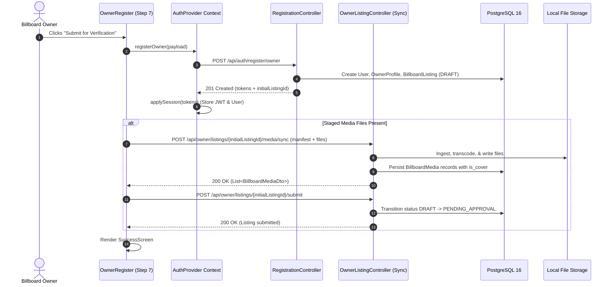
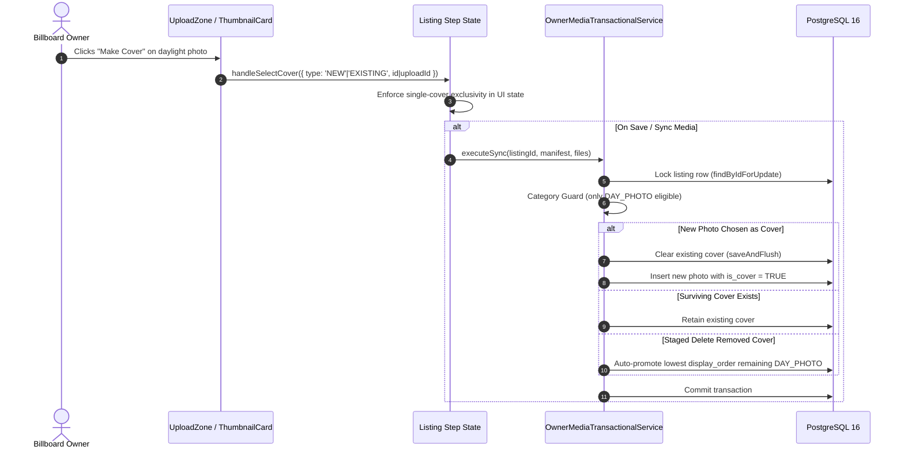

# Technical Document: PR-48 In-Form Cover Photo Selection, Comprehensive Media Previews & Image Lightbox Modal

- **PR Link / Ticket:** [PR #48](https://github.com/Advertisement-Market/advertisement/pull/48)
- **Author:** @vedafactor
- **Date:** 2026-11-09
- **Module / Package:** 
  - `backend/src/main/java/com/theadbasket/backend/owner`
  - `backend/src/main/java/com/theadbasket/backend/auth`
  - `backend/src/main/java/com/theadbasket/backend/registration`
  - `frontend/src/components/ui/ImageLightboxModal`
  - `frontend/src/pages/OwnerRegister`
  - `frontend/src/pages/NewBillboardListing`
  - `frontend/src/features/auth`

---

## 1. Overview & Business Intent

In **The AdBasket**, high-fidelity visual presentation of billboard inventory is paramount for prospective advertisers evaluating location visibility, angle, lighting, and surround context. Previously:
1. **Cover Photo Designation was Disjointed:** Billboard owners had no inline mechanism to designate which daylight photo served as the primary cover (`is_cover = true`) within the multi-step listing or registration wizards. Cover assignment was opaque or required separate post-creation edits.
2. **Missing Fullscreen Preview Capabilities:** Owners could not inspect newly staged or existing photos at full resolution before submitting them for moderation, limiting verification of readability, illumination, and framing.
3. **Registration Media Upload Data-Loss Bug:** Photos uploaded on Step 5 ("Media Uploads") of the owner registration wizard (`OwnerRegister`) were never uploaded to the backend because registration only created the initial listing record without synchronizing staged media files, forcing owners to re-upload all photos later from their dashboard.
4. **Edit Mode Asset Rendering Discrepancies:** Existing media DTOs returned `fileUrl` from the Spring Boot backend, but edit form hydration assumed `item.url`, resulting in blank thumbnail boxes when editing existing listings.

### Acceptance Criteria Fulfilled
- **Interactive Cover Photo Selection:** Owners can explicitly select any daylight photo as primary cover via hover/click ("Make Cover" action) with a prominent `⭐ COVER` badge and clear exclusivity (exactly one cover photo at any time).
- **Auto-Promotion Fallback:** If the current cover photo is deleted, the system deterministically auto-promotes the lowest `display_order` surviving daylight photo to cover.
- **Accessible Fullscreen Lightbox Modal:** Fullscreen modal previewing high-resolution images or videos with zoom containment, keyboard shortcuts (`Esc`, `ArrowLeft`, `ArrowRight`), focus trapping, body scroll locks, filename/resolution metadata, and download/delete controls.
- **Root-Level Portal Rendering:** Lightbox rendered outside ancestor layout containers via `ReactDOM.createPortal(..., document.body)` with `z-index: 999999` to eliminate CSS transform containing block leaks.
- **Unified Edit Visibility & URL Parity:** `mapListingToFormData` and `ThumbnailCard` normalize `fileUrl` and `storageKey` to ensure existing assets render seamlessly alongside newly staged uploads.
- **Automated Post-Registration Media Sync:** Step 7 submit handler automatically executes `ownerListingApi.syncMedia(initialListingId, manifest, files)` post-account creation, accompanied by UI progress state ("Creating account & uploading media...") and unload prevention.

---

## 2. Technical Architecture & Component Flow

### 2.1 Post-Registration Media Ingestion Flow



### 2.2 In-Form Cover Photo Selection & Exclusivity Pipeline



---

## 3. API Specification & Contracts

### 3.1 Media Synchronization Endpoint

`POST /api/owner/listings/{id}/media/sync`
- **Authentication:** `Bearer <JWT_TOKEN>` (`ROLE_OWNER`)
- **Content-Type:** `multipart/form-data`
- **Parts:**
  - `manifest`: `application/json` (`SyncManifest`)
  - `files`: `multipart/form-data` (Binary files)

#### Request Payload (`manifest`)
```json
{
  "stagedDeleteIds": [102],
  "fileMappings": [
    {
      "clientIndex": 0,
      "category": "DAY_PHOTO",
      "uploadId": "69f2e4aa-2544-4b5b-8692-a9b0e2ad0ce4",
      "isCover": true
    },
    {
      "clientIndex": 1,
      "category": "NIGHT_PHOTO",
      "uploadId": "9b1deb4d-3b7d-4bad-9bdd-2b0d7b3dcb6d",
      "isCover": false
    }
  ]
}
```

#### Response `200 OK`
```json
[
  {
    "id": 105,
    "category": "DAY_PHOTO",
    "fileUrl": "/api/media/billboards/12/f2a7a810-7f28-40b4-934d-862d59fcb0c9.jpg",
    "originalName": "billboard_front.jpg",
    "contentType": "image/jpeg",
    "fileSizeBytes": 1420580,
    "isCover": true,
    "displayOrder": 1,
    "createdTs": "2026-11-09T13:49:58.204Z"
  }
]
```

### 3.2 Owner Registration Endpoint

`POST /api/auth/register/owner`
- **Authentication:** Public (`PermitAll`)
- **Response `201 Created`:**
```json
{
  "accessToken": "eyJhbGciOi...",
  "refreshToken": "7d9b4b0e-...",
  "tokenType": "Bearer",
  "expiresIn": 900,
  "user": {
    "id": 28,
    "email": "owner@example.com",
    "role": "OWNER"
  },
  "initialListingId": 14
}
```

---

## 4. Frontend Component Hierarchy & Implementation

```
frontend/src/
├── components/ui/ImageLightboxModal/
│   ├── ImageLightboxModal.jsx     # Accessible portal-mounted modal dialog
│   ├── ImageLightboxModal.test.jsx# Comprehensive interaction & accessibility tests
│   └── index.js                   # Public module re-export
├── features/auth/
│   ├── registrationMappers.js     # Form DTO mappers with fileUrl fallback normalization
│   └── registrationMappers.test.js# Mapper verification tests
├── features/register/
│   └── RegisterProvider.jsx       # State provider with functional setter & unload guards
└── pages/
    ├── OwnerRegister/
    │   ├── steps.jsx              # Step 5 media uploads with cover selection & lightbox integration
    │   ├── widgets.jsx            # UploadZone & ThumbnailCard with cover badges & previews
    │   ├── widgets.test.jsx       # Widget unit tests
    │   ├── OwnerRegister.jsx      # Post-registration media sync orchestrator
    │   └── OwnerRegister.test.jsx # Registration flow integration tests
    └── NewBillboardListing/
        ├── steps.jsx              # Edit listing media controls & lightbox wiring
        ├── NewBillboardListing.jsx# Listing edit sync with cover designation
        └── NewBillboardListing.test.jsx
```

### 4.1 Root-Level Portal Rendering (`ImageLightboxModal.jsx`)
To prevent CSS transform containment traps (`animation: slideIn ... both` creating an unexpected containing block in `.reg-body`), `ImageLightboxModal` uses `createPortal(modalContent, document.body)`:
- `position: fixed; inset: 0; width: 100vw; height: 100vh`
- `z-index: 999999`
- `overflow: hidden; min-height: 0`
- Scroll lock on `document.body` while active
- Focus trap and Esc / Arrow key event listeners

---

## 5. Security & Concurrency Audit

1. **IDOR & Multi-Tenant Isolation:**
   - All media mutation endpoints enforce ownership check: `listing.getUser().getId().equals(userId)`.
   - Staged delete IDs are matched strictly against the listing's media pool. Foreign IDs are discarded without error, preventing tenant enumeration.
2. **Exclusivity & ANSI SQL Partial Unique Index:**
   - Enforced by database index `uq_billboard_media_cover ON billboard_media (billboard_id, is_cover)`.
   - `saveAndFlush()` pattern ensures clearing existing cover and saving the new cover occurs within the same locked transaction without uniqueness collisions.
3. **Pessimistic Row Locking:**
   - Transactions acquire `SELECT ... FOR UPDATE` via `billboardListingRepository.findByIdForUpdate(listingId)` to serialize concurrent media mutations.
4. **Load & OOM Defense:**
   - Pre-ingestion dimension checks (`MAX_PIXELS = 25,000,000`, `MAX_DIMENSION = 10,000`).
   - Concurrency throttling with `Semaphore(2)` limits concurrent image transcoding jobs.
5. **Two-Phase Consistency:**
   - Rollback hook cleans up physical files if DB commit fails.
   - Deletion of replaced files from disk is deferred to `TransactionSynchronization.afterCommit()`.

---

## 6. Verification & Automated Test Evidence

### Backend Test Results (Maven / JUnit 5)
```
[INFO] Running com.theadbasket.backend.owner.OwnerMediaSyncIntegrationTest
[INFO] Tests run: 13, Failures: 0, Errors: 0, Skipped: 0
[INFO] Running com.theadbasket.backend.registration.RegistrationFlowIntegrationTest
[INFO] Tests run: 5, Failures: 0, Errors: 0, Skipped: 0
[INFO] ------------------------------------------------------------------------
[INFO] BUILD SUCCESS (Total time: 38.274 s)
```

### Frontend Test Results (Vitest)
```
 ✓ src/features/auth/pincodeLookup.test.js (5 tests)
 ✓ src/features/notification/notificationApi.test.js (3 tests)
 ✓ src/features/owner/ownerListingApi.test.js (8 tests)
 ✓ src/lib/validators.test.js (20 tests)
 ✓ src/features/auth/registrationMappers.test.js (25 tests)
 ✓ src/lib/apiClient.test.js (8 tests)
 ✓ src/components/ui/ImageLightboxModal/ImageLightboxModal.test.jsx (11 tests)
 ✓ src/pages/OwnerDashboard/OwnerDashboard.profile.test.jsx (6 tests)
 ✓ src/pages/OwnerRegister/widgets.test.jsx (14 tests)
 ✓ src/pages/OwnerRegister/OwnerRegister.test.jsx (3 tests)
 ✓ src/pages/OwnerDashboard/OwnerDashboard.test.jsx (16 tests)
 ✓ src/pages/NewBillboardListing/NewBillboardListing.test.jsx (36 tests)

 Test Files  14 passed (14)
      Tests  163 passed (163)
```

