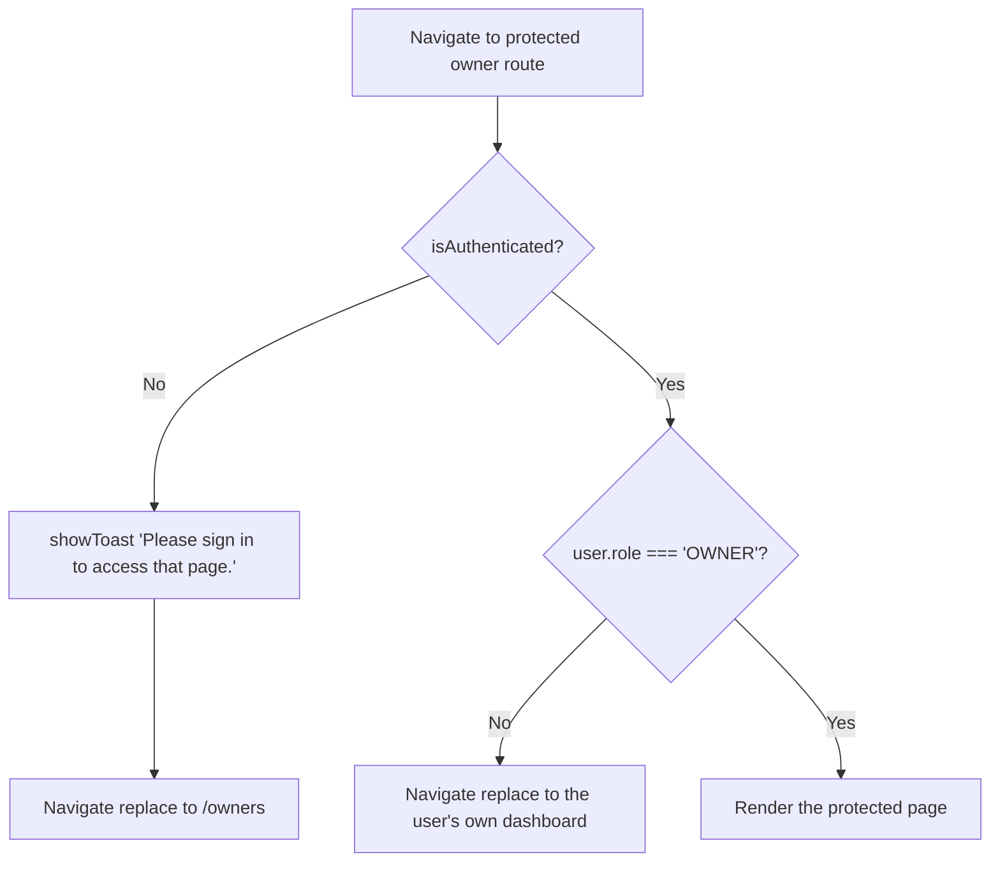

# Frontend Technical Document: Protected Route Guards for Owner Dashboard & Billboard Listing Pages

- **PR Link / Ticket:** [PR #55](https://github.com/Advertisement-Market/advertisement/pull/55) (closes [Issue #42](https://github.com/Advertisement-Market/advertisement/issues/42))
- **Author:** @AshuLaley
- **Date:** 2026-11-19
- **Module / Package:** `frontend/src/router`

---

## 1. Overview & Problem Statement

### 1.1 Problem Statement

In `frontend/src/router/AppRoutes.jsx`, the authenticated owner surfaces were mounted
directly with no authentication or role verification:

- `OwnerDashboard` at `/owners/dashboard`
- `NewBillboardListing` (create) at `/owners/listings/new`
- `NewBillboardListing` (edit) at `/owners/listings/:id/edit`

Any unauthenticated visitor could open these URLs directly. In development the
`OwnerDashboard` falls back to mock `LISTINGS` data when its API requests fail, which
visually masked the missing access control and made the gap easy to miss. A signed-in
user of another role (e.g. `ADVERTISER`) could likewise reach the owner dashboard shell.

### 1.2 Solution Goals

- Introduce a reusable `ProtectedRoute` guard component.
- Require `isAuthenticated` for the three owner routes and verify `user.role === 'OWNER'`.
- Redirect unauthenticated visitors to the owner landing page (`/owners`) with clear feedback.
- Redirect signed-in users of the wrong role to their own dashboard rather than exposing
  another role's surface.
- Keep the change frontend-only, cohesive, and fully covered by unit tests.

---

## 2. Technical Architecture & Component Flow

The guard reads auth state from `AuthContext`. The authenticated user hydrates
synchronously from `localStorage` inside `AuthProvider` (`useState(() => authStorage.getUser())`),
so the guard's decision is correct on the very first render — there is no loading flash
to special-case and no spinner state to manage.



Why a toast rather than opening the sign-in modal: the owner landing page
(`OwnerHome`) is rendered with `withModal={false}`, so the global `<AuthModal />` is not
mounted there and calling `openLogin()` would set state that nothing renders. The
`HomeLayout` shell always renders `<Toast />`, and the `ToastProvider` sits above the
router, so the toast message survives the redirect and is visible on `/owners`. This
gives the user an accurate reason for the bounce without relying on a modal the owner
landing intentionally omits.

---

## 3. Component API & Contract

`ProtectedRoute` (`frontend/src/router/ProtectedRoute.jsx`):

- **`role`** (optional, `'ADVERTISER' | 'OWNER' | 'AGENCY'`): required role. When omitted,
  the guard only enforces authentication.
- **`redirectTo`** (optional, default `ROUTES.home`): landing page for unauthenticated
  visitors. The owner routes pass `ROUTES.owners`.
- **`children`**: the protected page element to render when the checks pass.

Behavior:

- Unauthenticated: fires a one-time `showToast('Please sign in to access that page.')`
  from an effect, then returns `<Navigate to={redirectTo} replace />`.
- Authenticated but wrong role: returns `<Navigate>` to `DASHBOARD_BY_ROLE[user.role]`,
  falling back to `ROUTES.home` for roles without a dashboard (e.g. `MEMBER`).
- Authenticated with the required role: renders `children`.

`replace` is used for every redirect so the guarded URL does not pollute history and the
browser Back button behaves naturally.

---

## 4. Implementation Details

### 4.1 Guard component

`frontend/src/router/ProtectedRoute.jsx` is a new ~45-line component. The sign-in toast is
emitted inside a `useEffect` keyed on the `needsSignIn` boolean and the stable `showToast`
callback, so it fires exactly once per unauthenticated mount and never during render.

### 4.2 Route wiring

`frontend/src/router/AppRoutes.jsx` wraps exactly the three owner routes named in the
issue. Each wraps its existing element, for example:

```jsx
<Route
  path={ROUTES.ownerDashboard}
  element={
    <ProtectedRoute role="OWNER" redirectTo={ROUTES.owners}>
      <OwnerDashboard />
    </ProtectedRoute>
  }
/>
```

The `newBillboardListing` and `editBillboardListingPath` routes are wrapped identically.
Advertiser and agency dashboards are intentionally left untouched in this PR (see Scope
Boundaries) so the change stays tightly scoped to Issue #42.

---

## 5. Verification & Automated Test Coverage

A new unit test `frontend/src/router/ProtectedRoute.test.jsx` renders the guard inside a
`MemoryRouter` with stub landing and dashboard routes and asserts the redirect target by
which stub renders. It covers all three branches.

| Test / Check | Command | Result |
| :--- | :--- | :--- |
| ProtectedRoute unit tests (3 cases) | `cd frontend; npx vitest run src/router/ProtectedRoute.test.jsx` | 3 / 3 passed |
| Full frontend suite | `cd frontend; npx vitest run` | 18 files, 230 / 230 passed |
| Lint | `cd frontend; npm run lint` | 0 errors, 0 warnings |
| Production build | `cd frontend; npx vite build` | Built cleanly |

The three unit cases are: authenticated `OWNER` renders the page; unauthenticated visitor
is redirected to `/owners` and `showToast` is called once with a sign-in message; a
signed-in `ADVERTISER` is redirected to `/advertisers/dashboard` and no toast fires.

Manual verification in the dev server confirmed the live behavior: a direct hit on
`/owners/listings/new` while signed out redirects to `/owners` and shows the toast; an
owner session reaches the dashboard; and an advertiser session on `/owners/dashboard` is
bounced to `/advertisers/dashboard`.

---

## 6. Scope Boundaries & Deferred Work

1. **Advertiser & agency dashboard guards:** `ProtectedRoute` is generic and reusable, but
   this PR only wires the owner routes called out in Issue #42. Guarding the advertiser and
   agency dashboards can reuse the same component in a follow-up.
2. **Owner landing sign-in:** The owner landing page currently renders no sign-in modal and
   its navbar `onSignIn` is a no-op. Restoring a working sign-in entry point there is a
   separate concern and out of scope for this access-control fix.
