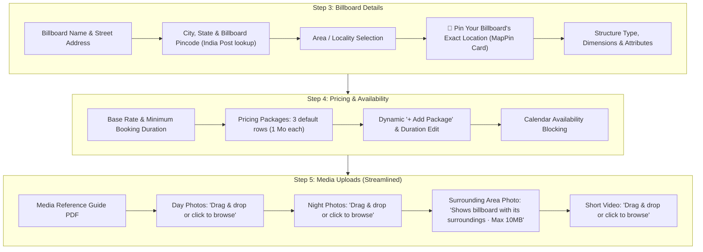

# Frontend UI/UX Technical Document: Owner Registration & Billboard Listing UI/UX Enhancements

- **PR Link / Ticket:** [Issue #53](https://github.com/Advertisement-Market/advertisement/issues/53)
- **Author:** @vedant
- **Date:** 2026-11-20
- **Module / Package:** `frontend/src/pages/OwnerRegister`, `frontend/src/pages/NewBillboardListing`, `frontend/templates`

---

## 1. Overview & Business Intent

### 1.1 Problem Statement & Background
In the 7-step owner registration wizard (`OwnerRegister`) and the unified billboard listing form (`NewBillboardListing`), inventory owners provide comprehensive billboard specifications including physical address, geographic coordinates, pricing, availability, and photographic assets.

Prior to this update, three key UX deficiencies existed in the onboarding and listing workflows:
1. **Disjointed Map Location Verification:** The **"Pin Your Billboard's Exact Location"** interactive map component (`MapPin`) was placed on **Step 5 ("Media Uploads")** in `OwnerRegister` (and Step 3 in `NewBillboardListing`):
   - Users entered the billboard's name, street address, city, state, and pincode on Step 3 ("Billboard Details"), only to encounter the map pin verification two steps later on Step 5 alongside day/night photo uploads, drone video links, and municipal documents.
   - By Step 5, the user was focused on visual media and file attachments. Requiring them to revisit spatial/geographic verification broken out of context created unnecessary cognitive friction.
   - The map placeholder rendered outdated prompt copy stating *"Map loads after you enter your billboard pincode (Step 3)"* and *"Enter pincode on the previous step to activate the map"*.
2. **Inconsistent Photo Upload Instructions & Labeling:**
   - On Step 5 (Media Uploads), Day Photos displayed `"Drag & drop day photos here"` and Night Photos displayed `"Drag & drop night photos here"`, omitting instructions that clicking the zone opens the file browser.
   - Surrounding Area Photo displayed the phrasing `"Shows billboard in its surroundings"` and omitted the 10MB size limit in its subtitle (`"Drag & drop or click to browse · JPG, PNG"`), unlike Day and Night photos which state their size limits.
   - The instruction `"Drag & drop or click to browse"` was present only in Surrounding Area Photo and Short Video, creating an inconsistent user experience across upload cards.
3. **Inflexible Static Pricing Packages:**
   - On Step 4 (Pricing & Availability), the rate card previously presented 5 fixed, hardcoded rows (1, 3, 6, 9, 12 months).
   - Inventory owners had no way to adjust package quantity or configure custom packaging durations cleanly, and having 5 pre-populated rows added visual clutter.

### 1.2 Solution Goals
- Move the **"Pin Your Billboard's Exact Location"** card into **Step 3 ("Billboard Details")** directly within the `<FormSection title="Location">` block, immediately beneath the address and pincode inputs.
- Cleanly decouple **Step 5 ("Media Uploads")** from geographic verification so it remains dedicated strictly to asset ingestion.
- Standardize the primary upload prompt across all photo upload fields (`Day Photos`, `Night Photos`) to `"Drag & drop or click to browse"`.
- Rename `"Shows billboard in its surroundings"` to `"Shows billboard with its surroundings"` across all wizards and templates.
- Explicitly display the 10MB file size limit (`"Max 10MB"`) in the Surrounding Area Photo subtitle (`"Drag & drop or click to browse · JPG, PNG · Max 10MB"`), matching the client-side 10MB photo validation rule.
- Display only **three Pricing Package rows by default** on Step 4 (`PricingTable`), with each package having a default duration of **one month** (`num: '1'`, `unit: 'months'`).
- Ensure duration values and units remain editable, and allow users to dynamically add more package rows (`Add Package` button) and remove unwanted non-base packages.
- Dynamically recalculate the base rate when base package duration is edited (`daily * (num * UNIT_DAYS[unit])`).
- Calculate discounts on subsequent rows taking both the row's duration and base duration into account (`expected = (baseEffectiveRate / baseDays) * pkgDays`).
- Strictly display positive discount percentages only (`${pct}% off`). If no discount exists (rate equals base rate, or is higher/premium) or if no rate has been entered, leave the discount badge completely blank without displaying extra premium percentages.
- Fix grid column and input alignment across headers and rows using consistent `minmax` columns, `gap: 16px`, responsive width, and a reserved 28px alignment slot for action buttons across all rows.
- Ensure all custom pricing packages (`f_pricingPackages`) are persisted in the `sessionStorage` allowlist draft so that refreshing the page retains all custom durations, rates, notes, and added rows.
- Persist email and mobile OTP verification flags (`f_emailVerified`, `f_phoneVerified`) in the `sessionStorage` draft so users do not have to reverify their email and mobile number upon page refresh, while automatically resetting the flag if they modify their contact details.
- Apply identical alignment to `NewBillboardListing` (`ListingStep1` Location section and `ListingStep3` Media Uploads) and `frontend/templates/owner-register.html`.
- Update the prompt copy within `MapPin` to accurately reflect its co-location with the pincode input field.
- Improve the Availability Calendar instructions to explicitly guide users to mark dates on which they already have reservations or bookings booked in advance.
- Remove duplicate date-change indicator/instruction from above the calendar grid and cleanly retain it below the calendar within the calendar footer bar.
- Evenly distribute calendar indicators (`Available`, `Blocked by Owner`, `Past`) across the full available calendar width.
- Implement proper validation for GST Number, Company Registration Number, City, and State fields.
- Reorganize Step 2 (Business Information) by moving Pincode immediately after Address Line 2 and renaming "Office Pincode" to "Pincode".
- Implement automatic City and State detection based on the entered Pincode and lock these fields (`readOnly` with visual locked styling) once auto-filled.
- Apply the same Pincode-based City and State auto-fill, field locking, and validation functionality to Step 3 (Billboard Details) and unified billboard listing.
- Update the location lookup status message from "Looking up" to "Getting your location…".
- Restrict Billboard Type custom input (`f_bbTypeOther`) to alphabets and spaces only.
- Standardize Height from Ground (`f_bbGroundHeight`) as a consistent form field matching Width and Height above it.
- Improve login and final submission password validation error messages to make them more visible, prominent, and user-friendly (in-modal/in-form alert banners with clear guidance instead of easily missed toasts).
- Implement email address verification on Step 1 (`OtpBoxes channel="email"`) with disabled state when email is blank/invalid, demo OTP verification flow, and required validation check.
- Ensure mobile number verification persists when navigating between registration steps (e.g. Step 1 -> Step 2 -> Step 1) without requiring users to re-verify.
- Reposition the mobile number verification section as the primary focus on the First Registration screen (`Step 1`) ahead of Email Address, Your Name, and Password.
- Fix the Company Phone field in Step 2 to ensure the greyed-out country code (`+91`) is displayed correctly via `.phone-wrap` and `.phone-prefix`, and is not subject to 10-digit mobile input restrictions (allowing landlines and varied formats).
- Add automated regression tests confirming correct step placement, copy consistency, dynamic package configuration, auto-locking, and input validations.

---

## 2. Technical Architecture & UI Flow

---

## 3. Component & Layout Changes

### 3.1 Owner Registration Wizard (`OwnerRegister/steps.jsx`)
- **Step 1 (`Step1`):**
  - **Repositioned Mobile Verification:** Reordered Step 1 so `<FormSection title="Mobile Number Verification">` is the primary focus at the top of the form, ahead of Email Address, Your Name, and Set a Password.
  - **Email Address Verification:** Added `OtpBoxes channel="email"` with `disabled={!isEmailValid}` until a valid email format is entered, allowing owners to verify their email with OTP and displaying an `"Email verified"` status badge.
  - **Mobile Verification Persistence:** Ensured `PhoneInput` guards against spurious `onChange` triggers so that navigating between steps (Step 1 -> Step 2 -> Step 1) cleanly retains the verified state without requiring re-verification.
  - **User-Friendly Password Validation Errors:** Integrated granular error reporting for password length, missing uppercase, missing number, missing symbol, and mismatch in both inline field rules and Step 1 validation.
- **Step 2 (`Step2`):**
  - **Layout Reorganization:** Moved Pincode (`f_bizPin`) immediately following Address Line 2 (`f_bizAddr2`) and renamed its label from `"Office Pincode"` to `"Pincode"`.
  - **Company Phone Prefix & Format Freedom:** Wrapped Company Phone (`f_companyPhone`) in `.phone-wrap` with `.phone-prefix` (`+91`) and removed strict 10-digit mobile restrictions, supporting landline and office numbers with STD codes.
  - **Auto-Detection & Field Locking:** Positioned City (`f_bizCity`) and State (`f_bizState`) in a `<FormRow>` directly beneath Pincode. When a valid 6-digit PIN resolves, `usePincode` auto-fills City and State and marks `biz.autoFilled` true, applying `readOnly` and `.locked-field` styling with an `(Auto-filled)` label badge. Clearing or shortening the PIN unlocks both fields for manual entry.
  - **Form Validation:** Integrated `rules={[v.gst()]}` with auto-uppercasing on `f_gst`, `rules={[v.companyReg()]}` on `f_companyReg`, and alphabetic/format validators on City (`v.city()`) and State (`v.state()`).
- **Step 3 (`Step3`):**
  - Integrated the `"Pin Your Billboard's Exact Location"` container inside `<FormSection title="Location">` right after the area/locality dropdown.
  - Added `marginTop: 14` to visually separate the map card from preceding form inputs while maintaining the unified section container.
  - Positioned Billboard Pincode (`f_bbPin`) above City and State, applying identical auto-detection, auto-filling, and locking (`bb.autoFilled`) to `f_bbCity` and `f_bbState`.
  - **Alphabet-Only Billboard Type:** Restricted custom billboard type input (`f_bbTypeOther`) to alphabetic characters and spaces only using regex sanitization on input (`replace(/[^a-zA-Z\s]/g, '')`).
  - **Consistent Height from Ground Input:** Standardized `f_bbGroundHeight` as a standard input field matching Width and Height above it (`type="number"`, `min="0"`, `max="300"`, `hint="Typical range: 0–300 ft"`).
- **Step 5 (`Step5`):**
  - Removed the redundant `<FormSection title="Location Pin Verification">` block.
  - Standardized Day Photos upload title to `"Drag & drop or click to browse"`.
  - Standardized Night Photos upload title to `"Drag & drop or click to browse"`.
  - Renamed Surrounding Area Photo upload title from `"Shows billboard in its surroundings"` to `"Shows billboard with its surroundings"`.
  - Added `"Max 10MB"` to Surrounding Area Photo subtitle (`"Drag & drop or click to browse · JPG, PNG · Max 10MB"`).

### 3.2 Unified Billboard Listing Wizard (`NewBillboardListing/steps.jsx`)
- **Listing Step 1 (`ListingStep1`):**
  - Mirrored the Step 3 placement: added the map pin card into `<FormSection title="Location">` after area/locality.
  - Reorganized Location section with Billboard Pincode placed before City and State, auto-filling and locking them on PIN resolution.
  - Restricted custom billboard type (`f_bbTypeOther`) to alphabets and spaces only.
  - Standardized `f_bbGroundHeight` as a standard input field matching Width and Height (`type="number"`, `min="0"`, `max="300"`, `hint="Typical range: 0–300 ft"`).
- **Listing Step 3 (`ListingStep3`):**
  - Removed `<FormSection title="Location Pin Verification">` from the media upload step.
  - Standardized Day Photos and Night Photos upload titles to `"Drag & drop or click to browse"`.
  - Renamed Surrounding Area Photo upload title to `"Shows billboard with its surroundings"`.
  - Added `"Max 10MB"` to Surrounding Area Photo subtitle (`"Drag & drop or click to browse · JPG, PNG · Max 10MB"`).

### 3.3 Dynamic Pricing Packages & Map Pin (`OwnerRegister/calendar.jsx`)
- **Dynamic Pricing Packages (`PricingTable`):**
  - Replaced 5 static hardcoded rows with state-backed `DEFAULT_PACKAGES` (3 rows default).
  - Every default package initializes with duration `1 Month` (`defaultNum: '1'`, `defaultUnit: 'months'`).
  - Added `+ Add Package` action button enabling owners to dynamically append additional package rows, also defaulting to `1 Month`.
  - Added row-level removal (`onRemove`) for non-base packages, preserving the base auto-calculated rate row.
  - Enhanced duration editing with accessible labels (`aria-label="Package duration value"`, `aria-label="Package duration unit"`).
  - **Dynamic Base Rate Recalculation:** Row 1 calculates `baseAutoRate = Math.round(daily * baseDays)` where `baseDays = num * UNIT_DAYS[unit]`. When the user alters the duration value or unit, manual rate override resets and the base rate updates in real time.
  - **Duration-Aware Discount Calculation:** Subsequent rows calculate discounts relative to the effective daily rate of the base row (`baseDailyRate = baseEffectiveRate / baseDays`) and their own duration (`expected = baseDailyRate * pkgDays`).
  - **Discount Presentation Rule:** Displays positive discounts only (`${pct}% off`). If no discount is present (rate is equal to base or is higher/premium) or if no rate has been entered, the discount badge remains completely blank (`""`), eliminating misleading "extra premium" notices and visual noise.
  - **SessionStorage Draft Persistence:** Added `f_pricingPackages` to `OWNER_DRAFT_ALLOWLIST` and bound `PricingTable` directly to `RegisterContext`. All customized durations, rates, notes, and dynamically added packages are persisted across page reloads and restored on refresh.
  - **Email & Phone Verification Flags Persistence:** Added `f_emailVerified` and `f_phoneVerified` to `OWNER_DRAFT_ALLOWLIST`. When verified via OTP, these flags are saved to the wizard draft. Upon page refresh, `OtpBoxes` reads the verified state directly and renders the green verified badge (`Email verified` / `Mobile verified`) without requiring the user to reverify. If the user subsequently edits their email or mobile number, the verification flag resets automatically to ensure contact info integrity.
  - **Grid Alignment & Row Standardization:** Standardized column definitions to `minmax(160px, 1.4fr) minmax(130px, 1.1fr) minmax(120px, 1fr) minmax(160px, 1.4fr)` with `gap: 16px`, responsive width, and a 28px alignment placeholder on Row 1 so inputs and headers align vertically across all rows.
- **Map Pin Widget Copy (`MapPin`):**
  - Updated the loading and placeholder strings:
    - Previous: `"Map loads after you enter your billboard pincode (Step 3)"` -> Updated: `"Map loads after you enter your billboard pincode"`.
    - Previous: `"Enter pincode on the previous step to activate the map"` -> Updated: `"Enter billboard pincode above to activate the map"`.
- **Availability Calendar UX & Legend Layout (`AvailabilityCalendar`):**
  - **Advance Reservation Instructions:** Clarified instructions to explain that users should mark dates on which advance reservations or bookings are already scheduled, preventing booking overlaps.
  - **Removed Duplicate Date-Change Indicator:** Removed the duplicate `.cal-selection-hint` banner above the calendar grid; consolidated date-selection status and the Cancel action into the footer bar (`.cal-footer-bar` / `.cal-summary`) below the calendar.
  - **Evenly Distributed Legend Indicators:** Updated `.cal-legend` with `display: flex; justify-content: space-between; width: 100%;` so status indicators are evenly distributed across the entire calendar width.

### 3.4 HTML Prototype Template (`frontend/templates/owner-register.html`)
- Relocated `#mapPinContainer` and coordinate display elements into `#step3` within the Location form section.
- Removed the separate Location Pin Verification section from `#step5`.
- Updated upload titles for Day Photos and Night Photos to `"Drag & drop or click to browse"`.
- Renamed Surrounding Area Photo upload title to `"Shows billboard with its surroundings"`.
- Added `"Max 10MB"` to Surrounding Area Photo subtitle (`"Drag & drop or click to browse · JPG, PNG · Max 10MB"`).
- Initialized `#pricingTable` with 3 rows defaulting to 1 Month duration, and implemented `addPricingPackage()` handler for dynamic row addition.
- Synchronized `updatePriceAndDiscount()` and `updateDiscount()` to dynamically recalculate base rate, compute duration-aware discount, and leave non-discount/premium rows blank.
- Updated calendar instructions for advance bookings and distributed `.cal-legend` items evenly across width.
- Updated prompt text to match React components.

---

## 4. Verification & Automated Test Coverage

| Test Suite | Command | Result | Verification Scope |
| :--- | :--- | :--- | :--- |
| **Component Placement Test** | `OwnerRegister.test.jsx` | **Passed** | Explicitly asserts `"Pin Your Billboard's Exact Location"` is rendered on Step 3 and NOT rendered on Step 5 |
| **Copy & Uniformity Test** | `OwnerRegister.test.jsx` | **Passed** | Asserts `"Shows billboard with its surroundings"` is rendered, old copy is absent, and `"Drag & drop or click to browse"` prompts appear consistently |
| **Pricing Package Default & Edit Test** | `OwnerRegister.test.jsx` | **Passed** | Asserts exactly 3 package rows render by default, each with 1 Month duration, and verifies editing duration values |
| **Dynamic Package Add/Remove Test** | `OwnerRegister.test.jsx` | **Passed** | Verifies clicking `Add Package` adds a 4th package defaulting to 1 Month and removing a package decrements the row count |
| **Base Recalculation & Blank Discount Test** | `OwnerRegister.test.jsx` | **Passed** | Asserts base rate recalculates on duration edit, duration-aware discount computes, and discount badge is blank on premium / no discount |
| **Pricing Package Draft Persistence Test** | `OwnerRegister.test.jsx` | **Passed** | Verifies `f_pricingPackages` is saved to draft and restores all rows, durations, rates, and notes on page refresh |
| **Email/Phone Verification Draft Test** | `OwnerRegister.test.jsx` | **Passed** | Verifies `f_emailVerified` and `f_phoneVerified` are saved to draft so user does not need to reverify on refresh, and editing phone resets verification |
| **Calendar Instructions & Legend Layout Test** | `OwnerRegister.test.jsx` | **Passed** | Verifies advance reservation instructions, absence of top duplicate date banner, retention of selection below calendar, and legend indicators |
| **Step 2 Layout & Auto-lock Test** | `OwnerRegister.test.jsx` | **Passed** | Asserts Pincode follows Address Line 2 with label "Pincode", and City/State auto-fill and lock |
| **Step 3 Pincode & Status Test** | `OwnerRegister.test.jsx` | **Passed** | Asserts Billboard Pincode placed before City/State, shows "Getting your location…", and auto-locks City/State |
| **Billboard Type Restriction Test** | `OwnerRegister.test.jsx` | **Passed** | Asserts custom billboard type input rejects digits and special characters, allowing alphabets only |
| **Ground Height Input Field Test** | `OwnerRegister.test.jsx` | **Passed** | Asserts Height from Ground is a standard input field matching Width and Height above it |
| **Form Validation Test** | `OwnerRegister.test.jsx` | **Passed** | Asserts validation for GST Number, Company Registration Number, City, and State |
| **Validator Unit Tests** | `validators.test.js` | **Passed** | Asserts format rules for GSTIN, CIN/LLPIN, City, and State names |
| **Step 1 Hierarchy & Focus Test** | `OwnerRegister.test.jsx` | **Passed** | Asserts Mobile Number Verification is repositioned as primary focus at the top of Step 1 |
| **Email Verification & OTP Flow Test** | `OwnerRegister.test.jsx` | **Passed** | Asserts Send OTP is disabled until email is valid, and verifies email with demo OTP |
| **Mobile Verification Persistence Test** | `OwnerRegister.test.jsx` | **Passed** | Asserts mobile verification persists across step navigation (Step 1 -> Step 2 -> Step 1) without reverification |
| **Password Error Visibility Test** | `OwnerRegister.test.jsx` | **Passed** | Asserts specific, user-friendly password validation errors in Step 1 and prominent Step 7 alert banner |
| **Company Phone Prefix & Format Test** | `OwnerRegister.test.jsx` | **Passed** | Asserts greyed-out `+91` prefix display and unrestricted landline/mobile format acceptance |
| **AuthModal 401 Login Alert Test** | `OwnerRegister.test.jsx` | **Passed** | Asserts visible `.auth-error-alert` box inside login modal when authentication fails with 401 |
| **Frontend Test Suite** | `cd frontend && npm test -- --run` | **Passed** | Complete Vitest suite across auth, registration, listing, calendar, and UI components |
| **Code Formatting (Prettier)** | `cd frontend && npm run format:check` | **Passed** | Prettier code style verified across all modified files |
| **Linter (ESLint)** | `cd frontend && npm run lint` | **Passed (0 errors, 0 warnings)** | Clean lint verification |
| **Production Build** | `cd frontend && npm run build` | **Passed** | Vite production bundle generated without errors |
