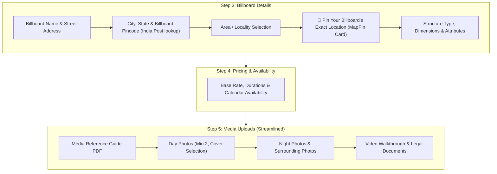

# Frontend UI/UX Technical Document: Move Billboard Location Map Pin to Step 3 (Billboard Details)

- **PR Link / Ticket:** [Issue #53](https://github.com/Advertisement-Market/advertisement/issues/53)
- **Author:** @vedant
- **Date:** 2026-11-20
- **Module / Package:** `frontend/src/pages/OwnerRegister`, `frontend/src/pages/NewBillboardListing`, `frontend/templates`

---

## 1. Overview & Business Intent

### 1.1 Problem Statement & Background
In the 7-step owner registration wizard (`OwnerRegister`) and the unified billboard listing form (`NewBillboardListing`), inventory owners provide comprehensive billboard specifications including physical address, geographic coordinates, pricing, availability, and photographic assets.

Previously, the **"Pin Your Billboard's Exact Location"** interactive map component (`MapPin`) was placed on **Step 5 ("Media Uploads")** in `OwnerRegister` (and Step 3 in `NewBillboardListing`):
1. **Disjointed Information Architecture:** Users entered the billboard's name, street address, city, state, and pincode on Step 3 ("Billboard Details"), only to encounter the map pin verification two steps later on Step 5 alongside day/night photo uploads, drone video links, and municipal documents.
2. **Cognitive Disconnect:** By Step 5, the user was focused on visual media and file attachments. Requiring them to revisit spatial/geographic verification broken out of context created unnecessary cognitive friction.
3. **Outdated Step Hints:** The map placeholder rendered prompt copy stating *"Map loads after you enter your billboard pincode (Step 3)"* and *"Enter pincode on the previous step to activate the map"*, explicitly highlighting the confusing distance between address entry and map verification.

### 1.2 Solution Goals
- Move the **"Pin Your Billboard's Exact Location"** card into **Step 3 ("Billboard Details")** directly within the `<FormSection title="Location">` block, immediately beneath the address and pincode inputs.
- Cleanly decouple **Step 5 ("Media Uploads")** from geographic verification so it remains dedicated strictly to asset ingestion (Day Photos, Night Photos, Surrounding Photos, Video, and Legal Docs).
- Apply identical alignment to `NewBillboardListing` (`ListingStep1` Location section) and `frontend/templates/owner-register.html`.
- Update the prompt copy within `MapPin` to accurately reflect its co-location with the pincode input field.
- Add automated regression tests confirming correct step placement.

---

## 2. Technical Architecture & UI Flow

---

## 3. Component & Layout Changes

### 3.1 Owner Registration Wizard (`OwnerRegister/steps.jsx`)
- **Step 3 (`Step3`):**
  - Integrated the `"Pin Your Billboard's Exact Location"` container inside `<FormSection title="Location">` right after the area/locality dropdown.
  - Added `marginTop: 14` to visually separate the map card from preceding form inputs while maintaining the unified section container.
- **Step 5 (`Step5`):**
  - Removed the redundant `<FormSection title="Location Pin Verification">` block.
  - Step 5 now flows directly from the Media Reference Guide banner into the `Day Photos` upload zone.

### 3.2 Unified Billboard Listing Wizard (`NewBillboardListing/steps.jsx`)
- **Listing Step 1 (`ListingStep1`):**
  - Mirrored the Step 3 placement: added the map pin card into `<FormSection title="Location">` after area/locality.
- **Listing Step 3 (`ListingStep3`):**
  - Removed `<FormSection title="Location Pin Verification">` from the media upload step.

### 3.3 Map Pin Widget Copy (`OwnerRegister/calendar.jsx`)
- Updated the loading and placeholder strings:
  - Previous: `"Map loads after you enter your billboard pincode (Step 3)"` -> Updated: `"Map loads after you enter your billboard pincode"`.
  - Previous: `"Enter pincode on the previous step to activate the map"` -> Updated: `"Enter billboard pincode above to activate the map"`.

### 3.4 HTML Prototype Template (`frontend/templates/owner-register.html`)
- Relocated `#mapPinContainer` and coordinate display elements into `#step3` within the Location form section.
- Removed the separate Location Pin Verification section from `#step5`.
- Updated prompt text to match React components.

---

## 4. Verification & Automated Test Coverage

| Test Suite | Command | Result | Verification Scope |
| :--- | :--- | :--- | :--- |
| **Component Placement Test** | `OwnerRegister.test.jsx` | **Passed** | Explicitly asserts `"Pin Your Billboard's Exact Location"` is rendered on Step 3 and NOT rendered on Step 5 |
| **Frontend Test Suite** | `cd frontend && npm test -- --run` | **Passed (17 files, 228 / 228 passed)** | Complete Vitest suite across auth, registration, listing, calendar, and UI components |
| **Code Formatting (Prettier)** | `cd frontend && npm run format:check` | **Passed** | Prettier code style verified across all modified files |
| **Linter (ESLint)** | `cd frontend && npm run lint` | **Passed (0 errors, 0 warnings)** | Clean lint verification |
| **Production Build** | `cd frontend && npm run build` | **Passed (`1.03s`)** | Vite production bundle generated without errors |
