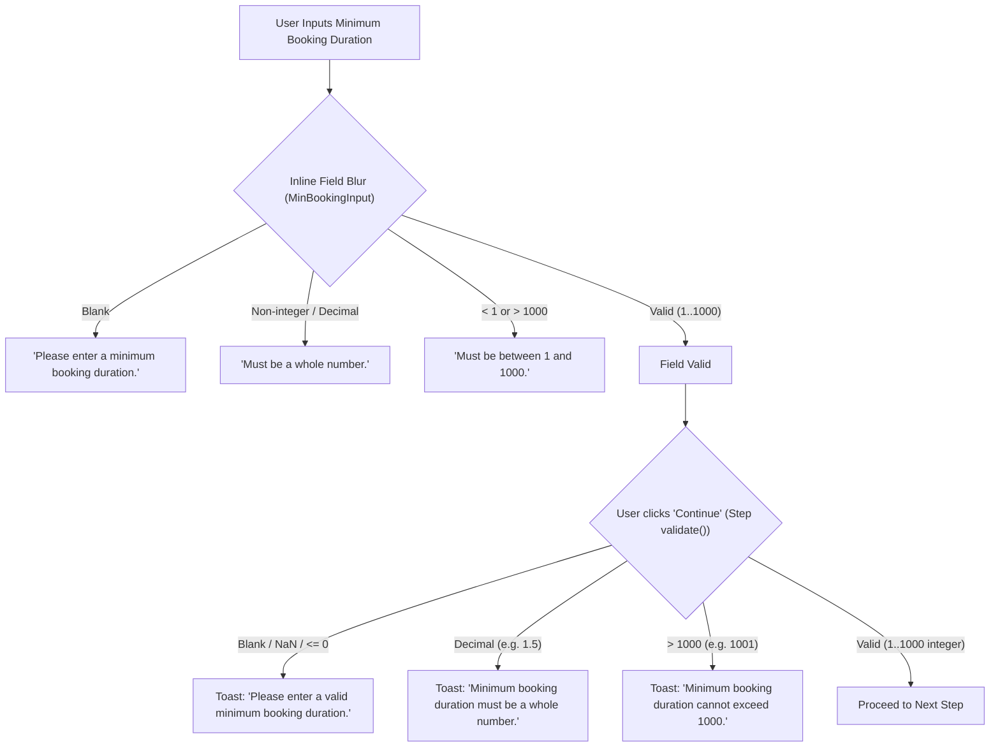

# Frontend Technical Document: Enforce Upper-Bound (<= 1000) and Integer Validation on Minimum Booking Duration

- **PR Link / Ticket:** [Issue #49](https://github.com/Advertisement-Market/advertisement/issues/49)
- **Author:** @vedant
- **Date:** 2026-11-21
- **Module / Package:** `frontend/src/lib/validators.js`, `frontend/src/pages/OwnerRegister`, `frontend/src/pages/NewBillboardListing`, `frontend/templates`

---

## 1. Overview & Problem Statement

### 1.1 Problem Statement
During automated browser UI testing of the Calendar and Pricing/Availability features (PR #32 and PR #33), two validation edge cases failed in both the New Billboard Listing Wizard (`/owners/listings/new` Step 2) and the Owner Registration Wizard (`/owners/register` Step 4):

1. **MB-05 (Max Value Boundary Violation):** Input values greater than 1000 (e.g. `1001`) were not rejected or clamped by step validation when clicking "Continue", allowing the user to proceed to subsequent steps. The backend entity and DTO strictly enforce `@Max(1000)` (`BookingDurationUnit.MAX_VALUE = 1000`), so submitting the listing ultimately failed with an unhandled/unfriendly API 400 error (`VALIDATION_FAILED`).
2. **MB-06 (Integer Type Validation Failure):** Decimal values (e.g. `1.5`) were not rejected or truncated. The field validator `v.range(1, 1000)` treated `1.5` as mathematically within range, and the step `validate()` only checked `Number(minVal) <= 0`. While HTML inputs specified `step="1"`, browser HTML5 step validation did not block custom JavaScript step-progression handlers (`validate(step, ...)`).

### 1.2 Root Cause Analysis
- **Step Validation Bypass (`validate()`):** In both `NewBillboardListing.jsx` (Step 2) and `OwnerRegister.jsx` (Step 4), validation only asserted `!minVal || Number(minVal) <= 0`. If `minVal === '1001'` or `minVal === '1.5'`, `Number(minVal) <= 0` was `false`, permitting step navigation.
- **Inline Field Validator Gap (`MinBookingInput` in `widgets.jsx`):**
  - `useFieldError('f_minBookingValue', [v.required(...), v.range(1, 1000, 'Must be at least 1.')])` erroneously returned `"Must be at least 1."` even when the upper bound was exceeded (> 1000).
  - `v.range(1, 1000)` only checked mathematical bounds `n >= 1 && n <= 1000` without validating integer type.

### 1.3 Solution Goals
- Add an empty-friendly `integer` validator in `frontend/src/lib/validators.js`.
- Update `MinBookingInput` in `frontend/src/pages/OwnerRegister/widgets.jsx` to enforce `v.integer('Must be a whole number.')` and `v.range(1, 1000, 'Must be between 1 and 1000.')` with `max="1000"` attribute.
- Update `validate()` in `NewBillboardListing.jsx` and `OwnerRegister.jsx` to fail with:
  - `"Minimum booking duration must be a whole number."` when non-integer.
  - `"Minimum booking duration cannot exceed 1000."` when exceeding 1000.
- Synchronize validation and max constraints in `frontend/templates/owner-register.html`.
- Add unit tests across validators, widgets, owner registration, and listing wizard.

---

## 2. Technical Architecture & Validation Flow



---

## 3. Implementation Details

### 3.1 New `integer` Validator (`validators.js`)
Added the `integer` validator and standard error message `MSG.integer = 'Must be a whole number.'`:
```javascript
export const integer =
  (msg = MSG.integer) =>
  (v) => {
    if (isEmpty(v)) return null;
    const n = Number(v);
    return Number.isInteger(n) && !String(v).includes('.') ? null : msg;
  };
```

### 3.2 Widget Form Validation (`widgets.jsx`)
Updated `MinBookingInput` to attach both `v.integer(...)` and `v.range(1, 1000, 'Must be between 1 and 1000.')`, along with HTML attributes `min="1" max="1000" step="1"`.

### 3.3 Step Validation (`NewBillboardListing.jsx` & `OwnerRegister.jsx`)
In `OwnerRegister.jsx` (Step 4) and `NewBillboardListing.jsx` (Step 2):
```javascript
const minVal = d('f_minBookingValue') ?? (d('f_minBooking') ? 1 : null);
const numMin = Number(minVal);
if (!minVal || Number.isNaN(numMin) || numMin <= 0)
  return fail('Please enter a valid minimum booking duration.');
if (!Number.isInteger(numMin) || String(minVal).includes('.'))
  return fail('Minimum booking duration must be a whole number.');
if (numMin > 1000)
  return fail('Minimum booking duration cannot exceed 1000.');
```

---

## 4. Verification & Automated Test Coverage

| Test / Check | Command | Result | Verification Scope |
| :--- | :--- | :--- | :--- |
| **Integer Validator Unit Tests** | `validators.test.js` | **Passed** | Asserts integer strings, numbers, optional blanks, decimals (`1.5`, `1.0`, `.5`), non-numbers, and custom message |
| **MinBookingInput Widget Tests** | `widgets.test.jsx` | **Passed** | Asserts inline blur errors for `1001` (> 1000), `1.5` (decimal), `0` (<= 0), and clean state for `15` |
| **OwnerRegister Step 4 Validation (MB-05, MB-06)** | `OwnerRegister.test.jsx` | **Passed** | Asserts rejection of `1001` (> 1000), `1.5` (decimal), `0`, and acceptance of `1000` |
| **NewBillboardListing Step 2 Validation (MB-05, MB-06)** | `NewBillboardListing.test.jsx` | **Passed** | Asserts rejection of `1001` (> 1000), `1.5` (decimal), `0`, and acceptance of `1000` |
| **Full Vitest Test Suite** | `cd frontend && npm test -- --run` | **Passed (253 tests)** | 19 / 19 test files passing |
| **Prettier Formatting** | `cd frontend && npm run format:check` | **Passed** | All matched files use Prettier code style |
| **ESLint Check** | `cd frontend && npm run lint` | **Passed (0 errors, 0 warnings)** | Clean linter run |
| **Production Build** | `cd frontend && npm run build` | **Passed** | Production bundle built cleanly |
| **Documentation Validation** | `python .github/scripts/validate-doc-content.py` | **Passed** | Verified documentation format and structure |

---

## 5. Scope Boundaries

- The `@Max(1000)` constraint matches the backend `BookingDurationUnit.MAX_VALUE = 1000`.
- Duration units (`DAYS`, `WEEKS`, `MONTHS`) and calculations remain unchanged.
- Backend API DTOs already enforce `@Max(1000)` and integer types; no database migration is required.
